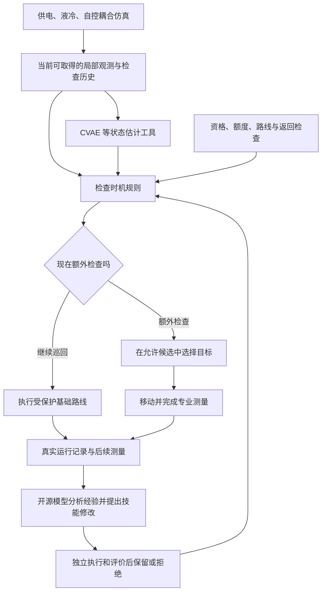

# Zhinengti-RSI 项目全景：进度、瓶颈、尚未解决的问题与下一步

核对日期：2026 年 10 月 31 日，Asia/Shanghai。现场状态快照时间为当日 20:28 左右。

阅读对象：第一次接触本项目的人。本文集中解释研究目标、系统怎么工作、历轮结果、当前代码状态、困难、未决问题和后续安排；末尾附可复制的 JSON 摘要。理解正文无需先阅读其他报告。

核对范围：本地仓库、已归档实验记录、最新未提交文件、GitHub 主分支与自动检查，以及集群当前队列。历史结果以归档证据为准；本次没有重新训练模型、启动新巡检实验或产生新的大模型提案。

## 1. 先回答最关心的两个问题

**项目已经有能实际运行、记录和复核的科研原型，目前正在验证“AI 的改进到底有没有用”。最近完成的是 M12-E；正在准备 M12-F，研究让开源模型根据巡检经验修改补查时机。**

目前最有把握的成果是：建立了机房仿真、不同专业的有效检查规则、覆盖保护、学习与估计工具，以及修改技能和评价改进的实验流程。最关键的科研结论仍待建立：经验驱动的方法能否稳定胜过强人工规则和简单搜索；进一步修改“产生改进的方法”，能否在新任务上获得额外收益。

**当前主要瓶颈是决策机制与证据，而非 GPU 缺乏。** 旧规则会阻断部分主动获取信息的机会；很多离线看起来有益的动作需要未来信息才能选中；PPO 在最近的门控实验中没有真正需要排序的多个候选。递归改进还面临一个更高要求：要证明改进器在新任务上更会提出有效修改，不能只证明输出了不同的规则。

|问题|现在的答案|
|---|---|
|还只有想法吗？|已经有代码、模型权重、真实集群运行记录、对照实验和审计材料。|
|仿真能运行吗？|能。已运行多轮巡检闭环、工具比较和开源模型提案实验。|
|AI 真正调用过吗？|调用过。Qwen、CVAE 和 PPO 在历史阶段都有实际执行记录。|
|最新工作完成到哪里？|M12-E 已完成并发布；M12-F 有协议草稿、部分实现和 12 项新增本地测试，正式执行尚未开始。|
|已经证明 AI 整体更好吗？|一些限定实验有改善，但尚未形成跨独立任务稳定胜过强基线的联合证据。|
|已经证明 RSI 有效吗？|尚未证明独立递归增量。已有负结果、接口失败与合法表达测试，三者需要区分。|
|能直接说接近论文完成了吗？|现阶段适合汇报问题、原型和实验发现；核心方法贡献仍在验证，无法据此给出可靠的“完成百分比”。|
|当前有实际任务在后台运行吗？|20:28 的集群快照中，renly 队列为空；M12-F 远端运行目录尚不存在。|

## 2. 项目究竟要解决什么

### 2.1 从导师的想法开始

导师关心的是：结合设备特点与专家经验，决定**谁在什么时候去哪里、检查什么**，持续覆盖需要检查的区域，减少长期盲区和低价值重复巡检。

例如，某个机柜昨天查过，并不意味着它今天不会出现热异常。另一方面，始终追着一个温度较高的机柜检查，可能让其他机柜长期无人检查。路线规划因此要同时考虑异常发现、检查成本与重访义务。

本项目用已知机房布局和仿真过程研究这个问题。最早讨论过单执行者起步；当前原型已扩展为 **18 名具有不同专业资格的移动执行者**。这表示 18 个承担位置、工时和检查能力的仿真对象，不表示同时运行 18 个大语言模型。

### 2.2 后来增加的 AI 与 RSI 研究目标

用户进一步认可了“技能、工具调用和协作流程的持续改进”。因此项目现在有三层问题：

1. **巡检能力：** 在覆盖义务不变的条件下，怎样更早确认异常、减少漏检？
2. **经验驱动的技能改进：** 大模型能否从运行经验中提出更好的规则，并在独立任务上有效？
3. **改进器自身的改进：** 系统能否调整诊断、经验检索和提案流程，使以后提出修改的效率提高？

第三层是本项目对递归自我改进的有限、可实验定义。例如，第一次改进的是“什么时候补查”；第二层改进的是“分析哪些失败、读取哪些经验、怎样提出下一版补查规则”。

### 2.3 与导师想法的对应程度

|导师关心的内容|当前对应实现|进度和边界|
|---|---|---|
|设备特点、专业要求|温度、电气接点热、冷却流量、控制偏差等任务及资格要求|仿真中已实现；现场阈值与规程尚未标定。|
|谁去、查哪里、查什么|异质执行者、所属任务、合法候选和任务评分|已有实际派单；跨人员接管和更自由的交接仍受限。|
|路线持续变化|在受保护巡回上决定是否插入额外检查|已执行；当前实验通常全队每回合只允许一次额外检查。|
|避免盲区、持续覆盖|完整返回计划与逐项重访检查|在声明的静态通道、确定耗时和任务归属条件下验证。|
|减少重复与无效任务|记录复查、首次确认、移动和检查成本|有测量与统计接口，尚未证明学习方法稳定减少无效重复。|
|多智能体决策|多个移动执行者共享资源并协调派单|已有协调机制；其独立 AI 协作收益仍待验证。|
|引入当前 AI 方法|开源语言模型提出修改，CVAE 估计状态，PPO 评分任务|模型已有实际调用；各模块的独立收益需要分别检验。|

因此，方向与导师的场景目标有明确联系。当前最合适的研究切口，是在持续覆盖保护下研究**经验驱动的信息获取与补查时机**。全面的动态人员组织和现场部署属于后续扩展。

## 3. 用一个例子看懂系统在做什么

把机房巡检理解成一个班组：每个人有固定的基础任务，系统允许全队临时增加一次检查。现在使用这次机会，可以提前查一个可疑位置；继续原巡回，则把机会留给后面。

M12-E 有一个真实开发案例：系统此前一直沿原路线巡检，到第 1005 秒才使用补查机会。当时公开融合温度约为 69.37°C；补查预计在第 1035 秒完成，按原巡回则预计第 1165 秒完成，提前 130 秒；后续排班会顺延约 45 秒。这个条件下，相对固定巡回，实际少漏一段异常，加权等待减少 45 秒。这个例子来自既有实验，用于解释动作含义，不代表所有场景都能获得同样收益。（证据 S2）

决定是否补查时至少要回答：

- 当前依据来自真实测量、模型估计，还是尚无观测？
- 这次检查能比基础巡回提前多少？
- 绕行会不会让其他任务错过短暂异常？
- 补查结束后还能否按时完成后续检查？
- 本回合唯一的额外机会，是否值得现在使用？

“继续巡回”仍在执行基础任务；它不表示停在原地等候，也不表示已经认定所有设备正常。

## 4. 整个系统怎样工作



上图中的内循环是“观察—判断—执行—获得新观测”；外循环是“分析已有运行—提出规则修改—运行比较—保留或拒绝”。最新 M12-F 要替换的是可编辑的时机规则，其他模块共同提供实验条件。

**仿真中的真实故障状态和未来故障时刻由评价器掌握。在线策略与大模型提案只能使用协议允许的信息。** 例如，上一轮实际检查后来取得的测量，可以成为下一轮改进的经验；当前巡检尚未发生的测量不能提前给当前策略。

### 4.1 每个 AI 模块的职责

|模块|用新手能懂的话解释|当前实际状态|
|---|---|---|
|Qwen3-8B 开源语言模型|分析运行记录，写出下一版技能或改进协议|已在集群实际生成过提案；当前使用固定权重。|
|CVAE，条件变分自编码器|依据已见观测及历史，估计未直接看到的温度状态|已有训练与部署；平均误差改善不自动等于巡检收益。|
|PPO 强化学习策略|为当前允许的检查任务打分、选择目标|已有训练权重；最新门控实验没有显示独立排序收益。|
|早期 DDQN|早期实验中的移动或任务决策方法|属于历史路线；当前主执行器采用后续高层调度与 PPO 适配。|
|基础巡回与人工规则|按照预定路线或明确条件检查|必须保留的强基线，也是持续覆盖的共同基础。|
|资格与返回检查器|判断执行者是否能检查、能否按时返回后续任务|人工实现的共同执行约束；收益不能归为大模型自行发现。|
|经验与提案档案|保存失败、修改、评价和来源，便于后续改进|已有接口；M12-F 的因果经验卡与提示过滤还需集成验证。|

用户后来选择的是学校 GPU 上运行开源模型。当前路线采用 Qwen，而不是最初讨论的云端 DeepSeek API。语言模型本身采用 Transformer 技术；VAE/CVAE 承担状态估计。把多个模型都放进系统，并不能单独证明它们各自有用。

### 4.2 哪些部分固定，哪些部分允许修改

当前冻结的研究条件包括物理过程、专业资格、访问与服务规则、全队一次补查额度、完整返回和重访要求。M12-F 还把共同冷却时间固定为 60 秒；这是本实验的共同条件。

准备开放给模型修改的是：哪些公开条件触发补查，如何处理缺测、读数年龄、工具分歧和提前检查的价值。候选规则只能使用有类型的有限字段和阈值，不能写任意 Python，也不能修改评价器。

这种设计便于回答“什么规则变了、行为为何变了”。它的表达能力也有限，需要通过实际实验判断是否足以产生有用修改。

## 5. 怎样理解进度，避免被数字误导

本项目同时存在四种进度：

|进度层次|目前情况|怎样才算更进一步|
|---|---|---|
|工程实现|已有可执行原型、冻结模型、日志与自动检查|新版本完成整体集成与正式来源绑定。|
|仿真和评价|已有专业测量、事件统计、路线及重访复核|场景与现场约束进一步对应，独立评价继续保持。|
|方法有效性|局部改善存在；强对照下仍有失败与零增量|在新任务上稳定优于预先确定的强基线。|
|论文贡献|研究问题逐渐收敛，证据边界已较清楚|明确新机制、直接对照、独立增量、适用范围和成本。|

因此，“测试通过很多项”和“论文核心结论成立”是两件事。前者说明相应代码行为受检查；后者必须看实际巡检结果和公平对照。

一些常用术语也需要先说明：

|术语|这里的意思|
|---|---|
|闭环回合|策略做决定后，后续位置、观测和排班会跟着改变；系统真的按这条路径运行。|
|有效确认|有资格的执行者完成规定测量，并在异常持续期间取得符合条件的结果。到达机柜或模型预测异常不等于确认。|
|重访|同一个检查任务需要在规定时间内再次完成。|
|漏检|评价器定义的一段异常在持续期间没有得到有效确认。|
|宏漏检数|先按过程和种子分层平均后的漏检段数，可能是小数；1.22 不是 1.22%。|
|删失等待|未发现异常也计入截至规定终点的等待代价，避免只统计已发现事件显得过于乐观。|
|随机种子|生成不同过程或模型输出的编号；多个编号不一定代表多个独立机房。|
|噪声条件|同一物理过程使用不同测量噪声。它们是配对观测，不应当作完全独立过程。|
|开发／验证／最终|开发用于修改与选择；验证检验是否值得进入最终；最终用于冻结后的独立确认。|
|Oracle，离线理想参照|事后使用未来真实事件寻找有益动作的评价工具；不能把它的答案交给在线策略。|
|NO-GO|某个预先规定的阶段启动门未通过。它约束该实验路线，不能直接推广成整个研究方向无效。|
|任务增量／经验增量／递归增量|分别回答技能是否更好、运行经验是否有帮助、改进方法本身是否更好。|

## 6. 从最初到现在，主要阶段做了什么

阶段名称是工作记录编号，数字大不代表结果一定更好。不同阶段改变过场景、指标和算法，不能直接把它们的分数排成一条性能上升曲线。

|阶段|主要推进|最重要的发现或保留结论|
|---|---|---|
|前期方向与阅读|整理巡检、部分观测、学习与智能体改进文献，制作汇报材料|找到可借鉴方法；发表所需的新颖性仍要落到具体机制和对照。|
|M1|缩小的 VAE＋多执行者 DDQN 原型，真实 Qwen 提案|超过部分弱基线，未超过强地图贪心；固定与可更新改进器的隔离还不充分。|
|M2|人工长期未检补查技能，等候选槽比较|人工补查有作用；模型首次诊断选择受到提示示例影响，不能算自主发现。|
|M3|移除答案示例，枚举 110 种配置并测试流程迁移|既有诊断流程迁移未显示收益；小空间调参不足以构成 RSI 贡献。|
|M4|生成可实际执行的条件工作流，验证后决定是否保留元更新|流程和元评价闭环能运行；模型元更新仍落后于随机工作流搜索。|
|M5|从头训练时限感知策略并做消融|学习有发生，当前内层仍明显落后于强规划器；人工接管收益需单列。|
|M6|把学习决策转到高层检查点分配，共同控制器负责导航|限定场景出现学习信号；VAE 与排重的独立收益尚未稳定。|
|M7|冻结权重后的压力与布局迁移测试|学习收益随布局变化；在部分布局落后于成对巡回。|
|M8|等预算重新训练，比较关系信息与布局训练|关系输入在配对种子中降低逾期，但仍有长期未重访和布局弱点。|
|M9|建立供电—液冷—自控的降阶耦合过程，检查机制与规模|具有更明确的机房含义；仍是合成模型内部验证。|
|M10|历史温度 CVAE 与状态估计比较|常规条件历史模型 RMSE 从 1.417°C 降至 0.956°C；局部异常仍有约 54°C 漏估。|
|M11|引入异质专业任务、工时、资源与实际策略重放|固定巡回在该任务配置中更可靠；短异常容易落在两次检查之间。|
|M11.1|完整返回计划与受保护补查原型|96 条保护案例精确重访零超期；异常发现改善仍小且不稳定。|
|M12-A|开源模型根据运行记录修改机房工作流|真实生成并执行了修改；未超过强巡回，记忆对照未拉开。|
|M12-B|修订评价代理、专业信号与返回技能，执行改进器更新和迁移|任务层有小幅描述性改善；独立元改进收益未建立。|
|M12-C0、C1-A|拆解异常信息、合法补查机会与附带损失|提前确认一个目标，可能同时错过其他短异常；局部收益不能替代整回合收益。|
|C1-B0、B1、B2|监督评分、检查／等待比较与跨故障相位确认|部分开发条件改善，但有过早耗尽额度、反复等待和跨种子退化。|
|C1-B3.2|冻结候选后的正式闭环验证|开发收益未在独立验证重复，NO-GO；按事先规则回退固定巡回。|
|B4-A|在旧记录上区分观测、评分、等待与可行动机会|一些有益动作缺少可用正线索；这是诊断，未产生新策略成绩。|
|B4-B0、B1a|检查旧数据覆盖，实际生成新的过程与观测条件|B1a 生成 1,280 条观测条件，35/48 个专业—视野—划分单元达标，整体仍为 LIMITED。|
|B4-B1b-Limited|在允许范围内比较简单概率模型与冻结工具|宏 Brier 相对改善 0.2425%，未达到预定 5%；依赖该预测分支的后续方案 NO-GO。|
|B4-B2|重新核对原论文、实际工具使用与 RSI 主线，设计正式对照|为独立巡检与 RSI 实验准备 LIMITED GO；未撤回前序负结果。|
|M12-D|正式五臂巡检与真实受控 RSI 实验|五臂未胜强巡回；RSI 没有独立递归增量，且 6 份元提案全部结构非法。|
|M12-E|验证完整元协议表达，以及保留额度后再补查|格式问题得到实际处理；人工门控有开发收益，但 PPO 无独立排序增量，旧 E2 未启动。|
|M12-F，当前|准备经验驱动的可编辑补查时机技能|已有草稿和部分代码；语义与字段测试通过，完整等价回归及真实搜索尚待执行。|

以上历史主要依据归档阶段报告与当前研究入口；M1—M5 的结论本次另查原报告，M12-E 和 M12-F 另核对了结构化证据。（S1—S8）

## 7. 最近已完成的 M12-D 和 M12-E，具体取得了什么

### 7.1 M12-D：实际运行了 RSI，但需要区分效果失败与接口失败

M12-D 的五臂巡检完成开发和验证各 180 条闭环，以及 360 条独立重放。修订候选在验证中与固定巡回的主要结果相同，因此五臂最终集没有生成或打开。

独立受控 RSI 则确实执行了：78 次正式 Qwen 调用，另有 1 次单列的真实预检；合计 4,068 次实际环境评价，并完成相应验证与最终比较。

关键问题是：**6 份元协议提案全部因嵌套结构与诊断项数量不合法被拒绝，执行中沿用了旧协议。** 因而这轮没有测到一个合法新元协议的实际贡献。它支持“本轮没有递归增量”的结论，也揭示了具体接口失败；无法用来判断一个合法更新后的改进器是否有用。（S3）

### 7.2 M12-E 的 E0：模型现在能按要求表达合法元协议

E0 进行了两种接口、每种 12 次，共 24 次真实 Qwen 调用：

|接口|直接输出完整合法元协议|结构组装后合法|不同合法协议数|能支持什么结论|
|---|---:|---:|---:|---|
|完整嵌套提示|12/12|12/12|9|在这组提示和格式挑战下，模型能直接写出正确结构。|
|字段选择后由程序组装|0/12；原始输出采用另一种格式|12/12|5|字段选择与机器组装接口可用；完整结构合法性部分由程序保证。|

按预先顺序，后续保留完整嵌套接口。该实验检验的是表达与合法性，尚未检验新协议是否带来巡检收益。旧提案与新测试上下文不同，不能把合法率变化直接解释成提示修改的严格配对因果效果。（S2、S5）

### 7.3 M12-E 的 E1：人工门控改善了部分开发结果

E1 用两个新开发种子生成 18 个物理过程、36 个观测条件。5 种方法各运行全部条件，共 180 条主要闭环；另有 40 条离线见证闭环。所有方法共用覆盖、资格和额度条件。

|方法|宏平均漏检段数，越低越好|宏加权删失等待，秒|36 条件中使用额外检查的次数|
|---|---:|---:|---:|
|固定巡回 Tour|1.222222|144.467|0|
|原人工专业规则|1.055556|137.790|10|
|无条件 PPO|1.222222|144.467|36|
|证据门控＋冻结 PPO|1.000000|137.325|12|
|相同证据门控＋简单紧迫度排序|1.000000|137.325|12|

这张表说明固定证据门与调度组合在这些开发条件中改善了结果。**两个门控组完全相同，且实际 12 次补查时，通过门的全队候选都只有 1 个。** 此时 PPO 没有需要比较的多个对象，无法识别学习排序的价值。

无条件 PPO 的 36 次额外检查则全部发生在第 5 秒。当前 actor 为任务排序训练，缺少对“全回合唯一补查额度如何保留”的专门表示与决策机制。它确实执行了评分，但现有任务设定下，评分不等于学会最佳使用时机。（S2、S5）

### 7.4 为什么 E2 仍是 NO-GO

原协议要求每个开发种子至少有两个不同物理过程，在两档噪声下都能复现公开规则提出的有益补查。实际两个种子分别为 **4 个和 1 个**，未通过。

另一门要求识别学习增量，但门控 PPO 与简单紧迫度相同。因此旧 E2 的正式验证、最终测试及元搜索均未启动。

这个停止决定继续保留。M12-F 要回答的是新的、预先说明的技能改进问题，不能用改名或新门槛替旧 E2 改判。

### 7.5 复核与成本做到什么程度

M12-E 归档了 317 项真实 Torch 检查和 96 项轻量 CPU 检查通过的记录。独立审计覆盖 220 条原记录、12,924 个公开决策根、298,152 个候选及 40 条见证；其中候选大部分是解析机会核验，不能写成 298,152 条真实闭环。

该阶段共有 6 个 Slurm 分配，均正常结束；累计 73.37 分配 CPU 核分钟，GPU 分配 195 秒。24 次模型调用的输入为 20,236 tokens，输出为 2,778 tokens。这些是 **M12-E 阶段成本**，不是项目从开始到现在的总成本。（S2、S5）

## 8. 最新复核发现了什么，为什么要准备 M12-F

### 8.1 电气与控制的旧触发逻辑存在首次主动检查的语义冲突

旧门的部分逻辑可以简化为：

```text
已经有阳性的专业线索
并且当前尚未告警
才允许使用额外检查机会。
```

但电气接点热和控制偏差的相应线索，需要先完成有资格的参考检查才会产生；取得阳性线索时，告警状态也同步更新。于是同时满足“已有阳性”与“尚未告警”的首次主动补查分支触发不了。

这像是在要求“先确认文件确实丢了，才准打开柜子找”，但确认所需信息恰好来自打开柜子。

这个问题不表示整个系统永远查不到电气或控制异常：固定巡回仍会进行专业检查，E1 中这两类相关异常记录已由巡回确认。问题集中在**额外检查怎样主动获取尚无的专业信息，以及能否更早确认**。（S6、S8）

### 8.2 事后有益，不等于当时知道应该去查

复算发现，30 个存在离线最优有益见证的噪声条件中，22 个见证动作在故障注入之前就派发了，涉及 11 个物理过程。

这不表示这些动作一定不合法；它们可能通过调整后续排班带来收益。问题是离线评价器事后知道未来，在线系统并没有同样信息。不能把这些答案直接当成“AI 本来应该预测到”的标准，也不能把故障起点放进提示帮助模型达标。（S6）

### 8.3 最近的补查没有证明“陈旧信息规则”有效

E1 的 12 次门控补查中，温度类 8 次、冷却类 4 次，电气和控制均为 0；记录中的对应直接测量年龄全部为 0 秒。

因此，旧结果支持“根据当前公开线索保留后补查”的接口能力，但尚未验证“读数太久没更新时主动获取信息”的效果。M12-F 准备把缺测、陈旧和工具分歧放入可编辑条件，后续再看实际是否有用。（S6）

### 8.4 已明确的修正方式

新版本把两类规则分开：

- 执行约束负责资格、路线、工时、额度、返回和重访可行性。
- 时机技能负责哪些信息值得进一步获取、何时用补查机会。

旧人工风险门完整保留为初始技能和参照。新候选直接面对原执行核允许的额外检查集合，避免先被旧风险门筛掉，以致模型即使修改规则也无法改变行为。

同时，缺测值明确表示为未知；历史读数附实际来源和年龄；复查已知告警单列，物理异常段的首次发现不会因为多次复查而重复计分。

## 9. M12-F 目前完成到哪一步

**当前定位：协议与实现准备阶段，尚无新的 F1 或 F2 科学效果。**

### 9.1 已经落地的准备工作

|工作|当前有的东西|还缺什么|
|---|---|---|
|复核建议归档|主要用户建议原文、输入来源清单|两份补充 Downloads 文件后来不可用；以已归档主文和独立复算为依据。|
|旧 E1 重新核算|按故障族、公开见证、注入前派发及测量年龄的复核 JSON|它是开发诊断，不产生新的独立性能。|
|TimingSkill 语言|最多 3 个“或”分支，每分支最多 6 个“且”条件，字段与阈值有类型限制|需和真实执行器做完整等价回归。|
|初始规则|能把旧 E1 门写成新技能对象|完整归档输入与整回合动作、指标一致性尚待正式 F0。|
|公开特征适配|专业线索、直接测量、年龄、工具分歧、移动及排班代价等|整体运行、因果经验卡及边界审计尚待验证。|
|新选择器与执行适配|保留原执行核、记录技能判断和实际动作的代码|真实 Torch 集成、源清单和集群运行检查。|
|来源与模型身份检查|新的身份校验代码、旧文件保护清单|完整新快照、运行身份和作业入口尚未绑定。|
|数据清单|20 个已知开发观测条件，以及 160 个未来观测条件的计划|未来条件只有清单，尚未生成物理过程。|
|方案草稿|研究约定 Markdown 与 M12F-Study-v1 JSON|当前正式 JSON 和集成执行器的完整独立审查尚未结束。|
|新增本地测试|本次重新运行 12 项，全部通过|不等于 F0 通过，也不等于新版本完整 Torch 检查通过。|

新增测试具体覆盖：旧电气／控制测量和告警的关系、恢复更新、同一异常复查不重复计数、缺测不当作正常、无资格观测不冒充专业参考、规则构造和非法字段拒绝等。

部分字段问题已有明确修正：观察器的默认数值不能冒充已经测得的正常值；保留的远程流量读数不能因旧来源标签而被重新标成专业参考；判断真实来源需要核对实际参考测量时间。模型估计时间未知时也不能伪装为刚刚更新。（S8）

### 9.2 尚未发生的事情

截至本次核对，M12-F 的集群完整检查、F0 已知回合等价执行、F1 真实技能提案、独立验证以及 F2 条件元更新均未开始。新增正式模型调用、正式环境回合和新确认物理过程均为 0。

初步源码审查已经给过反馈，但反馈明确要求补齐完整 F0、提示隔离、机制门和资源身份。它不等同于当前正式 JSON 与整体运行器已获执行认可。

尤其要区分：旧版本 317 项完整检查已通过；新版本本地 12 项新增检查已通过；把两者相加写成“新版本 329 项已通过”是不成立的。后者需要在同一个新源码快照下实际执行。

### 9.3 草稿里的三阶段安排

|阶段|要回答的问题|安排|当前状态|
|---|---|---|---|
|F0，工程等价与语义|新接口有没有改变旧基线含义？公开观测是否表达正确？|完整归档公开输入对照，20 个已知条件的动作与原指标对照，成本计时|部分语义测试完成，完整 F0 待执行。|
|F1，经验对技能的作用|相同技能语言和提案次数下，有经验的模型是否更会改？|简单搜索、无经验 Qwen、有经验 Qwen，分别 3 个候选；3 次生成重复|已有草稿，未真实生成候选。|
|F2，改进器的作用|只迁移更新后的诊断／检索／提案协议，能否在新任务中改善提案效率？|旧／新协议同起点比较，新任务清空技能与经验，再与固定改进器比较|条件阶段，未启动。|

F1 保留 Tour、原人工规则、初始 E1 技能和固定的信息获取规则作为强对照。经验组保留的技能另做 PPO 排序工具对照，从而区分时机规则和排序工具的作用。

F2 进入要求接口可用、每次生成重复中能产生合法且实际改变行为的经验候选、因果反馈可用，以及来源、执行约束和资源检查通过。**PPO 超过简单排序、所有预测视野达标、F1 性能一定为正，都不是它的通用前提。** F1 负结果必须保留；F2 若开展，使用事先登记的新划分和相同初始技能，不在旧验证集上继续调到通过。

### 9.4 计划数据和预算，均非实际消耗

F1 的 20 个开发观测条件来自已知 E1 材料，不能再包装成独立确认。后续清单为：

|预定分区|观测条件数|用途|
|---|---:|---|
|F1 验证|20|2 个新种子，各 5 类过程、2 档噪声。|
|F1 最终|40|4 个新种子，仅在预定验证条件通过后打开。|
|F2 元开发|20|比较旧／候选改进协议。|
|F2 新任务适配|20|只迁移协议，重置任务技能与经验。|
|F2 验证|20|独立检验元增量。|
|F2 最终|40|仅在预定元验证条件通过后打开。|

160 条未来观测条件尚未生成。全部启动时对应 80 个物理过程，每个配两档噪声。

当前草稿上限：F1 18 次真实模型调用；条件 F2 57 次，合计最多 75 次。最多 6 GPU 小时、2,400 分配 CPU 核分钟、6 GB 新存储，以及 6,000 次实际环境尝试。F0 的已知回合等价执行包含在环境预算内；工程纠错最多 3 个独立快照、每次最多 20 个既定条件，只能恢复既定 E1 行为，不能据性能调整策略。非法、重复、超时和失败都占原有机会并计账。（S7）

这些数值属于待完成审查的计划上限，不是运行结果或额外预算承诺。当前没有新的 Qwen、CVAE 或 PPO 训练安排。

## 10. 当前真正的瓶颈

### 10.1 第一瓶颈：公开信息能否支持提前行动

设备实际有异常，不代表策略此刻有线索。部分专业只有检查后才能获得确认，温度模型又可能漏估局部异常。

目前知道旧门存在语义冲突，也知道离线有益动作与公开可识别动作差距很大。仍需判断：利用真实缺测、历史年龄、邻近系统变化等公开条件，能否在不看未来标签的情况下选择值得获取信息的位置。

这决定任务是否存在可学的空间。若允许信息在这些条件下确实无法区分未来，换更大的模型也不能保证预测成功；下一步应验证信息获取策略，而非要求模型复现离线理想答案。

### 10.2 第二瓶颈：修改必须能影响实际行为

一个模型可以生成很多不同 JSON，但其中一些规则永远触发不了；另外一些虽然触发条件不同，最终却选择同一动作。

M12-E 的 12 次门控补查均只有一个候选，说明“调用了学习排序工具”与“学习工具改变了决定”之间还有距离。M12-F 因此准备逐层检查：规则结构、同输入决定、真实轨迹、整回合效果。只在前一层变化，不能直接算下一层成功。

### 10.3 第三瓶颈：强基线已经相当可靠

固定巡回负责持续检查，人工专业规则和简单紧迫度常能做到接近甚至更好的结果。AI 的正确比较对象必须包括这些方法。

过去多次出现模型方法超过较弱参照，却没有超过人工规则或随机搜索。因此需要回答：有经验的 Qwen 是否在同样的提案机会下，找到简单方法不容易找到的有效规则；若收益相同，额外模型成本是否值得。

### 10.4 第四瓶颈：局部提前与全局漏检存在冲突

提前检查一个机柜会移动后续排班，可能错过另一个短异常。完整返回检查能保护声明的重访时限，但时限之内仍可能发生短暂异常。

因此，“重访不超期”“所有任务最终都查到”“所有异常都被发现”是三个不同目标。当前方法要按整回合漏检、等待和成本评价，不能只展示被提前发现的目标。

### 10.5 第五瓶颈：递归增量比任务增量更难证明

即使模型提出了更好的技能，也可能只是多尝试了几个候选。即使修改了改进协议，也可能把有用任务规则或历史答案一起带到了新任务。

需要分别比较固定改进器、有经验改进器、简单搜索和更新后的改进器，计入全部准备成本；迁移时只保留协议，任务技能与经验清空。旧元提案的非法问题现已通过格式测试得到处理，但真实任务上下文中的合法性和效用仍要检验。

### 10.6 第六瓶颈：样本独立性和开发适配

已有实验数量较大，但不少记录来自相同物理过程、不同噪声或同一任务的多次提案。它们有助于检查稳定性，不自动增加独立机房数量。

M12-F 仍是小规模验证：F1 预定验证只有 2 个物理种子组、最终 4 个；3 次模型生成重复共用这些环境。即使通过，也应报告这一范围。反复研究已知开发记录可能形成适配，因此新验证必须在候选冻结后生成并保持隔离。

### 10.7 第七瓶颈：仿真到现场的对应关系

当前供电、液冷、自控过程是降阶合成模型。专业阈值、检查周期、人员能力、移动和服务时长还需要现场资料核对；电压和支路电流也缺少实际观测通道。

现有材料中的 PID 在后续项目语境中已明确为 Physics-Informed Diffusion 相关红外域重建；B-PID 是相应条件化方向。它目前只是未校准的辅助观测接口，不能替代真实温度、故障概率或合格专业测量，也不应混同为 P&ID 工艺仪表图。项目后续口径中的 G 指 GW 供电规模；供电容量不能换算成 FLOPS。（S8）

### 10.8 第八瓶颈：论文贡献仍需收敛

“大模型改技能”“自动搜索工作流”“修改改进器”都与仓库已经阅读的相关工作有重叠。现有整理不足以得出“没有相同论文”的完整查新结论。

最值得继续检验的贡献候选是：**在有专业测量要求和持续重访义务的部分观测巡检中，利用因果运行经验改进信息获取时机，并检验这种改进方式能否迁移。** 它还只是待证实的研究主张；模型名字、执行者数量和测试数量无法替代它的效果证据。（S4）

## 11. 我目前还不知道、不能直接替你确定的地方

这里列出真正未决的事项。每项都说明不确定来自哪里，以及怎样获得足够证据。

|未决问题|为什么现在不知道|当前采用的处理方式|什么证据能帮助决定|
|---|---|---|---|
|缺测和陈旧信息能否带来值得行动的规律？|旧 E1 的实际触发几乎没有覆盖这类依据，部分专业阳性又只能在检查后取得。|让规则表达缺测和实际年龄，保留固定信息获取基线。|新规则在同一公开输入上改变决定，并在新任务中提高净收益。|
|当前 3 分支、每分支 6 条件是否足够？|表达过窄可能只能微调，过宽又使合法性与搜索成本上升。|先采用固定有限语言，真实运行后报告它能和不能表达的行为。|若候选合法但几乎不能改变行为，定位具体表达缺口，再为后续另立协议；不在验证过程中随意扩充。|
|一次全队补查是不是太受限？|它便于隔离决策价值，也可能让协作与排序空间很小。|本轮保持一致，先测时机；不靠增加额度制造增益。|若确有反复出现的多个公开可区分合法机会，再讨论独立的额度／协作扩展。|
|PPO 应该继续排序，还是重新训练保留／使用决策？|现 actor 的训练目标和唯一额度时机问题不完全对应。|冻结为工具对照，不把它胜出作为所有研究的前提。|时机技能改变后，检查真实多候选机会和工具增量；如需重训，单列同目标、同预算实验。|
|CVAE 在任务中究竟增加了什么？|估计误差、热点召回与巡检收益不是同一指标；一些历史比较没有独立增量。|保留工具身份与实际调用，避免统归功于 CVAE。|同任务、同预算且只替换估计工具的干预；必要时再做独立训练消融。|
|8B 模型是否足够？|格式能力已有证据，复杂真实经验下的提案质量还没测清；表现还受提示与搜索空间影响。|先固定模型隔离机制，不把失败预先归咎于模型规模。|记录合法率、重复率、行为变化和同机会搜索结果，才能判断是否值得另做模型规模对照。|
|经验卡应优先保留哪些内容？|正常、首次告警、持续复查和恢复提供的信息不同，且反馈稀疏、滞后。|草稿固定白名单、因果顺序和每次最多 8 张卡；无经验组不看轨迹与验收位。|确认每专业都存在可用的“过去决定—后来实际测量”记录，且提示中无隐藏标签。|
|更新后的改进器能否迁移？|前序结果未支持稳定增量；E0 只解决合法表达。|F2 使用新划分，仅迁移协议，并匹配下游提案次数。|在新任务上胜过固定前三候选，保持强基线不退化，并报告全部元准备成本。|
|小规模验证效果能否推广？|新验证与最终种子组仍少，任务布局和工时假设固定。|报告每种子配对值及适用范围。|先完成当前有限确认，再独立设计更多拓扑、负载和现场扰动；不事后挑选追加样本。|
|若 F1 无收益，还要不要做 F2？|无收益可能来自无可行动信息，也可能来自现有改进协议较弱，需区分。|按预先机制门判断：合法性、真实行为差异、因果反馈和资源均通过时，才允许独立 F2。|若接口无法产生安全且不同的行为，就停止 F2；若机制可用而 F1 性能为负，保留该负结果再回答独立元问题。|
|是否已经足够发表？|尚缺稳定独立收益与明确差异机制，也没有完整的当前文献查新和现场标定。|把当前工作定位为方法与机制验证原型。|明确贡献、强对照、必要消融、独立结果与成本；若做负结果论文，还需系统解释适用与失败条件。|

这些事项中，有的可以通过已规划的算法实验判断，有的需要导师提供真实场景规则，有的属于后续研究取舍。当前没有必要把它们都变成等待用户回答的阻塞项：F0 等价检查、公开信息边界和 F1 实现可以继续推进。

## 12. 已经知道怎样处理的事情，与仍需研究的事情

**有明确工程处理方式的事项：** 完整嵌套格式、字段类型验证、未知值与默认值区分、观测来源时间、原始动作与实际执行区分、非法及重复候选计费、分区缓存身份、原始结果保护。

**需要实验回答的事项：** 主动获取信息是否有净价值、经验是否优于无经验与简单搜索、哪种技能能迁移、元改进是否值得其准备成本。

**需要场景资料回答的事项：** 真实设备检查周期、专业测量可替代关系、人员资格、服务工时、真实故障持续与传播参数，以及 B-PID 输出与实际温度的标定关系。

**当前不构成阻塞的事项：** GPU 入口、模型文件路径和基本集群资源。本次只读检查确认相应模型路径存在，4gpu 与 8gpu 分区当时有空闲 V100S。文件存在检查并不替代正式执行前的完整模型哈希核验。

## 13. 下一步怎么安排，做到什么程度就停

### 第一步：完成 F0，先保证新接口含义正确

把当前新模块、协议、数据清单、测试和依赖组成一个可核验的新源码快照，完成正式 JSON 与集成源码审查。随后在集群资源内运行完整检查和已知条件的等价测试。

需要核对的结果包括：初始技能与旧 E1 门在完整归档输入上相同；20 个既定条件的动作日志与原结果一致；资格、一次额度、返回和重访仍满足；默认与缺失值表达正确；取得真实测量后才能形成对应反馈。并记录单回合真实运行成本。

如果出现不一致，应保留失败记录并定位实现问题。工程修复以恢复固定基线含义为目标，不改旧结果或通过调初始策略提高成绩。

**本步产出：** 一份能说明新解释器等价、信息边界和执行成本的 F0 证据。未通过则不启动正式技能搜索。

### 第二步：完成 F1 的公平经验比较

完善技能提案、简单搜索、经验卡检索、提示过滤和候选评价。先在已知开发条件中进行相同机会的三组比较；有经验与无经验模型使用相同初始父技能和匹配生成种子。

无经验组可以看语法与自身输出是否合法，但不能看到被选择后的父技能、轨迹、隐藏评分或接受位；经验组可看到允许的因果记录与验收反馈。这样若出现差异，才能归于事先说明的“经验与反馈包”，而不是把更好的父答案偷偷给其中一组。

检查语法变化是否进一步造成同输入决定变化和实际动作变化。全部选定技能先冻结，再生成新验证过程。验证不支持相应收益时，保留负结果，按约定关闭 F1 最终集。

**本步产出：** 分别判断技能任务增量与经验增量，并披露简单规则、简单搜索、人工方法和 PPO 工具对照。

### 第三步：按机制门决定是否进入 F2

若 F0 正确、各生成重复能产生合法且有实际行为差异的候选、四专业因果反馈可用，并且执行与资源条件通过，才比较旧／新改进协议。

旧／新协议从相同技能和空历史开始，用匹配提案机会比较；严格更好才保留。进入新任务时只迁移协议，技能、经验、候选档案和跨分区评价缓存重置。与固定前三候选的主要比较，以及固定八候选的成本参照分别报告。

**本步产出：** 递归增量的独立判断。没有改善就按原标准报告；协议被接受次数、输出多样性或合法率均不能替代新任务收益。

### 第四步：围绕最有证据的机制组织论文

若经验驱动的时机技能稳定有效，而 PPO 或元更新没有增量，就围绕已验证机制组织论文。若元更新也有独立收益，再把它作为更高层贡献。若结果持续为负，则先分析失败条件是否具有系统性与可复现价值，再判断论文路线。

当前优先顺序已经足够明确：**新接口正确 → 提案改变行为 → 经验带来任务增量 → 改进方法带来迁移增量。** 每一步都能给出可判断的结果，不必同时扩大模型、场景和协作自由度。

## 14. 现在可以怎样向导师汇报

> 我们已建立一个能够实际运行和复核的机房专业巡检原型，保留了状态估计、多执行者学习与持续覆盖约束，并执行过开源模型修改工作流的实验。最近的人工门控在开发条件中减少了漏检和等待，但 PPO 与简单排序结果相同，尚无独立递归增量。复核发现，部分专业规则要检查后才有线索，因而无法触发首次主动补查。下一阶段将“何时获取信息”做成可编辑技能，在相同提案机会下比较有经验模型、无经验模型与简单搜索；机制可用时，再用全新任务检验改进器更新的价值。目前该阶段处于实现与等价验证准备，尚未产生新的正式效果。

这段汇报能说明场景价值、已有工作、具体失败原因和下一步研究问题，同时保留“AI 方法尚待证明”的真实状态。

## 15. 本次核对证据与材料位置

以下链接用于进一步检查，正文已经解释了主要结论。所有阶段数字均注明范围，没有把不同阶段结果累加成项目统一成绩。

|编号|材料|用途|
|---|---|---|
|S1|[当前研究入口](C:/Users/Donson/Documents/ChatGPT/Renly/CURRENT_RESEARCH.md)|已完成阶段与历史结论入口；当前顶部仍为 M12-E。|
|S2|[M12-E 完整报告](C:/Users/Donson/Documents/ChatGPT/Renly/reports/2026-10-31-M12-E-完整进度与瓶颈.md)|E0/E1 方法、指标、成本、审计和旧 E2 停止理由。|
|S3|[M12-D 完整报告](C:/Users/Donson/Documents/ChatGPT/Renly/reports/2026-10-30-M12-D-完整进度与瓶颈.md)|五臂比较、真实 RSI、非法元协议、独立增量及成本。|
|S4|[原论文与当前贡献对照](C:/Users/Donson/Documents/ChatGPT/Renly/research/2026-10-30-m12c1b4b2-alignment/原论文与当前贡献对照.md)|原理参照身份、CVAE/PPO 适配及新颖性缺口；本次未进行新的完整文献检索。|
|S5|[M12-E 结构化结果](C:/Users/Donson/Documents/ChatGPT/Renly/research/2026-10-31-m12e-timing-schema/evidence/E-results.json)|方法统计、真实模型调用和 Slurm 成本。|
|S6|[M12-F 对旧 E1 的独立复算](C:/Users/Donson/Documents/ChatGPT/Renly/research/2026-10-31-m12f-timing-skill/evidence/E-review-recomputed.json)|故障族、注入前见证、实际补查专业和测量年龄；仅旧开发诊断。|
|S7|[M12-F 当前协议草稿](C:/Users/Donson/Documents/ChatGPT/Renly/research/2026-10-31-m12f-timing-skill/M12F-Study-v1.json)|新技能语言、三阶段、分区、判定与资源上限；尚待完整独立审查。|
|S8|[项目术语](C:/Users/Donson/Documents/ChatGPT/Renly/CONTEXT.md)；[新增测试](C:/Users/Donson/Documents/ChatGPT/Renly/tests/test_timing_semantics.py)；[公开字段适配](C:/Users/Donson/Documents/ChatGPT/Renly/src/patrol_rsi/timing_skill_features.py)|有效确认、PID/GW 口径、语义和观测来源。|
|S9|[GitHub 当前提交](https://github.com/DonsonHH/Zhinengti-RSI/commit/39d06ce5edb4dc7f7fff18bedc76909350a946d4)|本次在线核对主分支仍为该提交，与本地 HEAD 一致。|
|S10|[当前提交的自动检查](https://github.com/DonsonHH/Zhinengti-RSI/actions/runs/41188547206)|在线核对为 completed/success；这是已提交 M12-E 的轻量 CPU 工作流，不覆盖尚未提交的 M12-F。|

本次还重新核对了旧文件保护清单：7,640 个已跟踪基线文件全部存在，SHA-256 没有变化。M12-F 文件当前是本地未提交文件。仓库 README 顶部仍保留较早 B1a 摘要，不能单独据它判断最新进度；本文将已发布 M12-E 与本地 M12-F 准备分开呈现。

旧 M12-E 全量 JSON 为 82,184,347 字节，包含此前详细历史和证据。本文是同一项目的集中说明，不把它的所有逐行原始记录再复制一遍；原始记录、源码及大数组继续按既有证据链保存。部分大体积材料在集群，公开仓库和说明文档不能单独替代完整离线复现条件。

## 16. 可复制的 JSON 状态摘要

以下内容是本报告的结构化摘要。`planned` 表示计划，`not_started` 表示尚未执行，`passed_local_tests_only` 仅表示列出的本地测试通过；协议中的门条件不是已经观测到的结果。

```json
{
  "project": "Zhinengti-RSI",
  "snapshot_date": "2026-10-31",
  "timezone": "Asia/Shanghai",
  "live_cluster_checked_at": "2026-10-31T20:28:05+08:00",
  "report_scope": "Project-wide explanation with current evidence; no new model generation or formal simulation in this reporting turn",
  "repository": {
    "url": "https://github.com/DonsonHH/Zhinengti-RSI",
    "local_HEAD": "39d06ce5edb4dc7f7fff18bedc76909350a946d4",
    "remote_main": "39d06ce5edb4dc7f7fff18bedc76909350a946d4",
    "latest_completed_stage": "M12-E",
    "current_preparation_stage": "M12-F",
    "M12F_committed": false,
    "baseline_files_checked": 7640,
    "baseline_files_changed": 0,
    "baseline_files_missing": 0,
    "published_CI": {
      "name": "Lightweight CPU checks",
      "run_id": 41188547206,
      "status": "completed",
      "conclusion": "success",
      "covers_uncommitted_M12F": false
    }
  },
  "research_questions": [
    "Can inspection improve anomaly confirmation while preserving revisit obligations?",
    "Does causal operating experience improve timing-skill proposals beyond prior-only generation and simple search?",
    "Does an improved diagnosis/retrieval/proposal protocol improve adaptation on reset new tasks?"
  ],
  "current_models": {
    "language_model": "Qwen/Qwen3-8B",
    "revision": "b968826d9c46dd6066d109eabc6255188de91218",
    "deployment": "Open-weight model on school Slurm GPU cluster",
    "estimator": "Frozen temperature CVAE",
    "ranking_tool": "Frozen PPO",
    "new_training_in_M12F": false,
    "remote_model_paths_exist": true,
    "all_remote_weight_hashes_rechecked_in_reporting_turn": false
  },
  "historical_findings": {
    "C1_B3_2": "NO-GO; development gains did not reproduce in independent validation",
    "B4_B1a": {
      "observation_conditions_generated": 1280,
      "coverage_cells_passed": 35,
      "coverage_cells_total": 48,
      "coverage_decision": "LIMITED"
    },
    "B4_B1b_Limited": {
      "macro_Brier_relative_improvement_percent": 0.2425,
      "registered_required_percent": 5,
      "decision": "NO-GO for the dependent prediction route"
    },
    "M12D": {
      "paired_patrol_development_episodes": 180,
      "paired_patrol_validation_episodes": 180,
      "paired_patrol_replays": 360,
      "paired_patrol_final_opened": false,
      "RSI_formal_model_calls": 78,
      "RSI_separate_preflight_calls": 1,
      "RSI_actual_environment_evaluations": 4068,
      "invalid_meta_protocol_proposals": 6,
      "independent_recursive_gain_demonstrated": false
    },
    "M12E": {
      "E0_real_model_calls": 24,
      "full_nested_raw_legal": 12,
      "full_nested_attempts": 12,
      "full_nested_distinct_legal_nonparent": 9,
      "E1_physical_processes": 18,
      "E1_observation_conditions": 36,
      "E1_main_episodes": 180,
      "E1_witness_episodes": 40,
      "macro_statistics": {
        "Tour": {"missed_segments": 1.222222, "censored_wait_s": 144.467},
        "human_professional": {"missed_segments": 1.055556, "censored_wait_s": 137.790},
        "unconditional_PPO": {"missed_segments": 1.222222, "censored_wait_s": 144.467},
        "evidence_gate_PPO": {"missed_segments": 1.000000, "censored_wait_s": 137.325},
        "evidence_gate_urgency": {"missed_segments": 1.000000, "censored_wait_s": 137.325}
      },
      "actual_gated_CHECKs": 12,
      "all_actual_gate_pool_sizes": 1,
      "PPO_multicandidate_dispatches_in_gated_arm": 0,
      "public_both_noise_useful_processes_by_seed": {"33000": 4, "33001": 1},
      "old_E2_decision": "NO-GO",
      "old_E2_executed": false,
      "full_Torch_checks_passed": 317,
      "lightweight_CPU_checks_passed": 96,
      "allocated_GPU_seconds": 195,
      "allocated_CPU_core_minutes": 73.366667
    }
  },
  "M12F_review_of_known_E1": {
    "scope": "Known-development diagnosis, not new independent performance",
    "offline_best_witness_conditions": 30,
    "offline_best_dispatched_before_fault_injection": 22,
    "physical_processes_with_prefault_dispatch": 11,
    "CHECK_professions": {"thermal": 8, "cooling": 4, "electrical": 0, "control": 0},
    "all_actual_gated_direct_measurement_ages_zero": true,
    "electrical_control_first_active_check_gate_conflict_confirmed": true,
    "old_results_changed": false
  },
  "M12F_current_status": {
    "status": "Preparation; no formal F0/F1/F2 execution",
    "skill_language": "Typed bounded TimingSkill DNF; max 3 OR rules, max 6 AND predicates per rule",
    "protocol_full_independent_review_complete": false,
    "integrated_runtime_review_complete": false,
    "new_local_test_status": "passed_local_tests_only",
    "new_local_tests_run": 12,
    "new_local_tests_failed": 0,
    "new_full_Torch_gate_complete": false,
    "F0_closed_loop_parity_complete": false,
    "formal_model_calls": 0,
    "formal_environment_episodes": 0,
    "new_physical_processes_generated": 0,
    "known_development_observation_conditions": 20,
    "future_manifest_entries": 160,
    "future_sources_generated": false,
    "F1": "not_started",
    "F2": "not_started; conditional mechanism gate"
  },
  "M12F_planned_limits_not_spending": {
    "F1_model_calls_max": 18,
    "F2_model_calls_max_if_opened": 57,
    "all_model_calls_max": 75,
    "GPU_hours_max": 6,
    "allocated_CPU_core_minutes_max": 2400,
    "actual_environment_attempts_max_including_F0": 6000,
    "new_storage_GB_max_decimal": 6,
    "F0_engineering_passes_max": 3,
    "F0_fixed_conditions_per_pass_max": 20,
    "future_condition_counts": {
      "F1_validation": 20,
      "F1_final": 40,
      "F2_meta": 20,
      "F2_adapt": 20,
      "F2_validation": 20,
      "F2_final": 40
    }
  },
  "live_cluster_snapshot": {
    "identity": "renly",
    "login_node": "mu01",
    "user_queue_empty": true,
    "M12F_remote_run_root_exists": false,
    "partitions": {
      "cu": {"total_nodes": 20, "idle_nodes": 2},
      "4gpu": {"total_nodes": 2, "idle_nodes": 2, "GPUs_per_node": 4, "type": "V100S"},
      "8gpu": {"total_nodes": 1, "idle_nodes": 1, "GPUs_per_node": 8, "type": "V100S"}
    },
    "interpretation": "Available at snapshot time, not a reservation"
  },
  "main_bottlenecks": [
    "Public information versus future-aware offline opportunities",
    "Editable syntax must change executed behavior",
    "Strong manual and simple-search baselines",
    "Local confirmation gains versus full-episode losses",
    "Separate task, experience and recursive increments",
    "Few independent environment seed groups",
    "Uncalibrated field assumptions and missing measurement channels",
    "Unproven specific publication contribution"
  ],
  "next_steps": [
    "Review and bind current protocol, integrated source, tests, models and cases",
    "Execute F0 full public-input and charged known-trajectory parity with cost profiling",
    "Execute F1 matched simple/prior/experienced skill search and independent validation",
    "Open F2 only if the preregistered mechanism and execution gates pass",
    "Judge task, experience and recursive gains separately; preserve negative outcomes"
  ],
  "evidence_SHA256": {
    "M12E_results": "a545caa505ded7ff00bc7da7848cfa11089a9778aa8ad6e79873fbbfd8ac5811",
    "old_E2_decision": "7593110ae9fd47392314e4f694936ce448b8767650a5ab845b3d3ccf3cce0346",
    "M12F_E_review_recomputed": "7e318f8ec77e2b52be23719be9e63e2094055bb2eb394711ec22e3b8aaf98aba",
    "M12F_current_protocol_draft": "7fa881cb0ca5c0ba005603df4afa790ca68b65804ac8d610b3b227868ac6fc72",
    "M12F_cases_manifest": "a40998b00a9056af09cd0320959466b7f8b22a0bbf179ac4b6dcac433592f0fc",
    "M12F_protected_baseline": "c3b171188b815b1ecc937c5508b8e5fcc5674d9cc7032e285ef742a0be803b22",
    "prior_M12E_full_history_JSON": "c3e3a2051de712ca3b84221140f70dd7834d15e05d78e8e257f20d3c3e29431e"
  }
}
```
