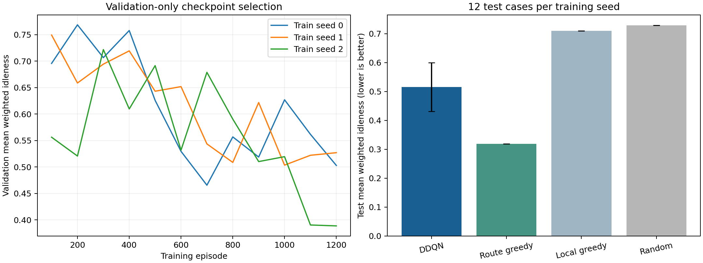

# M1固定基线结果

3个独立训练种子，每种方法每个种子12个测试场景。表中为训练种子均值的平均值±样本标准差。

| 方法 | 加权未检程度（低优） | 检查点覆盖（高优） | 终点最长未检步数（低优） |
|---|---:|---:|---:|
| Shared DDQN + VAE | 0.5154 ± 0.0844 | 0.9271 ± 0.0208 | 84.9722 ± 4.3376 |
| Route greedy + VAE | 0.3188 ± 0.0000 | 0.9583 ± 0.0000 | 68.9167 ± 0.0000 |
| Local greedy + VAE | 0.7098 ± 0.0000 | 0.1979 ± 0.0000 | 96.0000 ± 0.0000 |
| Random + VAE | 0.7292 ± 0.0000 | 0.6250 ± 0.0000 | 96.0000 ± 0.0000 |

检查点按验证集选择。本结果属于合成机房与缩小网络设置，未复现原论文表格，且未启用RSI。
