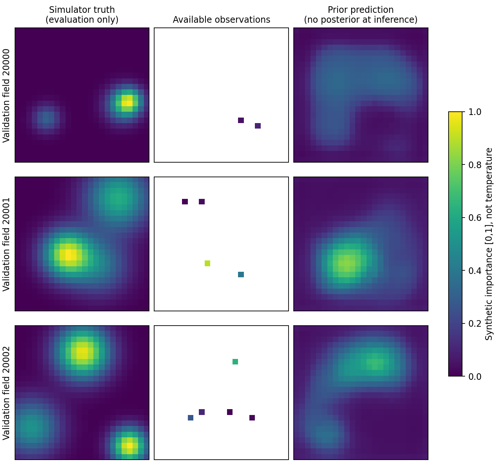
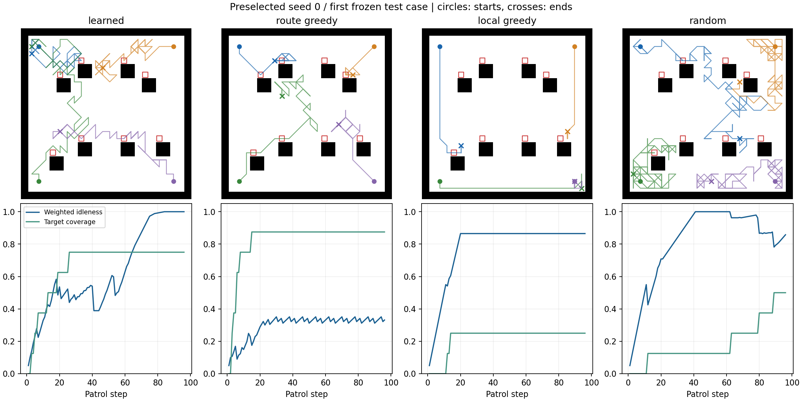
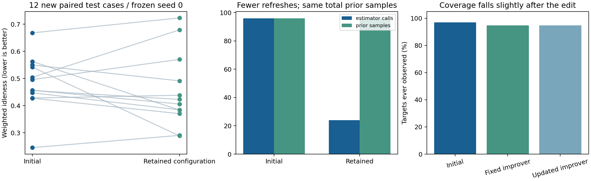

# 固定基线训练与真实开源模型提案

本轮完成了三种子的固定基线训练，并让本地Qwen3-8B读取开发巡检日志，真实提出和评价修改。结果显示：**学习策略超过弱基线，但未超过地图路线贪心；模型修改改善了一个主要指标，同时略微降低覆盖。固定与可更新改进器未拉开差距，尚无递归改进有效性的证据。**

## 1. 实际完成的内容

保留原论文的条件VAE-UNet、共享多智能体Dueling DDQN、优先回放及持续重访目标。在24×24合成机房通道中，4个执行者检查8个位置，每次96步。VAE进行3,000次更新，策略3个种子各训练1,200回合。

这里使用归一化的合成重要度场，未模拟真实温度、故障概率或热传导。96步是离散行动预算，尚不是按移动和检查秒数计算的真实等时预算；斜向移动距离和总距离另报。模型宽度、归一化和数据均为缩小参考设置，未复现原论文20,000回合及其表格。

训练、验证、固定基线测试、外层开发、外层最终测试分别划分。策略只按验证集选检查点；三个种子均报告，外层预先指定种子0，不按测试表现挑选。

## 2. 先修复了无效VAE

前两次训练产生接近全零的输出。虽然loss有限、参数有梯度，模型仍未学到有效重建。短诊断表明关闭感知损失也会退化，因此没有继续使用这两个估计器训练策略。

修正包括GroupNorm、潜变量向量的空间广播及卷积融合，并使验证观测接近室内0至8个检查点。修正后，稀疏验证MSE为**0.0330**，常数训练均值参考为**0.0536**。加入空间图案学习与提示词日志测试后，集群完整**20项测试通过**。这些是实现修正与有效性验证，不是算法创新。

## 3. 固定基线比较

主要指标是96步中“重要位置有多久没有被检查”的归一化加权均值，越低越好。覆盖比例表示任务中至少检查过一次的目标比例，不能替代持续重访质量。

| 方法 | 加权未检程度↓ | 检查点覆盖↑ |
|---|---:|---:|
| VAE＋共享DDQN | 0.5154 ± 0.0844 | 92.71% ± 2.08个百分点 |
| VAE＋地图路线贪心 | 0.3188 | 95.83% |
| VAE＋局部一步贪心 | 0.7098 | 19.79% |
| VAE＋随机巡检 | 0.7292 | 62.50% |

学习方法为3个训练种子的均值±样本标准差，每个种子各12个固定测试场景。三种非学习基线在相同场景和相同估计器下结果重复，因此其训练种子间标准差为0；这不代表它们在不同场景中没有波动。36条测试记录也不是36次独立训练。

策略分别在第700、1,000和1,200回合被验证集选中。曲线仍有明显波动，不能称已经收敛。当前最明确的问题是学习策略在新布局上仍有长期漏查或重复局部移动；地图路线贪心提供了必须保留的强对照。

## 4. 开源模型实际修改了什么

使用[Qwen3-8B官方固定提交](https://huggingface.co/Qwen/Qwen3-8B/tree/b968826d9c46dd6066d109eabc6255188de91218)，在V100S 32GB上本地FP16离线运行，语言模型权重固定。五个权重分片按官方LFS SHA-256校验，其他文件按官方Git blob核验。生成检查的显存峰值约15.3 GiB。

语言模型读取开发场景的汇总指标、检查点测量和巡检轨迹摘要。每组3次提案，保存完整提示词和原始回复。只允许修改估计刷新间隔、prior采样数、协调顺序；可更新组还允许保留诊断指令。

初次试运行129646的落盘提示词历史列表意外包含了当前轮事后反馈，生成时使用的文本则未包含它。保留原始记录，修复深拷贝及实际渲染文本保存后，以完全相同的冻结设置运行129653：六次模型输出、候选评价和最终测试结果均与原运行完全一致。以下以129653作为可核验主记录；这次重复用于日志核验，不作为独立实验样本。

两组均保留了第一轮的同一任务修改：**每步1个prior样本 → 每4步刷新一次、每次4个样本**，协调顺序不变。固定组第二轮重复已有配置，没有增益而被拒绝；后续6/6及8/8等配置使开发指标退化，也被拒绝。共6次真实模型调用、2条接纳记录，对应1种不同的保留任务配置。

模型认为这些修改会促进探索和覆盖，但刷新间隔变大本身只会降低更新频率，并不直接规划探索。独立评价没有支持其“覆盖改善”的预测，不能把模型解释当成实验结论。

## 5. 独立外层测试：改善与代价同时存在

下面使用另一批12个场景、同一个冻结种子0，不能与上一节三种子测试均值直接作前后比较。

| 指标 | 修改前 | 固定改进器保留配置 | 可更新改进器保留配置 |
|---|---:|---:|---:|
| 加权未检程度↓ | 0.48195 | 0.45406 | 0.45406 |
| 检查点覆盖↑ | 96.875% | 94.792% | 94.792% |
| 终点最长未检步数↓ | 84.75 | 88.08 | 88.08 |
| 估计刷新次数 | 96 | 24 | 24 |
| prior总样本数 | 96 | 96 | 96 |

主要指标约改善**5.8%**，但覆盖下降**2.08个百分点**，终点最长未检时间也增加。刷新次数减少75%，prior总样本数没有下降；当前每个样本仍执行一次U-Net计算，因此不能称计算量减少75%。

这是1个策略种子、1条语言模型生成种子序列和12个场景的试运行，没有统计显著性或跨任务普适性结论。两组任务配置和最终巡检表现完全相同；可更新诊断指令没有产生可测出的额外改进。

| 语言模型调用成本 | 固定改进器3轮 | 可更新改进器3轮 |
|---|---:|---:|
| 输入token合计 | 10,599 | 10,714 |
| 输出token合计 | 462 | 505 |
| 生成耗时合计 | 30.86秒 | 33.26秒 |

两组候选次数和输出上限相同，实际推理成本略有不同。这里的时间只含语言模型生成，不含权重加载及巡检评价。

## 6. 对后续论文工作的含义

可以确认“原论文内层＋开源模型外层”的执行链条可行。当前证据不足以声称强化学习超过强规划基线、100%覆盖或RSI已有效。

下一阶段应先用轨迹诊断区分从未访问、长期未重访及局部重复移动，再确定改进器需要调用的诊断与训练工具。正式RSI实验应增加等候选预算搜索、多生成种子和覆盖/重访约束，并检验诊断指令更新能否持续改善后续提案质量。当前候选的覆盖退化也说明，单一加权目标需要补充明确的覆盖要求。

## 7. 可核验记录

- 固定基线训练作业129640的0、1、2三个数组任务均COMPLETED、退出码0:0；VAE成功作业129639。
- 验证图作业129643；最终完整20项测试作业129654；开源模型生成检查成功作业129645；提示词记录修复后的外层核验作业129653。
- 失败VAE作业129636的进程虽正常退出，但有效性未通过；129637被门槛主动阻止。模型首次格式检查作业129644失败，明确格式并补充原始回复保存后129645通过。失败记录均保留。
- [固定基线原始汇总](evidence/fixed-baseline-report/aggregate.json)、[外层原始汇总](evidence/rsi-pilot-129653/summary.json)、[逐轮提案](evidence/rsi-pilot-129653)、[提示词日志修复核验](evidence/prompt-log-correction-audit.json)、[作业输出](evidence/jobs)、[代码复核](代码复核.md)。
- 训练使用source_manifest_v3.json对应快照；原外层使用v4，日志修复核验及最终测试使用v6；固定基线后处理使用v5，最终外层后处理使用v6。检查点在集群运行目录及本地私有.work目录保存，不向Git提交模型权重。文件指纹和作业终态见evidence/run_manifest.json及slurm-outcomes.psv。
