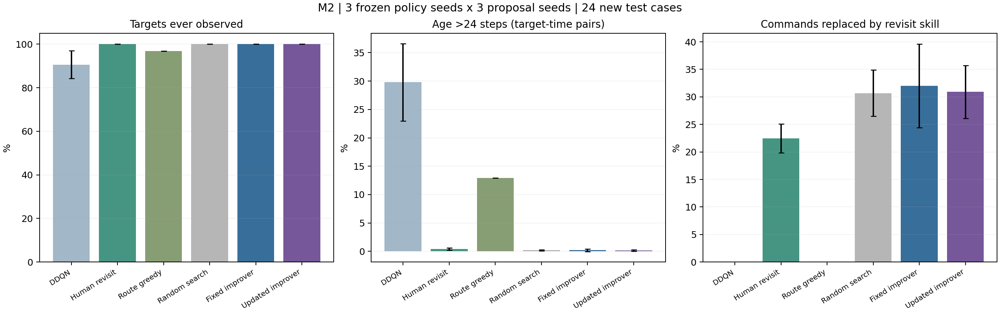
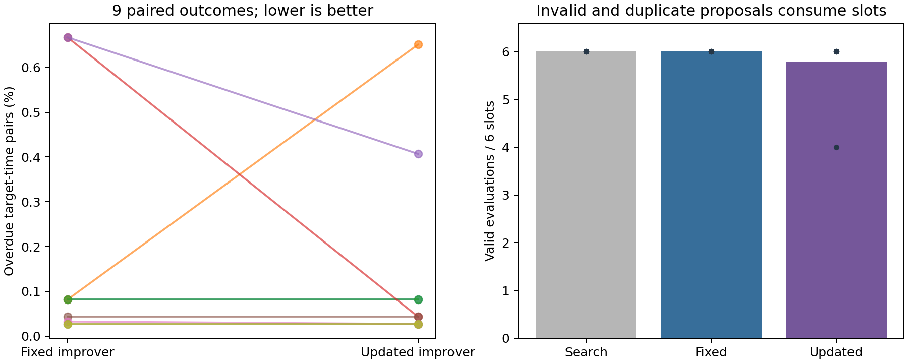
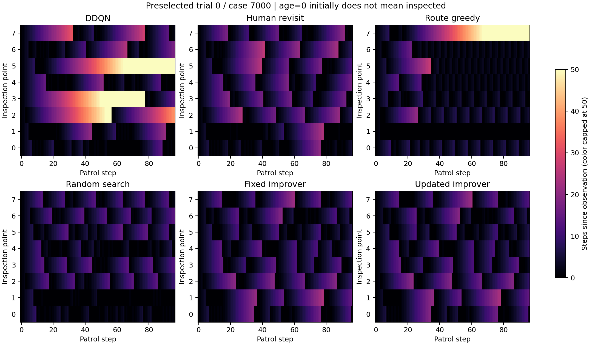

# M2结果：长期漏检大幅减少，递归改进证据仍有限

按用户要求，先复核M1，再完成了补查技能、诊断工具和等候选预算的多种子比较。**本轮明确有效的是人工补查技能；可更新改进器的平均结果略好，但尚未表现出稳定的递归改进优势。**

M3复核补充：9组第一次生成的诊断方案均照用了提示词中的同一句重访示例，因此首次工具切换不能作为自主发现的证据。数值和选择链仍可重算；下一阶段移除具体答案示例，加入人工固定重访对照、110配置开发枚举，以及重置任务参数的流程迁移检验，见[复核与后续方向](../2026-10-26-m3-transfer/复核与后续方向.md)。

## 1. 上一阶段发现了什么问题

原策略输入的未检程度在20步饱和，无法继续表达更长的等待。预先选定的M1示例还显示：覆盖过全部目标的策略，仍可能让某个目标81至90步不被重访，并存在大量两步返回。这些支持增加长期重访诊断，但不能证明饱和是所有问题的唯一原因。

复核还发现，M1固定组的历史中包含建议更新诊断指令的内容。M2将共同任务反馈与诊断方案分开：固定组始终用覆盖诊断；可更新组可以选择下一轮实际使用的覆盖、重访或往返诊断工具。原M1结果和源文件保持原样，修正依据见[M1复核记录](M1复核与修正.md)。

## 2. 实际实现和实验规模

继续使用原来的条件VAE和3组共享多智能体DDQN权重，没有重新挑选或微调权重。人工补查技能在目标等待达到触发值后，给执行者分配目标，并保持导航直到实际观察到该目标；其余动作交给DDQN。技能只读公开地图、位置和检查记录，不读真实重要度。

默认触发16步。模型或搜索可修改触发值、VAE刷新间隔、采样数和协调顺序。开发评价先考虑覆盖，再考虑固定24步逾期率，最后考虑原加权指标及采样成本。触发值变化不会改变24步评价时限。

- 3个冻结策略种子×3个提案种子，共9组配对；不是9次独立训练。
- 每方法每组6候选槽，共162槽；固定与可更新改进器合计108次真实Qwen3-8B调用。
- 新开发集6种布局用于选择；选择冻结后，在另外24种新布局测试。前12种无噪声，后12种测量噪声标准差0.03，单位是归一化重要度，不是摄氏度。
- 比较无补查DDQN、人工默认补查、地图路线贪心、随机搜索、固定改进器、可更新改进器。
- **集群31项测试全部通过。** 正式9个数组任务129676_0至129676_8均COMPLETED、退出码0:0；汇总作业129684同样正常完成。

## 3. 补查技能减少了长期漏检

“24步逾期率”是所有检查点、所有巡检时刻中，等待时间超过24步的比例；越低越好。覆盖表示至少检查过一次，不能代替持续重访质量。

| 方法 | 检查点覆盖↑ | 24步逾期率↓ | 原加权未检程度↓ | 补查接管动作占比 |
|---|---:|---:|---:|---:|
| 原DDQN＋VAE | 90.63% ± 6.34 | 29.792% ± 6.795 | 0.5096 ± 0.0547 | 0% |
| 人工默认补查＋DDQN | 100% | 0.441% ± 0.195 | 0.3308 ± 0.0184 | 22.47% |
| 地图路线贪心＋VAE | 96.88% | 12.956% | 0.2938 | 0% |
| 等槽随机搜索 | 100% | 0.200% ± 0.096 | 0.3102 ± 0.0237 | 30.67% |
| 固定改进器 | 100% | 0.190% ± 0.235 | 0.3050 ± 0.0156 | 32.00% |
| 可更新改进器 | 100% | 0.154% ± 0.122 | 0.3018 ± 0.0247 | 30.91% |

表中先在同一策略种子内平均3个提案种子，再计算3个策略种子均值与样本标准差；百分比后的±为百分点。非优化对照的3次重复没有增加独立样本。路线贪心不依赖策略权重，因此跨策略种子没有额外训练变异。

人工默认补查将逾期率从29.792%降到0.441%，相对减少约98.5%。这是公开地图和年龄记录驱动的人工工具收益，不能归给RSI。约22%的执行者动作被该技能接管，其余仍来自DDQN。

本批测试中补查相关各组均达到100%覆盖，但没有严格时限保证。人工默认补查的最坏单场景峰值年龄仍有32步，可更新组仍有29步，均超过24步要求。结论应表述为“在这些场景中大幅减少长期漏检”，不能表述为全场景保证或完全消除逾期。

原加权指标仍由路线贪心取得更低均值。M2强调覆盖与重访，是新增的任务要求，并非学习方法已全面超过强规划基线。

## 4. 更新改进器带来了多少额外收益

固定组保持覆盖诊断，可更新组在首次提案后均切到重访诊断，共45次后续调用确实使用了重访结果；没有选择往返诊断。更新影响了下一轮获得的信息，未将“换了诊断指令”本身当作改进成功。

可更新组的逾期均值为0.154%，固定组为0.190%，相差约**0.036个百分点**。但9组配对中仅**3组改善、1组变差、5组相同**；在无噪声子集，固定组均值反而略好。当前不能据此宣布递归改进稳定有效。

| 冻结策略种子 / 提案种子 | 随机搜索逾期率 | 固定改进器逾期率 | 可更新改进器逾期率 |
|---|---:|---:|---:|
| 0 / 71 | 0.092% | 0.081% | 0.081% |
| 0 / 173 | 0.168% | 0.081% | 0.651% |
| 0 / 269 | 0.651% | 0.081% | 0.081% |
| 1 / 71 | 0.071% | 0.667% | 0.043% |
| 1 / 173 | 0.065% | 0.667% | 0.407% |
| 1 / 269 | 0.407% | 0.043% | 0.043% |
| 2 / 71 | 0.049% | 0.033% | 0.027% |
| 2 / 173 | 0.049% | 0.027% | 0.027% |
| 2 / 269 | 0.244% | 0.027% | 0.027% |

两语言模型组都在7/9组中保留了12步触发，多数只调了少数参数。配置空间很小，提示词也包含输出结构示例，可能影响提案分布；得到12步配置本身不构成发现新方法的证据。随机搜索在相同候选槽下也获得接近的结果，说明“能调出更好的配置”还不足以支持RSI贡献。

## 5. 成本、失败和噪声子集

| 9组累计 | 随机搜索 | 固定改进器 | 可更新改进器 |
|---|---:|---:|---:|
| 候选槽 | 54 | 54 | 54 |
| 有效开发评价 | 54 | 54 | 52 |
| 非法提案 | 0 | 0 | 2 |
| 槽内重复配置 | 0 | 21 | 25 |
| 被开发规则接纳的提案 | 13 | 10 | 7 |
| 输入token | 0 | 81,924 | 79,814 |
| 输出token | 0 | 8,921 | 9,479 |
| 语言模型生成耗时合计 | 不调用 | 411.87秒 | 430.29秒 |

非法和重复提案都消耗槽位；重复计数针对6个候选之间的重复，不包含与初始配置相同的首次提案。随机搜索不用语言模型，因此这里是**等候选槽及评价场景预算，不是相同总计算量**。时间仅为生成累计值，不含加载与巡检评价，也不是并行作业的墙钟时长。

可更新组没有提高有效提案率，开发规则接纳的提案数也更少。接纳次数本身并非最终效果的充分指标，但结合重复配置与9组结果，当前没有证据表明改进器自身的提案能力持续增强。

无噪声/有噪声子集的逾期率分别为：人工默认补查0.394%/0.488%，随机搜索0.168%/0.231%，固定改进器0.143%/0.236%，可更新改进器0.147%/0.162%。两个子集的布局与状态场不同，因此这些数值不能解释为单独改变噪声造成的因果效果。

首个开发试运行129672虽正常退出，但4次语言模型输出因格式不合法被拒绝。修正明确的字段及嵌套对象说明后，129674通过开发接口检查；未使用新测试结果调整提示。正式比较中的2次非法提案仍保留原回复并计入预算。

图中起点年龄0仅代表开始计时，不表示起点已经检查；颜色上限50，原始数值未截断。

## 6. 下一步研究判断

目前可用的方向是：**以冻结VAE＋多智能体DDQN为内层，让外层智能体根据失败诊断调整补查技能与调用流程，并分别评价覆盖、重访和风险权重目标。** 这符合保留原论文主线再嵌入RSI的路径，但本轮仍以人工工具为主要能力来源。

若继续做论文，重点应是让改进器修改可复用的诊断/技能流程，并检验它能否在新任务中持续提高后续提案质量。还应加入固定参数枚举或贝叶斯搜索、去掉结构示例偏置、更多训练/生成种子及更复杂任务；仅比较当前几个参数不足以支撑RSI创新。原论文完整复现、真实温度模型、动态状态和现场数据仍未完成。

## 7. 证据入口

- [冻结实验设计](实验设计.md)、[M1复核](M1复核与修正.md)。
- [原始汇总与逐组结果](evidence/report/aggregate.json)、[完整选择链与轨迹重算](evidence/full-chain-audit.json)、[作业终态](evidence/slurm-outcomes.psv)。
- 每组完整提示词、模型原回复、开发评价、冻结选择及最终测试均在evidence/trial-0至trial-8。源码快照与后处理脚本指纹见source_manifest_v2.json、report_source_manifest_v2.json及evidence/run_manifest.json。
- 本阶段没有覆盖M1检查点、训练新权重或根据测试挑选种子。所有正式训练/模型推理仍在Slurm分配的资源内运行。
