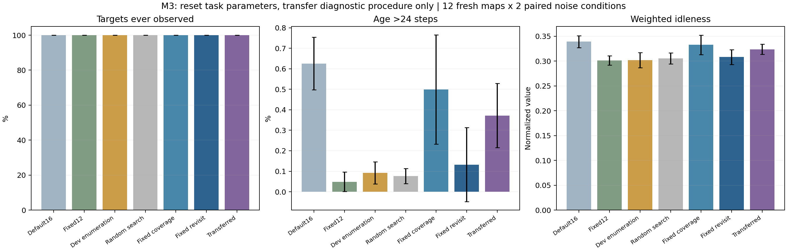
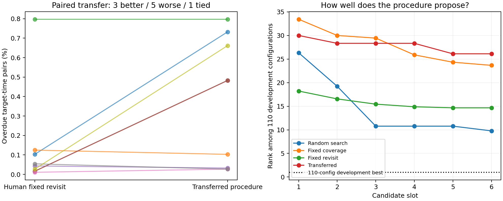

# M3结果：现有诊断流程迁移没有显示收益

**上一阶段的数值可重算，但其改进器结论需要更强对照。本轮完成移除具体答案示例、110种配置开发枚举及9组流程迁移实验后，结果不支持现有流程已经“更会改进”。** 迁移流程落后于人工固定重访诊断，固定12步补查配置反而取得更低的测试逾期率。

这为后续方向提供了明确依据：保留原论文的VAE＋多智能体强化学习内层，停止把当前小空间调参当作RSI贡献；若继续研究自改进，应改进可执行技能/诊断工作流，并通过内层任务效果评价每次改进器更新。

## 1. 复核发现与已修正的内容

重新核验M2全部162候选槽、108次模型调用和1,296条方法场景记录，未发现覆盖、逾期及选择链需要撤回的数值错误。

但9组第一次生成的诊断方案均与提示词中同一句重访示例完全一致。这是示例可能影响输出的直接迹象，不能单凭相同文本证明因果；更不能把首次切换工具当成自主发现的证据。原始M2报告保留，并增加了复核说明。

M3提示词移除填好参数和诊断答案的示例；增加人工固定重访诊断，避免只与较弱的覆盖诊断比较；重新从默认任务配置和空历史开始，只迁移已有诊断方案。另对110种合法配置完整枚举，并将噪声条件改为同布局同状态场配对。

详细依据见[复核与后续方向](复核与后续方向.md)。这不是新的全面文献查新，也未声称复现STOP或DGM。

## 2. 本轮实际完成的实验

- 保留M1冻结的VAE与3组共享DDQN检查点，未按结果重选或训练权重；人工补查技能与M2一致。
- 新开发集6布局；新测试12布局各运行噪声0/0.03，共24条件。与此前132种实际地图几何均不重复。
- 每个策略种子枚举110配置，共330个配置评价、1,980次开发巡检。只在开发集选择，不在测试中寻找最优。
- 3个冻结策略种子×3个新提案种子，共9组配对。随机搜索、固定覆盖、人工固定重访、迁移诊断流程均各6候选槽。
- 合计216候选槽、162次真实Qwen3-8B调用、1,512条最终方法场景记录。枚举和各组选择均在对应最终测试前冻结。
- **完整36项测试通过。** 枚举数组129700、比较数组129701及审计/出图作业129704均正常完成，退出码0:0。

巡检仍为96个离散行动步，不等同于96秒。状态场是静态合成归一化重要度，噪声不是摄氏度；没有模拟真实温度、故障概率或热传导。

## 3. 新测试结果

“24步逾期率”表示检查点与巡检时刻的组合中，距上次检查超过24步的比例。所有方法在本批测试均至少检查过全部8个位置，覆盖均为100%，所以本轮更重要的区别是重访质量。

| 方法 | 24步逾期率↓ | 原加权未检程度↓ | 补查接管动作占比 |
|---|---:|---:|---:|
| 人工默认16步补查 | 0.626% ± 0.129 | 0.3391 ± 0.0119 | 24.17% |
| 预先固定12步配置 | **0.049% ± 0.047** | **0.3014 ± 0.0094** | 35.72% |
| 开发枚举选中配置 | 0.092% ± 0.054 | 0.3018 ± 0.0153 | 35.63% |
| 6槽随机搜索 | 0.077% ± 0.037 | 0.3053 ± 0.0111 | 36.43% |
| 固定覆盖诊断 | 0.499% ± 0.267 | 0.3326 ± 0.0194 | 26.88% |
| 人工固定重访诊断 | 0.133% ± 0.181 | 0.3080 ± 0.0151 | 34.75% |
| M2迁移诊断流程 | 0.372% ± 0.157 | 0.3237 ± 0.0104 | 29.55% |

每个策略种子内先平均3个提案种子，再计算3个策略种子均值与样本标准差；百分比后的±单位为百分点，图中误差线也是标准差而非置信区间。重复评估固定配置和枚举选中配置不会增加独立训练样本。

枚举选中配置在测试上不及固定12步并非错误：它是在6个开发场景中最优，未必在独立测试上最优。因此称其为“开发枚举锚点”，不能称为测试上界或最优算法。

本批100%覆盖也不是严格重访保证。固定12步仍出现单场景27步的最大等待，其他方法最坏达到32步；24步期限仍有少量违例。

## 4. 改进器自身是否更有效

迁移流程只保留M2对应trial的tool与instruction，任务参数和历史均重置，也不向提示词传递M2测试结果。新任务适配期间诊断方案冻结，模型提出的后续诊断方案只保存、不采用。

相对人工固定重访诊断，迁移流程的测试逾期率均值高约**0.239个百分点**；9组配对中**3组更好、5组更差、1组相同**。当前没有可迁移收益证据，也不能将此结果扩展为所有自改进方法都无效。

| 策略种子 / 新提案种子 | 人工固定重访诊断 | 迁移流程 | 迁移方向 |
|---|---:|---:|---|
| 0 / 389 | 0.103% | 0.732% | 变差 |
| 0 / 467 | 0.125% | 0.103% | 改善 |
| 0 / 557 | 0.798% | 0.798% | 相同 |
| 1 / 389 | 0.016% | 0.483% | 变差 |
| 1 / 467 | 0.043% | 0.033% | 改善 |
| 1 / 557 | 0.016% | 0.483% | 变差 |
| 2 / 389 | 0.011% | 0.027% | 变差 |
| 2 / 467 | 0.054% | 0.027% | 改善 |
| 2 / 557 | 0.027% | 0.662% | 变差 |

完整枚举还允许直接检查提案能力。6轮后最佳开发配置在110种配置中的平均名次为：随机搜索9.78、人工固定重访14.67、固定覆盖23.67、迁移流程26.11（名次越小越好）。不同策略种子的名次用于描述各自有限空间中的位置，不表示相同效应量。

## 5. 合法率、重复与计算成本

| 9组累计 | 随机搜索 | 固定覆盖 | 固定重访 | 迁移流程 |
|---|---:|---:|---:|---:|
| 候选槽 | 54 | 54 | 54 | 54 |
| 合法开发评价 | 54 | 53 | 53 | 45 |
| 非法提案 | 0 | 1 | 1 | 9 |
| 槽内重复配置 | 0 | 12 | 20 | 25 |
| 被开发规则接纳 | 12 | 15 | 16 | 6 |
| 输入token | 0 | 77,285 | 74,432 | 71,667 |
| 输出token | 0 | 7,470 | 7,491 | 9,345 |
| 模型生成耗时累计 | 不调用 | 347.18秒 | 342.97秒 | 420.17秒 |

一组迁移流程连续6次提出不在允许集合中的14步触发值，全部被固定边界拒绝。没有将它们四舍五入或人工改成合法配置；原始回复与错误均保留。这说明已有指令迁移没有使其更好地处理新任务的取值约束。

非法和重复都消耗槽位；重复针对候选之间的相同配置，不包括首次与默认值相同的情况。生成耗时不含模型加载、开发巡检或最终测试，也不等于并行作业墙钟时间。**6槽对照只统一候选预算，不统一总算力；110配置枚举是额外预算的强参照。**

## 6. 噪声配对及结论边界

同一布局和状态场分别运行噪声0与0.03。加噪后的平均逾期变化（百分点）为：默认配置−0.051、固定12步−0.011、枚举−0.004、随机搜索−0.018、固定覆盖−0.099、固定重访−0.024、迁移流程−0.037。

这些是固定场景及随机序列下的配对差值；噪声会改变观测、动作及轨迹，结果偶尔下降不意味着测量噪声普遍有益。场景数量仍少，未主张统计显著性或真实机房鲁棒性。

## 7. 后续方向与停止条件

**不建议继续扩大当前110配置空间的语言模型调参实验。** 本轮最简单的固定12步基线已经很强，迁移流程也没有超过人工固定正确诊断；现有结果不足以支撑以RSI优势为论文主要贡献。

下一项研究应改为可执行技能/工作流的验证式改进：例如诊断工具调用顺序、失败恢复分支、面向异质重访要求的补查分配规则。外层生成候选流程后，必须在独立开发任务上运行固定预算的内层改进，按任务效果及成本决定保留或回退，再去新任务检验；不是提出新指令就采用。

先用受限流程语言及固定解释器控制执行范围，保留人工流程和同语言搜索对照。再逐项加入检查耗时、执行者可用性、不同重访要求等能改变决策的条件。暂定研究问题为：**经独立验证的流程自改进，能否在任务条件变化时提高VAE＋多智能体巡检的适应能力，并满足覆盖与重访要求？**

这仍是待验证方向，不是已获得的创新结论。若新流程也不能超过人工正确工具和计算预算相当的搜索，应将大模型定位为辅助诊断，不强行保留RSI标签。更具体安排及文献依据见[复核与后续方向](复核与后续方向.md)。

## 8. 可核验交付

- [冻结实验设计](实验设计.md)、[完整选择链和指标重算](evidence/full-chain-audit.json)、[逐方法汇总](evidence/report/aggregate.json)、[Slurm终态](evidence/slurm-outcomes.psv)。
- 原始提案与实际提示词、转移方案来源、冻结选择及测试轨迹位于evidence/trial-0至trial-8；110配置数据位于evidence/enumeration/policy-0至policy-2。
- 源码和报告脚本指纹见source_manifest_v1.json及report_source_manifest_v1.json。旧检查点和传输指纹见evidence/run_manifest.json。
- 本次完成的是M2复核、后续规划和M3验证实验；原文完整复现、真实热异常建模和M4流程生成尚未完成。
