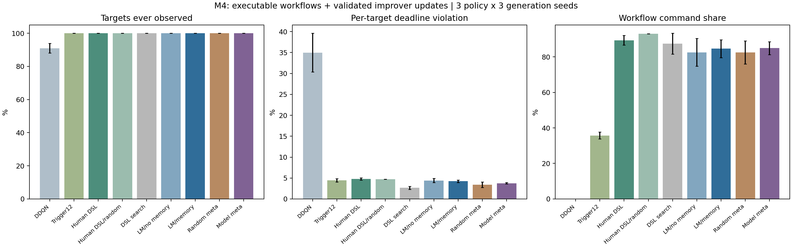
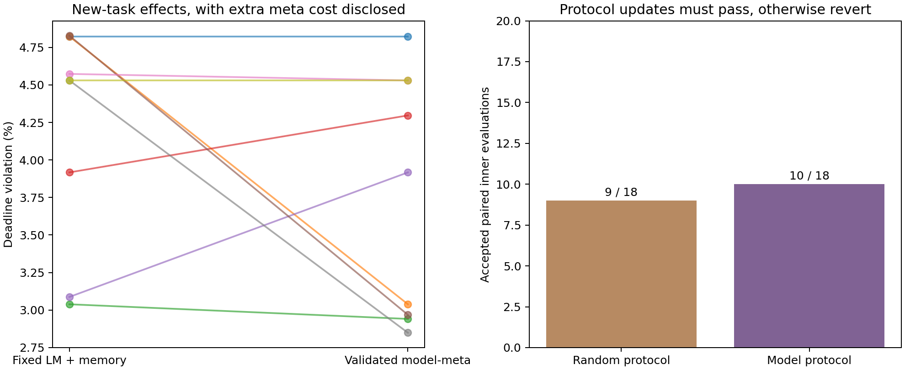
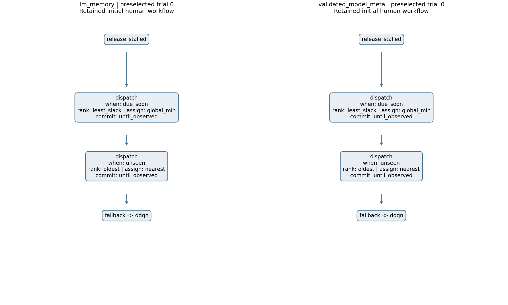

# M4结果：可执行流程与验证闭环已完成，尚未优于搜索

本轮完成了M3复核、M4策划和实际实验。**模型能够生成并运行有条件分支的巡检程序，改进器更新也经过内层评价后保留或回退；但在本批测试中，随机工作流搜索优于模型元更新，尚不能主张RSI优势。**

模型元更新相对仅保留记忆的固定生成器，平均逾期率从4.239%降至3.766%，9组中5组改善、2组变差、2组相同。这一改善使用了额外离线评价，且仍落后于随机元流程3.402%和随机工作流搜索2.657%。

## 1. 上一步复核与本次改变

M3的3×110配置、216候选槽、162模型调用和1,512条最终记录重新审计通过；其流程迁移无收益的数值没有改变。M3改的仍是工具名与诊断文字，未生成实际执行程序，也没有先评价候选改进器再采用。

M4增加固定解释器。模型生成JSON程序，决定分支顺序、目标筛选与排序、执行者分配、是否保持目标直到观测、是否释放卡住的承诺，最后回到DDQN。程序中的原子工具由人工编写，不能将它们当成模型发明；模型的作用是组合并修改流程。未知操作和任意Python文本不执行。

改进器更新则改变诊断工具顺序、记忆检索方式和分析指令。每次分别用旧/候选改进器在相同元开发任务、相同种子下各运行2个工作流候选槽，只有候选内层结果严格更好才保存；相同或更差则保留原流程。

诊断统计由固定代码预计算，元协议决定向模型提供哪些诊断、以什么顺序提供，以及检索哪些历史；没有生成新的诊断函数，也没有修改解释器或语言模型权重。真正可执行的程序生成发生在任务工作流层。

## 2. 实际实验规模与隔离

- 冻结原VAE、3组共享多智能体DDQN及每步1次prior采样，不训练或重选模型权重。
- 4个元开发布局，分2轮；另6个任务开发布局；最终12种新布局各配对噪声0/0.03，共24条件。与此前150种地图几何均不重复。
- 检查点公开重访时限不同：balanced为16/24/32步，tight为12/16/24步。它们是仿真假设，不是现场设备规范；M4逾期率不能直接与M2/M3统一24步的数值比较。
- 3个冻结策略种子×3个生成种子，共9组；5种任务优化方法各3候选槽，共135槽。元评价另有144个内层工作流槽、36次元候选提案（18随机、18模型）。
- 正式实验共270次真实Qwen3-8B调用：252次工作流生成、18次改进器协议生成。正式生成对象均通过语法与操作域检查；过程成功不代表效果更好。
- 元流程冻结后，任务阶段重新从共同人工程序与空历史开始；不转移元开发得到的任务程序或运行记录。最终测试仅在全部任务选择落盘后运行。
- **集群完整50项测试通过。** 正式数组129727_0至129727_8均COMPLETED/0:0；原始审计129728及加强复核129739同样正常完成。

本轮仍使用静态合成归一化重要度场。96步是离散行动预算，未加入真实检查秒数、热传导或动态故障；噪声0.03也不是摄氏度。

## 3. 独立测试结果

逾期率表示检查点与时刻组合中，未检时间超过该检查点自身公开时限的比例。覆盖表示至少检查过一次，不能替代重访质量。

| 方法 | 检查点覆盖↑ | 各目标时限逾期率↓ | 原加权未检程度↓ | 工作流/补查接管占比 |
|---|---:|---:|---:|---:|
| 无补查DDQN＋VAE | 90.97% ± 2.87 | 34.983% ± 4.622 | 0.5152 ± 0.0387 | 0% |
| 原固定12步补查 | 100% | 4.460% ± 0.409 | 0.3014 ± 0.0138 | 35.74% |
| 人工工作流＋DDQN | 100% | 4.800% ± 0.259 | 0.3794 ± 0.0105 | 89.33% |
| 同一人工工作流＋随机后备 | 100% | 4.709% | 0.3908 | 92.93% |
| 随机工作流搜索 | 100% | **2.657% ± 0.363** | **0.2662 ± 0.0155** | 87.40% |
| 模型生成，无记忆 | 100% | 4.422% ± 0.475 | 0.3618 ± 0.0210 | 82.53% |
| 模型生成，仅运行记忆 | 100% | 4.239% ± 0.300 | 0.3593 ± 0.0165 | 84.58% |
| 验证后随机元流程 | 100% | 3.402% ± 0.671 | 0.3480 ± 0.0152 | 82.48% |
| 验证后模型元流程 | 100% | 3.766% ± 0.187 | 0.3577 ± 0.0062 | 84.88% |

每个策略种子内先平均3个生成种子，再计算3个策略种子均值与样本标准差；百分比后的±为百分点。图中误差线是标准差，不是置信区间。固定对照重复执行不增加独立证据，随机后备不依赖训练权重，因此跨策略种子无额外训练变异。

这些结果支持“补查或调度能减少冻结策略的长期漏检”，但没有证明语言模型生成优于搜索。最优均值来自3槽随机工作流搜索，原固定12步补查的加权指标也优于所有模型生成组。

## 4. 改进器更新是否通过验证，能否迁移

随机元流程18次候选中接纳9次，模型元流程18次中接纳10次。每次接纳都能由同一对元开发任务的内层结果重算，未因模型声称更好就保存。接纳率本身不是最终收益证明。

下表在完全不同的任务开发和最终测试场景上，比较模型元更新与仅运行记忆的固定改进器：

| 策略种子 / 生成种子 | 仅记忆逾期率 | 模型元更新逾期率 | 方向 |
|---|---:|---:|---|
| 0 / 641 | 4.823% | 4.823% | 相同 |
| 0 / 743 | 4.823% | 3.038% | 改善 |
| 0 / 853 | 3.038% | 2.941% | 改善 |
| 1 / 641 | 3.917% | 4.297% | 变差 |
| 1 / 743 | 3.087% | 3.917% | 变差 |
| 1 / 853 | 4.829% | 2.968% | 改善 |
| 2 / 641 | 4.574% | 4.530% | 改善 |
| 2 / 743 | 4.530% | 2.848% | 改善 |
| 2 / 853 | 4.530% | 4.530% | 相同 |

总体改善约0.473个百分点，但随机元流程的均值更好，且元训练具有额外模型调用与评价成本。两轮、4个元开发布局仍可能过拟合，当前没有证据说明模型提出元流程比随机提出元流程更有效，也未证明持续递归增强。

## 5. 程序是否真正变化，以及DDQN还起多大作用

5种优化方法共45个保留程序，包含人工初始程序在内有17种不同JSON程序。随机工作流9组中1组未改变人工初始程序；无记忆模型6组、仅记忆模型4组、随机元流程3组、模型元流程3组仍保留初始程序。没有把这些回退结果标成模型新发明。

选择的程序确实经解释器执行，记录规则触发、目标分配、释放和动作轨迹。报告图预先固定展示trial 0；其中仅记忆与模型元更新恰好都保留人工初始程序，因此图上已明确标注，不挑另一个成功例子替换。

人工工作流接管约89%的执行者指令，DDQN只负责余下约11%。换成随机后备后，逾期率没有变差，而加权未检程度略差。因此在这一人工流程下，没有观察到冻结DDQN对逾期率的稳定边际收益；不能将组合系统的全部收益归于强化学习。

该消融只针对人工工作流，不代表每个生成程序或重新训练后的DDQN都无作用。工作流接管和回到DDQN是受控接口，模型权重仍被保留，但“保留了网络”不足以证明网络在新任务中有研究贡献。

原始assignments、stalled_releases和executed_rules字段统计DSL解释器，对原12步补查和纯DDQN对照不适用；这些列的0值不能解释为没有其他工具执行。主要比较使用单独定义的接管比例和原始动作轨迹。

## 6. 实际成本、重复与失败

任务阶段每组3槽，9组累计如下。重复指候选间的相同程序，不含首次与初始程序相同的情况。

| 任务阶段 | 随机流程 | 无记忆模型 | 仅记忆模型 | 随机元流程后 | 模型元流程后 |
|---|---:|---:|---:|---:|---:|
| 候选槽/合法评价 | 27/27 | 27/27 | 27/27 | 27/27 | 27/27 |
| 重复程序 | 0 | 9 | 13 | 12 | 10 |
| 被开发规则接纳 | 10 | 4 | 6 | 10 | 7 |
| 任务模型调用 | 0 | 27 | 27 | 27 | 27 |
| 任务生成耗时累计 | 0 | 186.18秒 | 187.82秒 | 186.97秒 | 194.06秒 |

| 额外元准备阶段 | 随机元流程 | 模型元流程 |
|---|---:|---:|
| 元候选/接受 | 18/9 | 18/10 |
| 内层工作流槽 | 72 | 72 |
| 内层及元提案模型调用 | 72 | 90 |
| 输入/输出token | 91,386 / 10,972 | 108,802 / 12,207 |
| 元准备生成耗时累计 | 497.82秒 | 552.49秒 |

因此随机元流程整条方法用了99次模型调用，模型元流程用了117次，固定仅记忆用了27次。所有正式生成的协议和工作流都合法，但合法率不说明效果。时间为模型生成累计值，不含加载、环境评价或测试，不等于并行墙钟时长。任务候选槽相同，**总计算预算不相同**。

初次接口作业129723中模型回显证据并截断，确认无效后停止，保留CANCELLED状态及部分日志；修复输入与输出请求分隔后129725完成50项测试、13次合法模型调用，未读最终测试。正式结果不覆盖这次失败。数据取回也拒绝了压缩未结束的部分文件，最终使用服务器完整SHA-256一致的归档。

## 7. 场景差异与结论边界

balanced与tight子集的逾期率分别为：原12步补查1.595%/7.324%，人工工作流0.937%/8.662%，随机流程0.790%/4.524%，仅记忆1.045%/7.433%，模型元流程0.854%/6.678%。两类子集使用不同布局和状态场，不能把差值解释为单独改变时限的因果效应。

同布局、同状态场的噪声配对已保留，原始差值在汇总JSON中。一次噪声变化可能改变后续动作和轨迹，既可能改善也可能变差，不能据小样本称噪声有益或已验证真实机房鲁棒性。

覆盖100%并未消除时限违例：固定12步最坏场景仍有28步等待，模型元流程37步，随机元流程44步。时限是否可完全满足也未做最优可行性证明。本阶段未完成真实机房热异常发现、检查耗时建模或原论文完整复现。

## 8. 后续研究决策

已实现的机制比前几阶段更贴近“技能和流程自改进”：模型生成程序、独立内层评价、接受或回退、在新任务重新适配并测试。但效果仍未超过强搜索，且调度流程主导了动作。

**不建议立即加深同一提示词的轮数或把本结果写成RSI有效。** 下一阶段优先解决贡献归因：让学习策略接收并学习异质时限，比较重新训练策略、规划器、组合模型和移除VAE/移除学习策略；明确哪些场景真的需要风险估计与协作学习。若神经模块没有稳定收益，先调整研究模型，而不是继续在弱内层外堆叠改进器。

外层研究则应在明确的内层上，用相同总调用或GPU时长比较元学习、流程搜索与人工规则，并扩大独立元任务，检验接受的协议是否可持续迁移。只有同时超过人工/搜索、保留内层贡献且收益大于额外成本，才适合以自改进作为论文主要贡献；否则将大模型定位为辅助生成或诊断工具。

## 9. 证据入口

- [冻结实验设计](实验设计.md)、[M3复核与阶段策划](M3复核与阶段策划.md)、[代码与方法复核](代码与方法复核.md)。
- [原始汇总](evidence/report/aggregate.json)、[完整选择链与轨迹重算](evidence/full-chain-audit-v2.json)、[作业终态](evidence/slurm-outcomes.psv)。
- 每组原始回复、实际渲染提示词、元候选配对、冻结协议、任务工作流选择和最终轨迹均在evidence/trial-0至trial-8；失败和成功接口试跑分别保留。
- 推理/测试使用source_manifest_v2.json，最初后处理使用report_source_manifest_v1.json，加强审计和最终图使用report_source_manifest_v2.json；部分草稿报告文件虽在推理打包中，但未用于后处理。当前使用角色及指纹见evidence/run_manifest.json。
- 以上只完成本次M4原型阶段，未完成长期论文目标、开放式代码进化或真实热异常实验。
