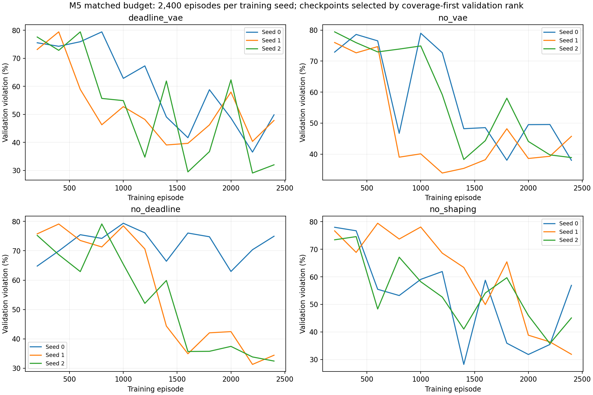
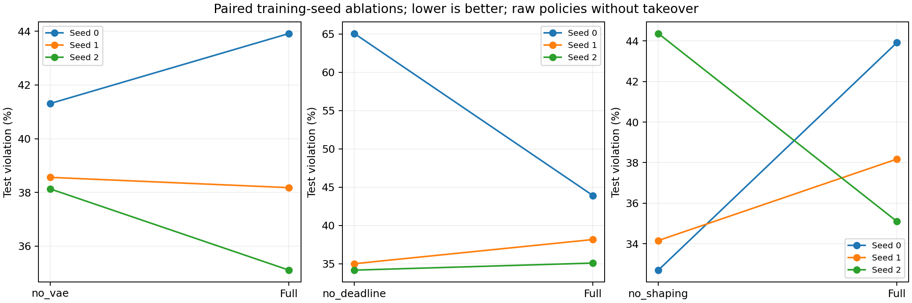
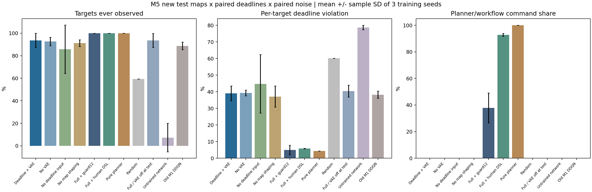
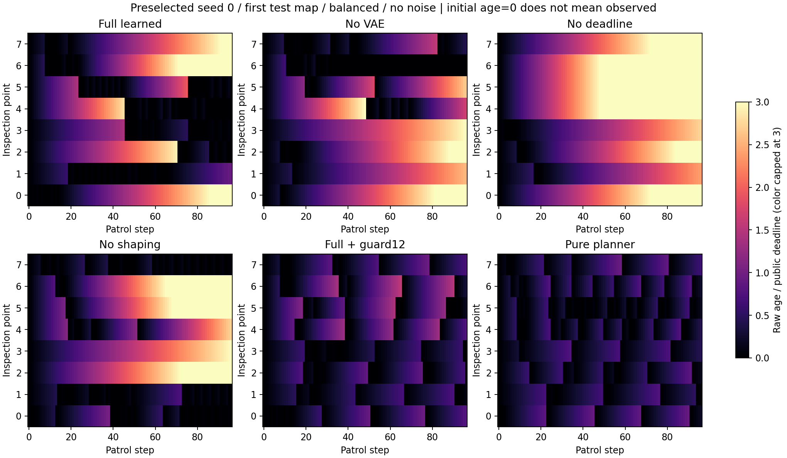

# M5结果：重新训练后，内层仍未建立稳定优势

本轮按要求复核M4、先冻结方案，再完成时限感知内层训练及模块消融。**网络确实发生了学习，但在本批合成场景中仍大幅落后于纯规划器；VAE、时限输入和距离引导均未表现出跨种子的一致任务收益。当前不宜继续叠加RSI来掩盖内层问题。**

完整组的检查点覆盖为93.66%，逾期率39.07%；纯截止裕度规划器覆盖100%，逾期率4.29%。完整组加固定12步补查后逾期率降至4.92%，但这包含人工接管，不能算成纯学习策略的效果。

本阶段没有调用语言模型或增加RSI轮数。目录沿用任务创建日期；训练跨午夜继续运行，数据来源和作业路径未重命名。

## 1. 对上一步的复核与本次修正

M4的270模型调用、135任务槽、1,944条最终记录和712种场景—路径记录重新重放通过，原结论保持不变：模型元更新没有超过随机工作流搜索，人工流程高度接管动作。

但M4的冻结DDQN没有接收各目标时限，其训练任务也不是异质时限。因此M4不能证明“适当训练后的学习策略没有价值”。M5新增公开时限、年龄/时限、未见目标等输入，从头训练；主比较只执行网络分数经共同安全协调后的动作，不让规划器替代决策。

新奖励仅使用公开测量、年龄、时限和地图；VAE预测不提供奖励权重。地图距离差分奖励被明确标为人工引导，另设移除组。真实重要度只用于固定外部评价，不能把训练奖励变化当成任务效果。

## 2. 已完成的实验与验证

- 4个训练组：完整时限感知DDQN＋VAE、无VAE、隐藏时限输入、移除地图距离势函数。策略网络结构与参数量相同，3个种子在各组之间配对初始化，指纹逐项一致。
- 共12个从头训练任务，每个2,400回合×96步，合计2,764,800团队行动步、691,020次DDQN更新。是每组3个配对种子，不是12个独立随机初始化或12个独立统计重复。
- 64训练布局、8独立验证布局；最终12种新布局各配对2种时限和2种噪声，共48测试条件。新增84种几何与此前172种实际地图均不重复。
- 每200回合验证，按覆盖损失、逾期、加权未检三项排序选检查点；测试不决定预算、超参数或模型选择。每个最终检查点均从磁盘新读并重放第一测试场景，动作和指标与保存记录一致。
- **59项完整测试通过。** 正式数组129749_0至129749_11、原始审计129760、加强复核129783及实际权重元数据核验129803均COMPLETED/0:0。12个策略均为327,257参数。
- 独立审计核对2,016条方法场景记录，重放1,808种场景—路径记录；检查全部动作与位置差分、年龄/时限、覆盖、逾期、真实加权指标、初始化配对及验证选择。初始参数指纹可查，12个最终权重保留在私有工作目录与集群，Git只保存指纹和可审查结果。

VAE仍用M1固定检查点，本轮不再训练。状态场是静态合成归一化重要度，不是实测温度或校准故障概率；96步不是96秒。时限balanced为16/24/32步，tight为12/16/24步，均为公开仿真假设。

## 3. 主比较：没有规划接管的学习策略

逾期率为检查点与时刻组合中，未检时间超过该点自身时限的比例。覆盖表示至少检查过一次，不代表后续始终按时复查。

| 训练组 | 检查点覆盖↑ | 逾期率↓ | 真实重要度加权未检程度↓ |
|---|---:|---:|---:|
| 时限感知DDQN＋VAE | 93.66% ± 6.27 | 39.07% ± 4.47 | 0.5444 ± 0.0515 |
| 无VAE重新训练 | 92.62% ± 3.78 | 39.33% ± 1.73 | 0.5485 ± 0.0195 |
| 隐藏时限输入 | 85.76% ± 21.51 | 44.76% ± 17.59 | 0.6248 ± 0.1639 |
| 无地图距离引导 | 91.15% ± 2.96 | 37.08% ± 6.36 | 0.5443 ± 0.0726 |

表中为3个训练种子均值±样本标准差，百分比后的±为百分点，不是置信区间。覆盖等有界指标的标准差延伸可能超出0至100，不能把它解释成可达数值或概率区间。

4组主结果均无导航或补查接管，但仍有相同的人工避障和冲突投影。达到2,400回合只是跑满事先预算；验证曲线仍明显波动，不能称收敛。

## 4. 模块贡献是否稳定

| 训练种子 | 完整组逾期 | 无VAE逾期 | 隐藏时限逾期 | 无距离引导逾期 |
|---|---:|---:|---:|---:|
| 0 | 43.92% | 41.31% | 65.06% | 32.70% |
| 1 | 38.18% | 38.56% | 35.02% | 34.16% |
| 2 | 35.10% | 38.13% | 34.18% | 44.37% |

**VAE：** 完整组逾期均值只低约0.27个百分点，2种子更好、1种子更差。沿各自实际访问轨迹，完整组的前24步预测MSE均值约0.0346，无VAE约0.1011；全程约0.0133与0.0419。估计误差下降没有稳定转化为重访性能优势。由于轨迹与获得的测量不同，这些误差不是把同一份观测送入两个估计器的纯准确率对照。

**时限输入：** 完整组均值优于隐藏组约5.69个百分点，但主要来自种子0；另两个种子的完整组逾期反而略高。隐藏组在同布局、同噪声的两个时限标签下产生相同轨迹，说明信息消融确实生效。隐藏组训练奖励仍使用任务时限，不能称其训练完全没有时限信息。

**地图距离引导：** 移除后逾期均值更低，但覆盖也下降；完整组在2个种子中逾期更差、1个更好。这里既有多目标权衡也有训练波动，不能挑一个平均数称引导有效或无效，更不能把人工引导藏成算法创新。

这3个消融没有给出一致正收益；样本也不足以作统计显著性或普适结论。

## 5. 强对照、敏感性与接管作用

| 方法或检查 | 检查点覆盖↑ | 逾期率↓ | 额外规划接管 |
|---|---:|---:|---:|
| 完整训练策略 | 93.66% | 39.07% | 0% |
| 同初始未训练网络 | 7.29% | 78.66% | 0% |
| 随机动作 | 59.38% | 60.11% | 0% |
| 原M1冻结策略 | 88.72% | 38.22% | 0% |
| 完整权重，仅部署关闭VAE | 93.58% | 40.39% | 0% |
| 完整策略＋12步补查 | 100% | 4.92% | 37.87% |
| 完整策略＋人工工作流 | 100% | 5.79% | 92.80% |
| 纯截止裕度规划器 | 100% | 4.29% | 100% |

训练明显优于未训练网络与随机动作，说明不只是参数发生变化；但纯规划器仍在覆盖、逾期与加权指标上领先当前完整学习策略。纯规划器是贪心启发式，不是数学最优或任务性能上界。

原M1与M5的回合数、输入和奖励不同，只能作背景比较，不能将其差异归给某一新通道。部署关闭VAE属于固定权重的分布变化敏感性检查，不能代替同预算训练的无VAE组。

规划器也沿共同流程计算VAE以便记录，但其分配只用时限和距离，并不依赖预测重要度。这96次估计调用不是纯规划器必要的部署成本，不能据此夸大其成本。

按事先方案，4组均另外测试了相同12步补查：

| 训练组＋同一补查 | 检查点覆盖 | 逾期率 | 补查接管比例 |
|---|---:|---:|---:|
| 完整组 | 100% | 4.92% | 37.87% |
| 无VAE组 | 100% | 3.39% | 30.95% |
| 隐藏时限组 | 100% | 4.75% | 36.87% |
| 无距离引导组 | 100% | 4.12% | 33.02% |

人工补查可以掩盖纯策略的长期漏检，也会改变各组之间的排序。上述组合结果不能算作网络独立解决了重访问题；完整VAE组合也没有取得最低逾期均值。完整组加补查的加权未检程度约0.3158，低于纯规划器约0.3843，但逾期略高，体现目标权衡，未证明全面优胜。

图中颜色在年龄/时限比3处截断，原始数值未截断；起点年龄0只是开始计时，并不意味着已经检查。

## 6. 预算、检查点与成本

| 训练组 | 各种子被验证集选中的回合 | 每任务训练＋验证平均时长 | 每任务选定后测试平均时长 |
|---|---|---:|---:|
| 完整组 | 2200 / 1400 / 2400 | 27.65分钟 | 2.68分钟 |
| 无VAE | 1800 / 2000 / 1400 | 14.94分钟 | 0.30分钟 |
| 隐藏时限 | 2000 / 2200 / 2400 | 27.83分钟 | 0.81分钟 |
| 无距离引导 | 1400 / 2400 / 2000 | 26.60分钟 | 0.80分钟 |

所有训练任务都完成2,400回合，再回读验证选中的检查点。每个任务230,400团队步、57,585次更新；不是只训练到被选择的回合就停止。

完整组的最终测试项目更多，不能把包含额外测试的总作业时间当成训练成本。上表分开了训练加验证与选定后的评价；同时存在并发与节点负载差异，不是专门的单任务速度基准。固定VAE的预训练已在M1发生，本轮时长不包含该历史成本。

无VAE组每场0次估计网络调用，其他学习组一般96次。它的实际训练更快，但这不等于各组总算力相同；本实验统一回合/数据生成/更新预算，计算量按实际报告。

## 7. 结果适用范围与未解决问题

本轮新地图仍来自同一机柜扰动布局族，不能称任意机房泛化。全队共享可用测量与检查记录，未建模通信延迟、信息丢失或定位误差。静态场中已测值长期保留，也不同于变化中的热状态。不同噪声与时限现在已按同布局、同场配对，原始配对差值在汇总中；未证明真实热异常发现或现场时限可行性。

所有纯学习组都出现过单场景96步的最长等待。完整＋补查仍有29步、纯规划器有34步的峰值；覆盖100%并不保证每个公开时限均满足。也未证明存在满足所有时限的最优方案，不能把全部违例都归为学习失败。

当前网络仍是缩小的栅格CNN共享独立Q近似，没有显式循环历史或图结构；Bellman备份使用静态地图合法动作掩码，未逐样本重建联合冲突协调。训练代理奖励也未必精确对应覆盖优先的最终排序。这些是潜在原因，尚未通过新的控制实验证明，不能据M5否定原论文、所有多智能体RL或VAE。

距离势函数的差分形式有[经典奖励塑形工作](https://people.eecs.berkeley.edu/~russell/papers/icml99-shaping.pdf)可参考，但当前部分观测、多执行者及函数近似不构成其全部理论条件。本轮没有证明最优策略不变或训练收敛。

## 8. 后续研究决策

**暂不增加同一内层上的RSI轮数。** 先把“下一个检查点/协作分配”的高层决策与共同低层导航分开，或重构能表达实体及导航距离的内层，同时解决训练备份与联合执行的不一致。先做小环境可学性与原论文条件核对，再做独立布局和模块消融。

只有内层有可复核的稳定作用、VAE在明确部分观测或动态条件下确有增量，才重新评价外层如何适应预测/协作失配，并控制总调用或GPU时长。若简单规划持续更强，应调整问题条件与方法定位，而不是强行把复杂度当成科研贡献。

相关研读线索与设计推论已单列[后续方法定位资料](后续方法定位资料.md)。它们不是已实施的方法，也不保证优于规划；图或注意力本身也不是创新。M5没有完成原论文全部实验、动态热场、真实检查耗时或可投稿的新颖性论证。

## 9. 证据入口

- [冻结实验设计](实验设计.md)、[M4复核与阶段规划](复核与阶段规划.md)、[代码与方法复核](代码与方法复核.md)。
- [完整选择链和轨迹审计](evidence/full-chain-audit-v2.json)、[逐方法汇总](evidence/report/aggregate.json)、[组合消融与成本补充表](evidence/report/supplementary-tables.json)、[Slurm终态](evidence/slurm-outcomes.psv)。
- 原始12组训练日志、选择、最终测试和首次动作分数位于evidence中对应组目录；12个权重的[指纹](evidence/checkpoint-fingerprints.json)公开，二进制权重保存在集群和本地私有.work中。
- [实际选中权重的独立核验](evidence/selected-weight-audit.json)直接读取文件内的种子、组别、选中回合、验证分数和参数，与记录对照。
- 推理/训练使用source_manifest_v2.json，原始后处理v1，加强审计及最终出图使用report_source_manifest_v2.json；本地补充表只重算既有结果，没有新模型调用或测试选择。具体文件角色、传输哈希和来源见evidence/run_manifest.json。
