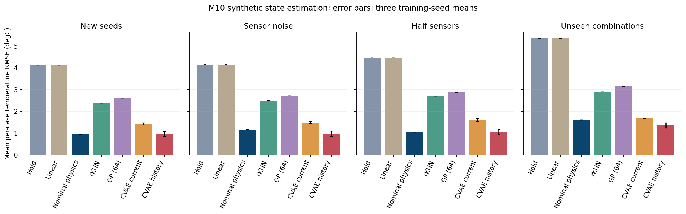
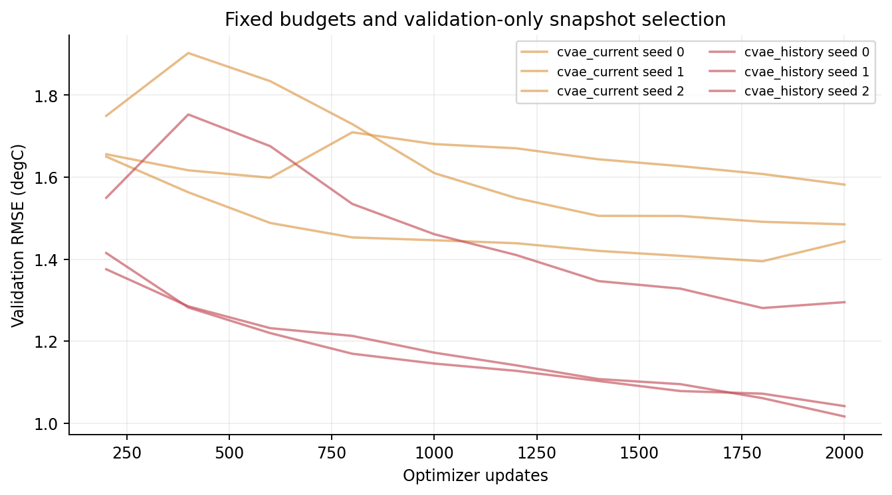
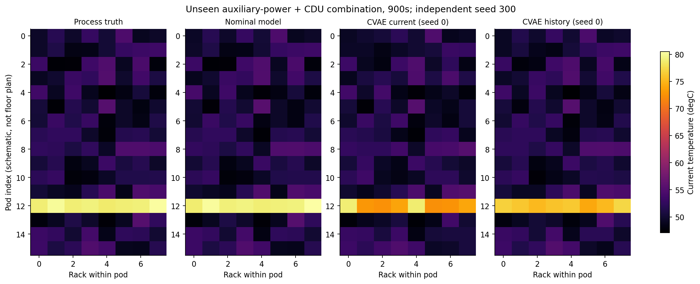
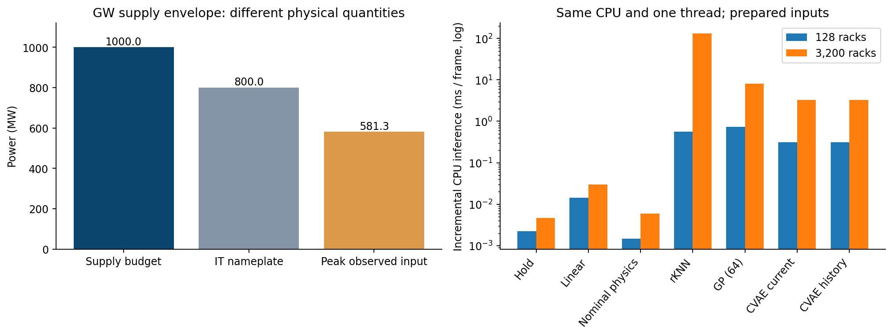

# M10：历史观测能改善柜温估计，但仍需要主动补查盲点

已复核M9，按用户确认把G解释为GW供电，并完成M10的六次真实GPU训练、独立测试和全量数值／权重复审。**历史CVAE比同参数的当前帧CVAE更准确；它还不能替代名义物理模型，更不能仅凭平均RMSE保证发现局部异常。**

常规观测下，逐轨迹温度RMSE均值从1.417°C降至0.956°C，三个配对训练种子均改善。与此同时，一台未直接测量的故障机柜仍出现约54°C的局部漏估。这使下一阶段的重点落到“主动补查、异常后果与最长未检时间”，与导师提出的巡检盲区问题直接衔接。

## 上一步复核与本轮修改

M9的95份冻结源、187份交付文件和统计再次核对；Slurm129921重新读取150份原始数值文件，重放54,000步，并独立检查电／热收支，确定性结果与M9原审计完全相同。详见[M9复核与GW口径修订](M9复核与GW口径修订.md)及[M9复审记录](M9复审.json)。

GW现在是供电规模。M9的1,024MW是额定IT负载，历史结果保留。本轮另设1,000MW设施供电总预算、800MW额定IT、3,200柜的补充场景，分别记录实际输入。这里汇总并联设施，不表示单条10kV或380V回路承载1GW。

方法复核修正了GP对照：大量测点时间相同时，取前64点会偏向前部区域；固定50°C均值也会引入任意偏置。在读取正式分数前，改为近期观测分散取点和所选实测点均值，保留两个版本。全部318条正式条件中，其他十组预测数组逐元素完全相同，包括六个CVAE输出；见[版本核对](evidence/version-proof.json)。

## AI具体做什么

每柜有一个代表性热节点，目标是估计它的当前温度（°C）。模型根据最近测温、测量年龄／掩码、同pod已知温度、公开功率／液冷／控制量，以及当前位置作出估计。历史模型使用当前和过去三个30s帧，即最多90s历史；当前帧对照重复当前帧，占用相同网络输入与参数量。

两个条件VAE均为共享逐柜网络，参数量26,145；每种输入使用三个配对初始化。训练后验可读取模拟标签，部署先验只读观测。训练固定2,000次更新、批1,024，按预定10次验证中的最低RMSE选权重，不通过测试选模。它是新域工程实现，不是原水域VAE的逐式复现。

旧静态水域模型输出无量纲重要度，缺少已验证的物理温度映射，因此没有任意换算成°C来参赛。本轮没有执行B-PID模型或新的RSI实验。

## 数据和评价

| 部分 | 新模拟种子 | 情景与数量 |
|---|---|---|
| 训练 | 100–107 | 14单情景×2控制×8种子，共224条 |
| 验证 | 200–201 | 同情景，共56条 |
| 独立测试 | 300–302 | 单情景及3种未训练组合，共102条；常规、噪声、减半传感三种条件合计306条 |
| GW补充 | 400–402 | 无故障及辅助馈线＋CDU组合，两控制，共12条 |

每条1800s，物理步长5s，每30s评价一次。总计598条、215,280步，35,880个评价时刻。温度传感正常噪声σ=0.2°C、噪声组σ=1°C，专业热检查σ=0.1°C，均为合成假设。不同噪声／稀疏条件保持相同物理过程和专业检查。

输入、标签、时间戳与有效检查规则见[冻结设计](实验设计.md)和[接口清单](观测与任务接口.json)。检查只更新信息；控制规则独立于估计输出，没有自动维修。

## 温度误差

下表先对每条轨迹求RMSE，再取均值；CVAE进一步对三个训练种子取均值，±为训练种子均值的样本标准差。未见组合列是常规测试的子集，不是额外独立样本。

| 方法 | 常规观测 | 测温噪声 | 传感点减半 | 未见组合子集 | GW补充 |
|---|---:|---:|---:|---:|---:|
| 测量保持 | 4.114 | 4.149 | 4.456 | 5.349 | 1.893 |
| 有界线性外推 | 4.114 | 4.149 | 4.456 | 5.349 | 1.893 |
| 名义物理模型 | 0.944 | 1.150 | 1.042 | 1.599 | 0.236 |
| 时空rKNN | 2.373 | 2.496 | 2.693 | 2.890 | 1.964 |
| GP，最多64点 | 2.602 | 2.709 | 2.860 | 3.144 | 2.151 |
| 当前帧CVAE | 1.417±0.045 | 1.481±0.046 | 1.599±0.060 | 1.677±0.009 | 0.902±0.025 |
| 历史CVAE | 0.956±0.126 | 0.960±0.125 | 1.048±0.113 | 1.347±0.118 | 0.485±0.019 |

单位均为°C。三个配对训练种子在各列均有历史增益；常规列的历史减当前差值为−0.323、−0.579、−0.479°C。只凭三个训练种子不作广泛显著性或行业领先判断。

线性外推与保持完全重合是当前观测时序的结果：固定点在评价时刚更新，未固定点在1800s内至多完成一次热检查，无法建立旧测温斜率。它不提供额外有效对照证据，也提示专业重访尚未实现。

名义物理模型知道本轮方程及参数；CVAE有离线完整标签，GP／rKNN只使用当条已有测量。结果支持这些明确实现的比较，不能据此判断一般VAE或GP的优劣。

同色三条线表示同方法的三个训练种子，逐条数值见[训练记录](evidence/training.json)。两个模型各有一个种子选中第1800次更新，其余选2000；实际选中权重已重新读取验证。

## 平均更准，热点就一定发现得更全吗

65°C为合成热点阈值。下表先合并各轨迹的TP/FP/FN，再对三个模型种子取均值；无热点时相应指标保持空值。

| 方法 | 常规：召回率 | 常规：精确率 | GW：召回率 | GW：精确率 |
|---|---:|---:|---:|---:|
| 名义物理模型 | 95.6% | 92.2% | 93.5% | 99.8% |
| 当前帧CVAE | 83.0% | 89.6% | 76.8% | 100.0% |
| 历史CVAE | 90.4% | 94.9% | 79.1% | 99.6% |

历史模型相较当前帧有改善，但物理模型在这里仍能发现更多热点。决定巡检优先级时，应评价漏检代价与误报，不能只取RMSE最低者。

图为未训练过的“辅助馈线＋CDU”组合、种子300、900s，行是pod，列是柜索引，非现场平面图。四图共用色标；该例两种CVAE均低估热点，历史输入更接近真值，但仍不及名义模型。展示案例在实验前固定。

更突出的反例来自冷板故障：种子302、第114柜在810s的真值为94.64°C，历史CVAE估计40.92°C，误差53.72°C；它从未被固定测温或专业热检查直接测到。名义物理模型也出现相似漏估。两个预存案例的有界只读核查见[尾部反例](evidence/tail-diagnostics.json)。

这不构成“所有算法必然无法识别”的理论证明，但清楚显示：全设施平均分数会掩盖局部盲点。M11需检验检查年龄、模型分歧和主动补查能否改善异常发现。

## GW供电口径及计算成本

12条补充场景的最大实际源输入为581.31MW，1,000MW预算裕量至少418.69MW；额定IT为800MW。该运行点没有把输入推到1GW满载，模型也没有完整进线保护或全局限功率控制。

GW场景仅含两种情景，且单故障pod在全设施中的占比降低。它的平均RMSE不能与128柜直接比较成“规模越大越准”。同一组学习权重能够在3,200柜接口运行，仍未验证真实GW设施、任意新拓扑或专家标定参数。

单CPU线程、已准备状态上的历史CVAE增量推理均值约0.309ms／128柜帧、3.274ms／3,200柜帧。共用观测更新每30s评价帧另约1.304ms与3.330ms，还维护了名义物理状态；历史上下文准备另列于逐轨迹指标。图不用于证明端到端算力优势。仿真、训练、文件读写和真实设备通信没有计入该柱图。

GP保持64点预算，不能解释为全量GP能力；rKNN也没有专门做大型邻居索引优化。详细延迟、未新测误差、资产重要度加权误差、R²和最大误差均在[完整指标](evidence/metrics.json)与[汇总](evidence/report/aggregate.json)。

## 已核查到什么程度

- 106项开发完整测试和真实V100S短训练通过；GP修订后107项完整测试全部通过，无跳过。
- 正式六模型均完成2,000次更新。独立作业重新生成全部598条序列，逐数组核对，独立检查215,280步电／热收支。
- 重新读取六份实际权重，验证选模，并对27,924,480个先验预测值及3,498条方法记录重新计算；未用目标后验生成部署预测。
- 完整数据254.88MB、预测210.38MB留在集群指纹路径。全部事件索引、逐轨迹指标、一个演示案例的两份完整NPZ及四张图已取回，六份选中权重另存本地私有目录。
- 五份源归档、传输文件及全部分组／配对统计本地再次核验；四张PNG逐张视觉检查。无需依赖M9尚未预览的HTML。

首次打包作业129927无法从计算节点访问Slurm账本服务，失败日志保留。改为mu01提取轻量账本，再由Slurm129928离线打包；没有重跑研究计算。其余七个所需作业均COMPLETED／0:0，见[最终账本](evidence/slurm-final.psv)。这与“所有提交都成功”分别记录。

## 下一步怎么安排

M11先做资源可行性，再做风险调度。当前合成设定每柜一次热检查服务10s：3,200柜若要在1800s全部完成，仅服务时间就至少需18个并行热检查执行者；若选择300s重访周期，下界为107个，尚未计路程。这是合成条件的算术下界，不是现场人员配置。

随后冻结专业任务与通道、通行路径和有效完成条件，比较固定轮巡、重访紧迫度、风险贪心、滚动规划与重新训练的学习策略。保留名义物理估计器和历史CVAE的对照，用独立验证决定工具／阈值，检验估计改善是否转为更早确认异常和更短最坏未检时间。供电后果与液冷异常继续分开。

M12才把开源语言模型接入技能、工具调用与协作流程的改进；固定环境与评价器，分开比较固定工作流、等预算搜索和改进器更新。具体见[下一阶段任务](下一阶段任务.json)。本轮完成的是M10，M11／M12训练尚未开始。

## 可复核材料

[冻结设计](实验设计.md) · [代码与方法复核](代码与方法复核.md) · [阶段验收](阶段验收.md) · [独立全量审计](evidence/full-audit.json) · [本地交付核验](evidence/delivery-verification.json) · [完整数据／权重路径与指纹](evidence/raw-storage.json)。
