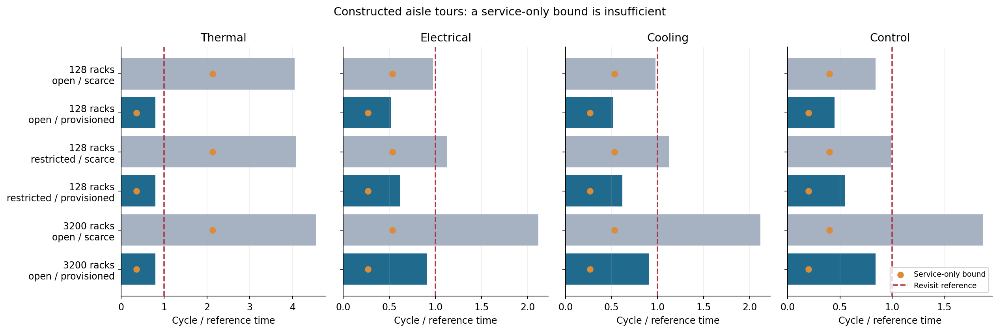
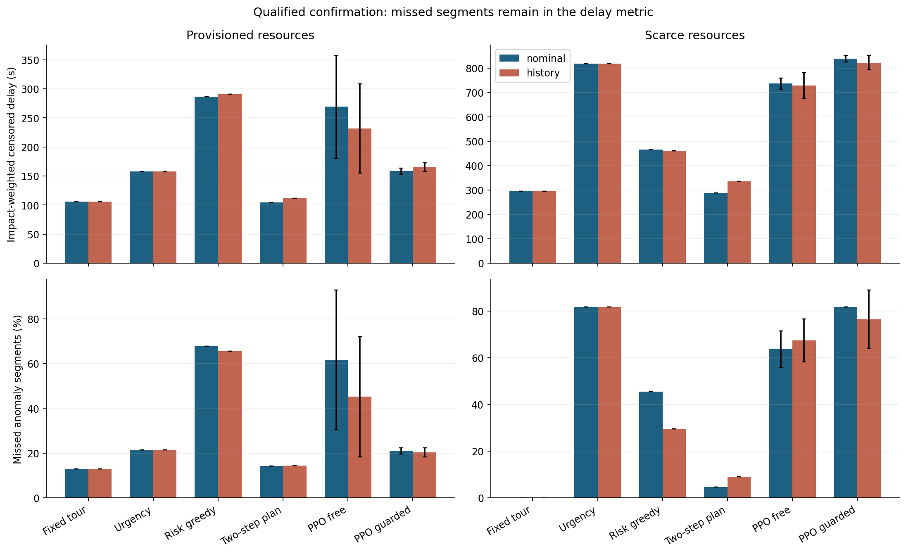
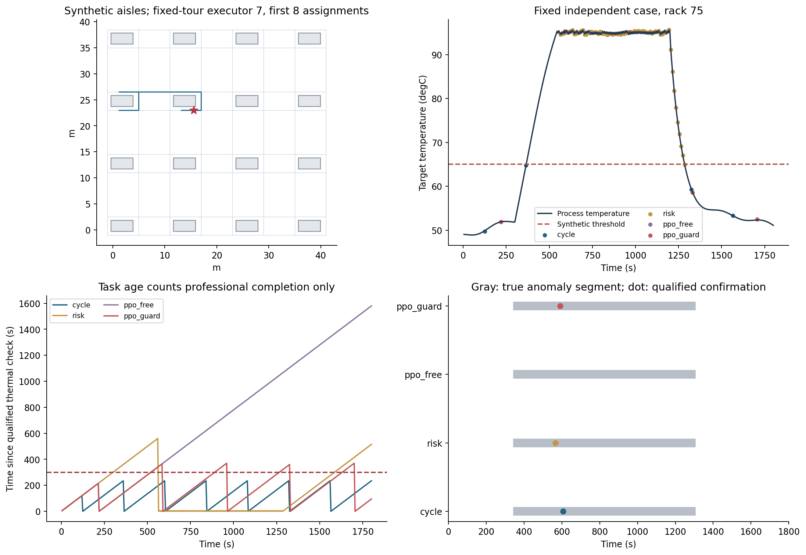
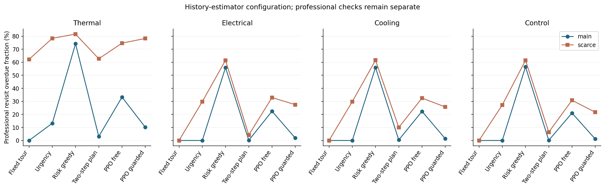

# M11：先保住覆盖，再主动补查短时异常

已完成M10复核、资源修订、六个正式策略训练、1,136条闭环测试和独立全量重放。四张图已逐张检查，本地源与交付统计核验通过。**这轮PPO的主要漏检与重访指标没有优于可行的固定巡回；年龄守卫能减轻部分漏检，但不能代替资源可行性和可靠的覆盖机制。**

这使研究问题更具体：在有覆盖兜底的条件下，如何利用观测、历史和空余巡检能力，更早确认短时异常？单纯把路线选择换成PPO，还不足以构成方法贡献。

## 上一步复核和本轮实际工作

M10本地归档、传输与统计再次核对；Slurm129931重新生成598条序列，读取六份实际估计权重、重放215,280步及27,924,480个先验预测值，结果与M10原审计完全一致。M10的原始结果保留，见[M10复审](M10复审.json)。

M11实现机柜外检查通道、图最短路、四类专业资格、路程与服务时间、任务预留，以及真正完成后的参考测量。两种估计工具均保留：名义物理模型，和按M10验证成绩固定选择的历史CVAE。新的共享任务评分PPO另行训练，没有修改估计器权重。

## 服务时间够，不代表路线来得及

热任务每次服务10s、参考重访300s；电气／制冷每次20s、自控15s，参考重访600s。移动速度1m/s，按5s格执行。这些是仿真压力条件，不是现场制度或人员配置建议。

初版8名热执行者的构造巡回最长325s，超过300s；GW原编号分区还会跨越布局换行。于是先做纯几何与服务审计，改成空间连续分区，并选三种候选中人数最少且构造巡回通过的一档：128柜配置12热＋其余各2，共18名执行者；GW同比450名。

| 条件 | 热执行者 | 热服务占用／可用工时 | 最长构造热巡回 | 结论 |
|---|---:|---:|---:|---|
| 128柜紧缺档 | 2 | 213.3% | 1215s | 仅服务时间就不可能满足300s重访 |
| 128柜配置档 | 12 | 35.6% | 240s | 存在这条构造巡回的周期证据 |
| 3,200柜紧缺档 | 50 | 213.3% | 1365s | 仍然资源不足 |
| 3,200柜配置档 | 300 | 35.6% | 240s | 热巡回通过，其他专业也在600s内 |

证据对应固定区域、起点和构造路线，不代表任意策略都能守约。图中还保留关闭部分跨pod通道的条件；没有模拟执行者碰撞或排队。

初版源、开发记录及六次过渡训练均保留；正式结果只用资源修订后的六次等预算重训。资源修改发生在正式测试前，依据是路线周期，没有按测试分数选人手。

## 实验怎样比较

正式六模型：名义／历史估计各三个配对初始化，单模型固定48个1800s episode、每episode四轮PPO更新。每12个episode仅按四条固定验证案例的公共奖励选权重，未以测试漏检率选模。

独立测试共1,136条：主配置720条、紧缺档240条、通道变化80条、GW补充96条。不同方法共享过程、传感噪声、资格和时间预算；派单改变后续专业测量，这是主动巡检闭环。主实验两个模拟种子，GW只使用预先指定的策略训练seed0，不把大量交叉条件当成同等数量的独立模型重复。

对照为固定巡回、重访紧迫度、风险贪心、两步滚动打分规划，以及同权重的PPO无守卫／有年龄守卫。守卫在“当前年龄＋完成成本”接近参考周期时优先最紧迫任务，是启发式筛选，没有形式化时限保证。

## 配置档：固定巡回仍是强基线

以下为历史估计条件，异常漏检先在各策略训练种子中合并事件，再取三个种子均值；规则只运行一组确定性选择。完整种子与专业分层保留在证据中。

| 方法 | 异常段漏检率 | 专业任务平均超期率 | 期末专业检查覆盖 |
|---|---:|---:|---:|
| 固定巡回 | 13.01% | 0.00% | 100.00% |
| 重访紧迫度 | 21.37% | 9.58% | 100.00% |
| 风险贪心 | 65.51% | 69.26% | 17.95% |
| 两步滚动规划 | 14.40% | 2.29% | 100.00% |
| PPO移除守卫 | 45.18% | 30.18% | 89.91% |
| PPO带年龄守卫 | 20.33% | 7.80% | 100.00% |

这一配置下，固定路线已经能维持覆盖，不能预设“固定路线必差”。风险贪心容易反复检查已知热点而漏掉其他任务。年龄守卫降低了这轮PPO的平均漏检与超期，但仍落后固定巡回；这不是已证明的学习优势。

历史条件下，三个策略种子的“有守卫减无守卫”漏检率差值分别为−51.22、−26.13、＋2.79个百分点。第三个种子反而更差，平均改善不能写成每个种子都改善，也未据三个种子给出显著性结论。

本轮所有设备、检查点和可通行图事先已知，盲区主要指未及时取得测量或完成检查。未建档设备和未知区域的发现尚不在本轮模型内。这一范围与现场“固定清单漏掉某些设备”的问题需要分别讨论，不能由当前固定巡回结果否定现场经验。

名义估计条件下，带守卫PPO漏检率21.02%、超期率6.51%。历史条件的漏检略低、超期反而更高，不能写成历史估计在所有调度指标上更优。PPO条件还连同各自训练的策略一起变化，估计器自身的作用应结合不变规则组判断。

在主测试／历史条件的全部运行中，固定巡回热任务的最大记录年龄235s，带守卫PPO为520s；风险贪心和移除守卫PPO均出现1800s未检。这里是5s采样时刻的检查年龄最大值，不是三个种子的均值，也不是连续时间的时限证明。其他专业使用600s参考周期，不能将全专业绝对最大值统一与300s比较。

延迟图保留没有发现的异常段，按异常段结束截尾；不只平均成功发现的情况。这里的后果权重由资产重要度和合成超阈幅度组成，不是经济损失或故障概率。

## 覆盖满足，为何仍漏掉异常

为解释固定巡回的13.01%漏检，事后检查了全部36条主测试／历史／巡回记录，没有按分数挑案例。861个异常段按持续时间分组：

| 合成异常持续时间 | 异常段数 | 漏检数 |
|---|---:|---:|
| 15至不足60s | 51 | 37 |
| 60至不足300s | 269 | 75 |
| 至少300s | 541 | 0 |

所有112个漏检段均短于300s。满足重访参考周期并不等于能发现所有短时异常；这轮更有价值的切口是，在覆盖兜底之外增加有信息依据的补查。表格是对这一组模拟结果的解释，没有通过新阈值重新定义原事件。

后续还需核对短时波动的工程意义：本轮标签只表示超过合成阈值，并未证明每个短段都需要现场处置。应先定义可行动异常及其后果，再用新实验评价补查，不事后更改这轮事件来制造更好分数。

图中案例、设备种子和四种方法在正式测试前固定。灰色是真值异常段，点必须来自合格执行者完成服务后的测量；模型提示本身不算已巡检。行走与服务发生在同一1800s预算中。

## 紧缺档：优先级不能创造巡检工时

128柜只有两名热执行者时，固定巡回在所选12个过程条件中没有漏掉已定义异常，但平均专业超期45.25%。这是“一次经过碰上了较长异常”，不是满足持续重访。

同档历史PPO移除守卫的漏检67.42%、超期63.04%；带守卫为76.52%、63.69%。守卫在资源不足时也可能让选择更差，不能把配置档的改善外推到所有预算。

最长未检、专业覆盖、行走／服务时间应与漏检一起读。只报一次覆盖，或只报部分已发现异常的平均延迟，都不足以证明任务完成得好。

## GW补充：先分开两档资源

GW仍指1,000MW供电总预算，额定IT为800MW、3,200柜；六个独立过程条件的最大实际输入580.46MW，没有把设施推到1GW满载。该模型代表汇总并联设施，不代表单条10kV或380V回路承载1GW。

历史估计、预设策略seed0的结果：

| GW执行者资源档／方法 | 异常段漏检率 | 平均超期率 | 期末覆盖 |
|---|---:|---:|---:|
| 配置档450名：固定巡回 | 0.0% | 0.0% | 100.0% |
| 配置档：两步滚动规划 | 0.0% | 1.63% | 100.0% |
| 配置档：PPO带守卫 | 0.0% | 11.87% | 100.0% |
| 紧缺档125名：固定巡回 | 90.0% | 51.37% | 100.0% |
| 紧缺档：两步滚动规划 | 30.0% | 49.68% | 93.18% |
| 紧缺档：PPO带守卫 | 70.0% | 73.37% | 31.56% |

两档混起来会掩盖主要差异。GW只含三种情景、两个过程种子和一个策略种子，结果用于明确条件下的接口与资源迁移检查，不证明一般大型设施性能。

## 当前仍缺什么

本轮电气确认任务仅测连接热；测试主情景没有产生电气热异常段。IT馈线损失即使造成服务缺口，也可能不落入这些异常定义，因此不能据本轮确认率宣称已覆盖供电故障诊断。需要补电压／电流／供电可用性任务和明确故障试验。

四个IT馈线损失过程条件分别产生约294.72或301.49kWh未满足IT需求，却没有任何已定义的任务异常段。这是任务目录缺项的直接证据；相应空值不是成功发现，也不能据此忽略供电后果。

哪些固定遥测能满足检查要求，也需按任务核对；本轮把专业参考测量和遥测提示分开，是合成任务设定。参数、资格与300／600s时限均未现场标定。没有模拟维修，物理服务损失不因检查策略而改变。

## 下一步安排

先做M11.1的可靠调度门槛，再接M12改进器：

1. 用经过验证的巡回作覆盖兜底，学习／规划只在剩余时间允许的范围内插入补查，检验能否保留重访表现。
2. 单列短时异常，比较补查带来的确认收益；同时补齐电气异常与供电可用性任务，核对遥测可替代哪些检查。
3. 加入守卫配规则、无训练网络和无守卫独立训练等对照，分清收益来自规则、先验还是学习；使用全新测试种子和预算，不继续针对本轮测试调参。
4. 可靠底座通过后，再让开源模型提出工具选择、技能和协作流程修改，与固定流程和等预算搜索比较；改进器自身的更新单独评价。

本轮不会因模型名称而宣布创新成立。当前证据支持把“可行覆盖＋短时异常主动补查”作为待验证方向；新颖性还需与具体模型和约束逐项比较。

还需检查奖励设计：当前每次专业测得异常都计奖励，包括同一持续异常的重复复核，未直接区分新发现与重复确认。下一轮可按预先冻结的干预检验其影响，本轮不据此重改奖励或挑选模型。

给导师汇报时可以概括为：“已经把供电、液冷和专业检查放到同一仿真时钟上。首轮调度说明，盲区既可能来自资源不足，也可能来自过度追逐已知热点；人力和路线可行时，固定巡回仍是强对照。下一步研究在保住覆盖的前提下，怎样用历史观测安排短时异常补查，再检验智能体改进流程是否有额外价值。”

## 复核入口

[冻结设计](实验设计.md) · [M10复核与取舍](M10复核与本轮取舍.md) · [代码与方法复核](代码与方法复核.md) · [相关工作定位](相关工作定位.md) · [阶段验收](阶段验收.md)。

- [完整审计](evidence/full-audit.json)：实际读取六个最终策略及固定估计器，重放1,136条闭环／407,824个任务时钟步骤；46个独立过程条件的完整数组及16,560物理步核对通过。
- 逐项独立核对2,865,910次派单及同数完成测量、18,820个异常段记录，并重新计算全部检查年龄、专业超期及截尾指标。这些是各策略重复运行中的仿真记录，不是独立现场样本。
- 从温度重算控制体储能、从源输入与分量重算功率，最大残差约1.60×10⁻⁷kJ和2.76×10⁻¹⁰kW；说明实现内部一致，不替代物理参数标定。
- [原始保存索引](evidence/raw-storage.json)：1,136份完整闭环记录共175.35MB、46份过程数组共172.47MB保留在集群。主交付取回全部紧凑指标、四个完整演示和一份过程NPZ；另外为事后诊断私有读取36条固定巡回记录，全部861事件另存为公开诊断数据。
- [本地核验](evidence/delivery-verification.json)、[最终作业账本](evidence/slurm-final.psv)：四份源归档、92份原始交付文件、全部分组与配对统计通过。四张PNG逐一视觉检查，六份实际最终策略权重私有备份且字节指纹一致。
- [固定巡回事件诊断](evidence/cycle-event-diagnostics.json)、[资源与情景分层](evidence/resource-scenario-diagnostics.json)、[下一阶段任务](下一阶段任务.json)。正式测试129953、完整审计／绘图129954和打包129956均COMPLETED／0:0；原时限内结束，没有执行准备的超时恢复方案。
