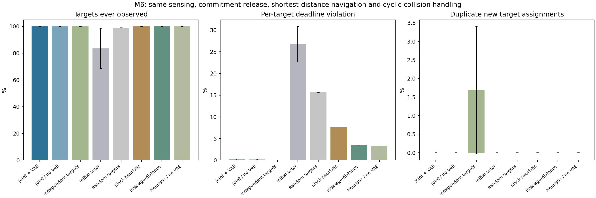
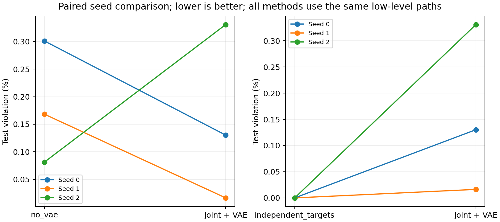
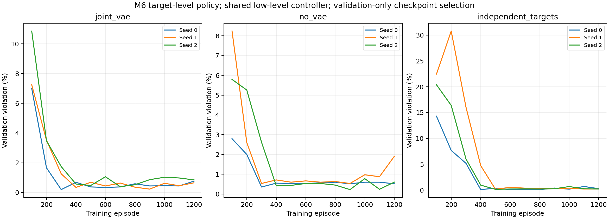
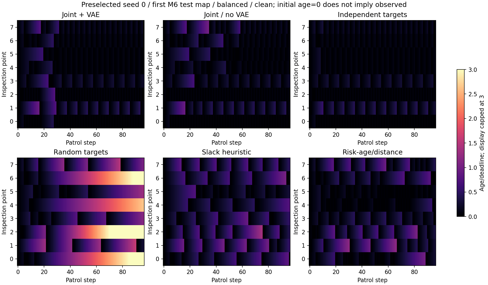

# M6：学习高层检查点分配

M5复核和下一阶段规划均已完成，M6也已完成预定主实验。**在相同低层导航条件下，学习决定“下一处去哪检查”已经优于本次两条简单启发式；VAE的任务增益和显式目标排重的收益仍未证实。** 本阶段不增加RSI或语言模型调用。

## 本次实际改变了什么

M5让网络直接选择栅格移动方向，效果仍明显落后于规划。M6让空闲执行者选择检查点，保持目标直到被任一执行者观测；路径与避碰由全部方法共用的人工控制器完成。共享实体MLP读取年龄、时限、已有测量或估计、地图距离、位置和任务承诺，以PPO训练。

这次同时改变了动作层级、表示和训练方法，因此不能把相对M5的改善单独归给PPO、目标分配或某个特征。保留了VAE和多执行者持续巡检背景，但不是原论文DDQN的数值复现。

## 实验完成情况

先复核M5证据；再通过完整测试、CUDA更新和固定场景可学性门槛，才进入主实验。预检只用预定种子0：256回合后，按验证选出的第192回合模型将固定场景覆盖从75%提高到100%、逾期从37.89%降到0%。这是小场景可学性检查，没有用它代替泛化测试。

主实验为3组×3个配对训练种子，各1,200回合、115,200团队微步、3,600次梯度minibatch更新；合计1,036,800微步、32,400次更新。64训练布局、8验证布局、12最终布局互不重复；最终同布局配对两类时限和两档测量噪声，共48条件。每100回合验证，按冻结排序选检查点，之后才运行最终测试。

完整测试现为**66项通过**。9个训练任务及最终审计均`COMPLETED / 0:0`。独立审计验证2,160条方法—场景记录，重放786种不同的场景与选择序列，并从磁盘核对9个实际权重（每个17,666参数）。每次PPO更新前的行为概率误差最大5.73×10⁻⁶，低于门槛2×10⁻⁵。

## 同一低层控制下的主结果

下表是各训练种子先对48条件取平均，再报告3种子均值±样本标准差。逾期的标准差单位为百分点；48条件不算48次独立训练。加权未检越低越好。

| 高层选择方式 | 曾检查覆盖率 | 逾期率 | 真实重要度加权未检 | 同轮重复目标比例 |
|---|---:|---:|---:|---:|
| 联合选择＋VAE学习 | 100% | **0.159% ± 0.159** | 0.1039 ± 0.0180 | 0% |
| 联合选择、无VAE学习 | 100% | 0.184% ± 0.111 | 0.1065 ± 0.0231 | 0% |
| 允许本轮重复目标的学习 | 100% | **0% ± 0** | **0.0886 ± 0.0017** | 1.691% ± 1.722 |
| 相同结构、未训练网络 | 83.59% ± 15.00 | 26.780% ± 4.072 | 0.4869 ± 0.0737 | 0% |
| 随机目标 | 98.96% | 15.685% | 0.4261 | 0% |
| 截止裕度启发式 | 100% | 7.693% | 0.4228 | 0% |
| 重要度年龄／距离启发式 | 100% | 3.518% | 0.1904 | 0% |
| 上一条启发式、无VAE | 100% | 3.301% | 0.1913 | 0% |

后三条规则及随机目标在相同数据和固定评价随机数下，不随训练种子变化，故不重复列0标准差。两个启发式是明确给定的简单规则；截止裕度使用与网络相同、在4处截断的年龄比，并非最优调度器。超过这些对照不等于超过通用规划方法或文献最优结果。

覆盖表示96步内至少检查过一次；逾期表示各步各目标的年龄超过其重访时限的比例。100%覆盖不等于始终满足时限，测试中零逾期也不构成硬约束保证。加权未检使用仿真真值，仅用于评价；训练奖励和策略输入只使用公开信息。

## 两个关键消融没有得到预期的完整支持

| 种子 | 联合＋VAE选中回合／逾期率 | 无VAE选中回合／逾期率 | 允许重复选中回合／逾期率 |
|---|---|---|---|
| 0 | 300／0.1302% | 300／0.3011% | 400／0% |
| 1 | 900／0.0163% | 300／0.1682% | 500／0% |
| 2 | 700／0.3309% | 900／0.0814% | 500／0% |

**VAE：估计更准，但任务收益较小且不稳定。** 完整组相对无VAE组，逾期均值只低0.0244个百分点，同种子两胜一负。前24步估计MSE为0.01548，无VAE为0.03630；全程为0.004157和0.009360。不能把预测误差改善直接写成巡检任务收益，更不能凭3种子声称显著优越。

**显式排重：本次没有显示收益。** 允许重复目标组仍共享团队状态、集中价值和既有任务承诺掩码，只移除“本轮新目标排重”。它平均出现1.69%的重复分配，但任务指标更好。联合组重复率为0首先由规则保证；当前结果不支持把该规则称为有效创新，也不能解释成“协作训练无效”。

## 曲线、时限与噪声

验证曲线保留全部三个种子及完整1,200回合，没有只画最好模型。选中回合来自验证排序，不能从最终测试选择较好回合。

| 方法 | balanced逾期率 | tight逾期率 |
|---|---:|---:|
| 联合＋VAE学习 | 0.0796% | 0.2387% |
| 无VAE学习 | 0.0723% | 0.2948% |
| 允许重复目标学习 | 0% | 0% |
| 重要度年龄／距离启发式 | 2.0454% | 4.9913% |

同地图、同状态场的0与0.03噪声配对中，联合＋VAE和允许重复组的逾期均值未变，无VAE组增加0.00543个百分点。这仅覆盖静态场和小幅噪声，不据此声称普遍鲁棒。

联合＋VAE、无VAE、允许重复组的“每场最大年龄”的平均值分别11.97、12.64、10.22步。三个组所有测试条件中出现过的最长年龄分别31、31、20步。下图固定为种子0、第一个测试布局、balanced无噪条件，没有按效果挑图；初始年龄0不代表已经观测。

## 成本和适用范围

每任务单张V100S 32GB，训练加验证平均耗时：联合＋VAE22.43分钟、无VAE15.82分钟、允许重复21.61分钟；之后完整评价分别约164、88、157秒。这些是已记录运行时间，受并发和节点负载影响，不是严格性能基准，也不包含M1的VAE预训练成本。

三组每场总移动距离约492.66、492.73、495.01格距；96步预算相同。VAE组每微步调用一次估计器，无VAE不调用。分配次数不等于完成检查次数，因为目标可能被其他执行者顺路观测而释放。完整成本、峰值、调用数与分配数见[汇总JSON](evidence/report/aggregate.json)及[补充统计](evidence/report/supplemental.json)。

当前仍是24×24、8检查点、4执行者的相近机柜布局族，重要度为静态合成归一化场。观测进入半径即完成，无额外检查时长；不是真实温度、故障概率或异常发现实验。策略和价值使用全队公开状态，未验证通信受限的去中心化协作。共同最短路、周期避碰、承诺与掩码均为人工规则，低层路径能力应归于控制器。

## 下一步的研究判断

内层学习已经值得继续验证，但当前任务接近零逾期，且无VAE及允许重复组都很强，直接接回RSI难以区分改进来源。建议下一轮按以下顺序冻结方案，再运行新实验：

1. **增加有意义的任务压力。** 在全新的布局族、检查点数量及执行者数量上检查适用范围；加入明确的检查时长与同等预算，先评估任务可行性，避免用不可达时限制造失败。动态重要度需要同步定义观测刷新与历史失效。
2. **检查VAE为何有用或无用。** 保留无VAE从头训练，加测量保持、简单预测器等相同观测预算对照，区分早期未知估计和持续动态预测；同时记录任务收益和估计成本。
3. **检查协作收益。** 明确区分显式排重、共享团队信息与协同训练，再做单因素消融；补充更强的联合分配或滚动规划对照，保持共同低层控制和计算预算披露。
4. **再决定RSI入口。** 只有在独立新任务上存在稳定、可改进的内层差距，才让固定开源语言模型修改技能或工具流程；继续设置人工规则、等预算搜索及固定改进器对照。

这些是后续方案，未伪称已启动新的训练批次。用户本轮要求的“先review、计划并开启下一阶段”已落实为M5复核、M6冻结设计、实现、门槛与完整主实验。

## 证据与复现入口

- [M5复核和M6规划](M5复核与下一阶段规划.md)、[冻结设计](实验设计.md)、[实现复核](代码与方法复核.md)、[阶段验收](阶段验收.md)。
- [最终Slurm账本](evidence/slurm-outcomes-final.psv)、[压缩存储后使用修复代码的全链审计](evidence/post-storage-atomic-audit.json)、[实际权重审计](evidence/selected-weight-audit-v2.json)。
- 三组各三个`summary.json.gz`保留完整事件、位置、年龄和指标；[存储清单](evidence/evidence-storage-manifest.json)提供压缩前后SHA-256，可精确恢复原JSON字节。
- 正式训练绑定`source_manifest_v1.json`；原子接口修复及66测试绑定`source_manifest_v2_atomic.json`。修复只改变非法输入拒绝时的副作用，合法轨迹和参数复验一致。
- 首次打包129830因计算节点不能查询记账服务而失败，129850读取登录节点账本后完成。失败日志保留；没有因此重训、延长训练或重选模型。

PPO更新形式参考[Schulman等，2017](https://arxiv.org/abs/1707.06347)，仅作方法来源，不声称复现其基准或获得收敛保证。
