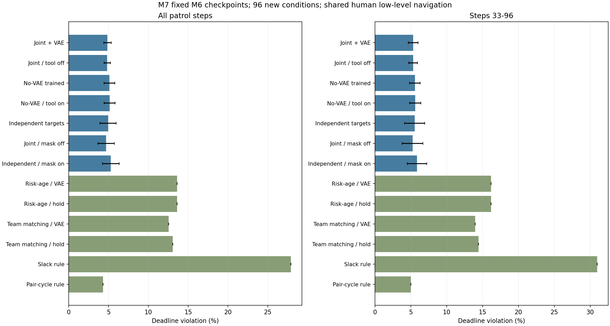
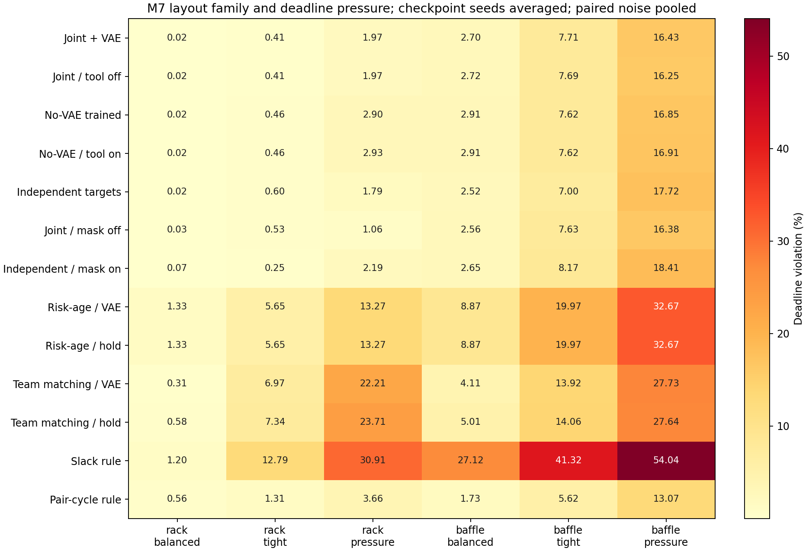
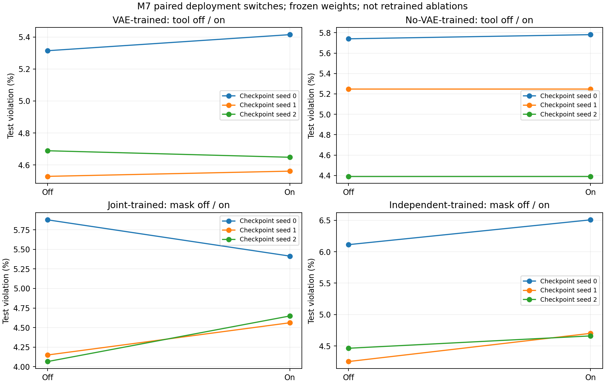
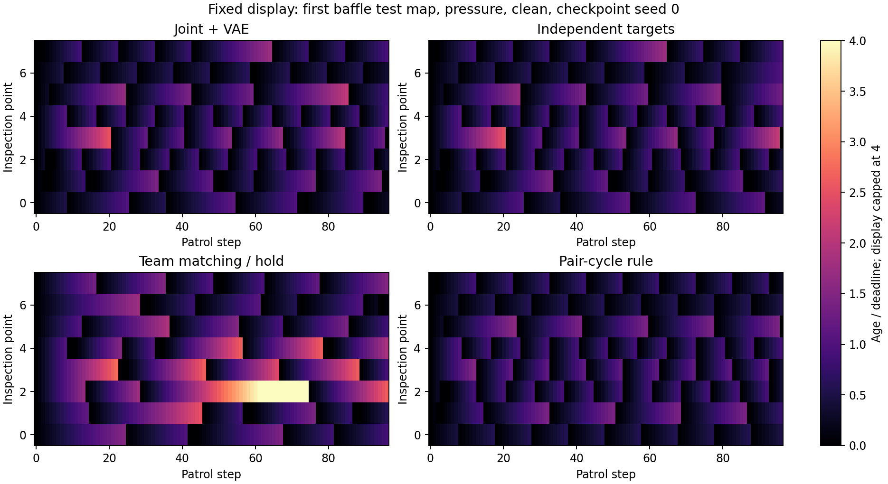

# M7：固定权重的压力迁移与规划比较

M6已复核，M7已完成。**学习策略在相近机柜布局上仍优于本轮规划规则，但迁移到交错通道后落后于成对巡回；VAE与显式排重仍没有稳定的独立任务收益。** 下一轮应优先验证新布局训练和团队表示，再决定RSI入口。

## M6复核新增的发现

原66项测试、9个训练任务、权重与数值均经复核；Slurm129853重新重放M6全链，结果与原审计相同。另发现一个研究设计限制：静态场中，所有已测值永久覆盖VAE预测。完整组平均第10.625步已看完全部目标，后续88.93%的决策步中，VAE不再影响检查点的估计。

这解释了为什么预测MSE改善没有稳定转成任务收益，但不能由此否定早期预测或训练期间的间接作用。详细证据见[M6复核与M7规划](M6复核与M7规划.md)、[逐场窗口统计](M6复核证据.json)及[M6交付复核](M6交付复核.json)。

## 本阶段实际做了什么

固定M6全部9份检查点，不做梯度更新或重选模型。7种学习部署设置各使用3个原训练种子，另有6种规划设置，合计27个任务。16个新布局配对3类时限和0／0.03测量噪声，共96条件，得到2,592条方法—条件记录。

`rack`为相近机柜布局，`baffle`为交错通道的布局压力测试。两者仍是24×24、8检查点、4执行者和96步。平均起点到目标路程分别12.44、19.79步；baffle距离特征最高2.23，超出原训练范围。这是冻结模型迁移，不是适应该环境后重新训练的结果。

共同感知、任务承诺、低层最短距离控制与周期避碰保持一致。新增的测量噪声按位置和时刻配对，不依赖之前采样数量。所有方法从同一公开来源取信息，但规划器显式计算全点间距离，学习网络仍用原14特征和压缩的团队摘要；表示与计算能力并不相同。

完整**74项测试通过，无跳过**；4个开发布局的13设置均通过运行门槛，之后才提交最终任务。27任务全部正常结束。独立CPU审计重放全部2,592条记录、1,930种不同控制序列，核对物理轨迹、公开奖励、估计误差与55,296次规划选择。所有学习部署另从磁盘新读同一权重重放首场景。

## 主结果

下表先对每个原训练种子的96条件平均，再列3检查点种子均值±样本标准差，逾期单位为%，标准差单位为百分点。规划规则只有一个确定性设置，不把布局数当成独立训练次数。全部条件的曾检查覆盖率均为100%，但重访仍有逾期。

| 设置 | 逾期率 | 第33–96步逾期率 | 真实重要度加权未检 |
|---|---:|---:|---:|
| 联合训练＋VAE，原部署 | **4.875 ± 0.470** | 5.333 | 0.2120 |
| 同一权重，关闭VAE | 4.844 ± 0.415 | 5.336 | 0.2118 |
| 无VAE训练，原部署 | 5.126 ± 0.682 | 5.566 | 0.2203 |
| 同一无VAE权重，开启VAE | 5.140 ± 0.701 | 5.608 | 0.2212 |
| 允许重复目标训练，原部署 | 4.943 ± 1.019 | 5.548 | 0.2149 |
| 联合训练，同一权重关闭本轮排重 | 4.697 ± 1.024 | 5.245 | 0.2068 |
| 允许重复训练，同一权重开启排重 | 5.290 ± 1.055 | 5.865 | 0.2172 |
| 重要度年龄／距离＋VAE | 13.627 | 16.180 | 0.3103 |
| 同一规则，测量保持 | 13.627 | 16.180 | 0.3103 |
| 全队到达收益匹配＋VAE | 12.542 | 13.959 | 0.3867 |
| 同一匹配，测量保持 | 13.057 | 14.451 | 0.3914 |
| 截止裕度规则 | 27.897 | 30.965 | 0.5051 |
| 成对巡回规则 | **4.324** | **4.995** | 0.2161 |

成对巡回在总体逾期均值上更低，完整学习组的加权未检略低，不能把某一个指标概括成全面胜出。全队匹配仅对24步窗口中的一次加性代理目标穷举最优，实际持续巡检仍较差；更完整的组合搜索并不自动带来更好任务表现。两个新规则都不是最优巡检或文献SOTA。

## 布局迁移暴露了差距

| 布局族与时限 | 完整学习组 | 允许重复训练组 | 成对巡回 |
|---|---:|---:|---:|
| rack／balanced | 0.022% | 0.024% | 0.562% |
| rack／tight | 0.412% | 0.602% | 1.310% |
| rack／pressure | 1.969% | 1.790% | 3.662% |
| baffle／balanced | 2.702% | 2.517% | 1.725% |
| baffle／tight | 7.715% | 7.004% | 5.615% |
| baffle／pressure | 16.428% | 17.719% | 13.070% |

完整组在rack三档时限平均逾期0.801%，成对巡回1.845%；baffle分别8.948%与6.803%。学习在相近布局上仍有价值，但新通道几何和更长距离削弱了它的表现。该比较同时包含表示限制与分布外迁移，不能单独归因于PPO。

96条件中有48个条件被至少一个已测方法实现全覆盖零逾期，构成这些有限场景的可行见证。另有4个条件的启动逾期下界大于0，最大为0.2604%；该下界仅考虑首次可能到达前的不可避免逾期。其余未找到零逾期方案的条件，仍标为完整任务可行性未知。后期逾期依然存在，不能将所有误差归为启动过程。

完整学习组最差单条件逾期32.03%、最长年龄43步；成对巡回为18.62%、33步。总体均值会掩盖这些场景，原始逐场数据全部保留。

## 工具与排重的交叉开关

| 固定权重内的切换 | 逾期变化均值 | 三个原训练种子的方向 |
|---|---:|---|
| VAE训练：部署关闭→开启VAE | +0.0307个百分点 | 两次变差、一次改善 |
| 无VAE训练：部署关闭→开启VAE | +0.0136个百分点 | 一次变差、两次不变 |
| 联合训练：部署关闭→开启排重 | +0.1772个百分点 | 一次改善、两次变差 |
| 允许重复训练：部署关闭→开启排重 | +0.3468个百分点 | 三次都变差 |

VAE部署仍改善估计：完整组全程MSE为0.003704，同权重关工具为0.009740；但逾期几乎不受益。无VAE从头训练组与VAE从头训练组的比较，也仍是两胜一负。M7支持“预测改善不等于任务改善”，不支持VAE没有任何作用或已经产生稳定贡献。

排重关闭时，两个允许重复的部署设置重复分配比例约3.10%；开启时由规则保证为0。部分重复可能可被共同感知和低层分散消化，当前结果没有证明强制本轮目标唯一能提升任务。已有承诺排重、团队价值和公开信息仍然存在，不能把该对照解释成完全取消协作。

## 时间与能力边界

在本轮V100S分配环境中，完整组平均每96步回合耗时约0.954秒，其中估计0.316秒、目标选择及特征准备0.533秒；同权重关VAE约0.638秒。成对巡回约0.166秒，选择及分区准备约0.069秒。它平均1.77%的分配使用跨点对后备，不能称严格固定路线。时间受设备与并发负载影响，回合统计不含环境构建／地图缓存，不作严格实时基准。

所有方法使用相同96步和传感预算，但计算量、估计调用和表示不同。全部VAE部署每微步调用一次估计器，非VAE部署不调用。首个全覆盖时间在本轮没有删失案例；代码中的97仅是未覆盖时的删失标记，不代表实际到达时间。

下图固定展示首个baffle最终布局、pressure无噪、种子0；颜色为检查年龄／目标时限，显示上限4。初始年龄0不表示已观测，示例不能代替全部条件统计。

场仍是静态合成重要度，没有检查服务时长、动态热异常、通信延迟、真实传感数据或新的RSI。三个检查点种子均来自M6，没有新增训练样本量；结果只作描述性比较，不宣称统计显著或新论文创新已成立。

## 后续实验安排

1. **优先做新布局内的从头训练和表示对照。** 在全新划分上保持PPO、奖励和共同低层一致，比较现14特征与更完整的点间距离／团队状态表示；保留成对巡回及当前强对照，区分“没有见过布局”与“表示不足”。不能反过来用M7最终布局训练后继续称其为测试集。
2. **估计问题独立设计。** 需要持续未知的重要度才适合检验状态估计价值。动态场应同步定义历史失效和新观测刷新，比较测量保持、简单时序预测及可训练时序模型；已有静态VAE先作为迁移对照，不能假定其已能预测动态热风险。
3. **协作按信息、训练和部署规则分开。** 本轮只检验本轮排重；后续再单因素比较团队状态与训练结构，并保留重复率之外的任务指标。
4. **RSI继续等待独立改进空间。** 先确认新任务上的学习缺口及可用工具，再让固定开源模型修改技能与流程，并采用等预算搜索和固定改进器对照。

本轮用户要求的“M6 review、计划并开始下一流程”已落实为M6复核与完整M7实验。上述后续安排尚未提交新训练。

## 证据入口

- [冻结设计](实验设计.md)、[实现复核](代码与方法复核.md)、[阶段验收](阶段验收.md)。
- [最终Slurm终态](evidence/slurm-outcomes-final.psv)：129853复核、129855门槛、129856数组、129878审计绘图、129884打包。
- [全链审计](evidence/full-chain-audit.json)、[本地传输与统计复核](evidence/delivery-verification.json)、[汇总JSON](evidence/report/aggregate.json)。
- 27个`summary.json.gz`保留完整选择、估计、事件、位置和年龄；每份同时提供压缩及原JSON字节SHA-256。固定权重指纹见[frozen_m6_weights.json](frozen_m6_weights.json)。
