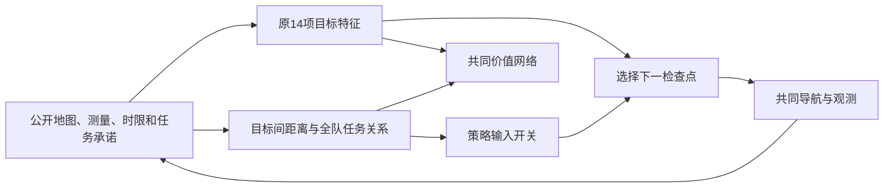

# M8实现与方法复核

本阶段的actor指“选择下一个检查点的策略网络”，critic指“估计当前团队状态长期表现的价值网络”。比较重点是策略能看到哪些公开信息。

## 对M7的review

本地重新核对M7当前源指纹、162份传输文件及2,592条记录的全部分层／交叉汇总，一致。Slurm129885重新运行完整物理与规划审计，与M7原审计相同。未发现推翻M7既有数值的错误。

M7只研究冻结权重迁移，无法区分未见训练分布与演员信息压缩。M8按因子设计继续研究，不把更换表示或混合布局训练预设为有效，也不沿用M7测试图训练后继续称其为测试。

## 状态与网络

新增关系状态继承M7公共环境，未修改旧源文件。点—点关系由公开最短路、年龄、时限、估计和承诺构造；团队关系由公开位置、路程和目标承诺构造。隐藏真值改变时，全部状态数组保持一致。

所有四组使用22,594个参数和相同初始化；local只在演员关系编码后置零，价值网络仍接收同一完整公开状态。该对照控制拓扑和总参数量，但演员可用特征及其梯度路径本来就不同，不能称所有有效演员参数或优化过程完全相同。双方都仍有原14通道中的最近其他执行者距离和承诺摘要，不是有／无协作的对比。

这里“完整公开状态”特指共同的全队实体及两类关系输入，而非原始地图和历史的无损表示。年龄仍截断、信息仍汇聚、未知值仍是预测；不能据此称已得到完全可观测的真实状态。

集合汇聚排除自身检查点，团队集合包含标记过的本执行者。测试验证目标重排后的评分等变、团队集合换序不变。该性质只测试既定8点4执行者，不推断已验证任意规模泛化。原距离特征仍除22，新关系距离除48，属于这项表示组合的一部分，不把效果单独归于某一距离通道。

联合选择按同一周期顺序逐个执行。每次新选择后更新目标保留掩码，以及全队看到的新承诺距离与标记。采样和PPO回放调用同一条件过程，全部更新前重算行为概率；忙执行者选择−1，不贡献log概率。GAE复用已经验证的回合终止实现，不跨96步任务传播。

VAE预测继续使用独立随机上下文，训练布局／时限由独立NumPy随机数生成器调度。各组同种子的初始参数及地图索引、场和时限调度必须一致；训练分布仅按冻结表映射不同家族。验证前后保存恢复策略随机状态。

## 对照和解释范围

共同价值网络、VAE、公开奖励、PPO、联合目标排重、移动与观测均固定。rack组也用同一含baffle的验证集选检查点，不能称完全未接触baffle评价的零样本迁移。

训练4组×3种子，每组1,200回合；主因子比较只在M8相同最终条件内进行。M8与M6网络结构不同，即使两个阶段同叫local，也不作单因素跨阶段比较。

共有349张旧阶段公开地图与M8的117张公开地图检查几何指纹，未重复，新图均连通。M8各组训练表都64张，但mixed替换了其中32张地图；分布效应不等于对完全相同样本加入一个二元标签。

去重采用“导航掩码＋检查点掩码”的联合指纹。另查导航掩码单独重用：rack最终8例均未重用训练墙体；baffle训练32例只有9种墙体，最终8例的墙体均在mixed训练中出现，但检查点联合实例不同，见`geometry-scope.json`。因此M8的baffle结果是同结构家族中新巡检实例的表现，不证明未见墙体拓扑泛化。冻结划分和算法未因此更换，结果将按该范围报告。

## 已完成运行门槛

Slurm129886通过82项完整测试，无跳过，两种演员模式各完成4回合真实CUDA更新和12次梯度minibatch，并从磁盘新读选中权重重放。实际设备为V100S 32GB。

129887两成员按预定种子0和固定baffle场景进行256回合可学性检查。门槛只判断冻结排序下是否严格优于初始，不能据此认定新布局泛化或论文贡献。

两项预检均已按冻结门槛完成：local初始逾期29.17%、选中32回合10.16%；relation初始26.82%、选中32回合14.32%，各256回合和768次梯度更新，最终测试为空，重放一致。正式12任务129889在门槛后提交，129890公共规划评价也在方法固定后完成，129897等待两者终态后作独立审计。

测试访问按各方法自身冻结状态理解：六个规划规则在训练开始前已经固定，因此可先计算其测试结果；结果不用于修改正在训练的模型、超参数或选择标准。每个学习任务仍只用验证选权重，然后运行自己的测试。没有声称全部12个模型选完之前整个工程从未计算任何测试场。

12个正式训练任务已全部COMPLETED／0:0；129897完成2,880条记录、1,693种不同公开控制序列重放。另实际读取12份检查点，验证参数／元数据及首个测试条件在CPU上的1,152次微步选择，与原记录一致。该CPU审计使用记录的公开VAE输出，不重新生成未观测点的预测；原训练任务另有完整估计调用的新读GPU首场景复验。

最终结果后补做尾部检查：混合／关系在一个时限16的目标上出现92步未重访。`scripts/diagnose_m8_tail.py`定位该原始记录，并复现年龄饱和后输入与代价无法区分的人工反例；这不是已证实的唯一失败原因，也不是新增主实验。当前不具备硬重访约束保证。

143份原始交付文件及16份实际权重（12正式、4预检／冒烟）的本地指纹通过核验，全部分层均值、样本标准差、配对因子与交互重新计算一致。四张PNG逐一视觉检查；SVG仅移除行尾空白并验证XML内容一致，原传输字节在归档保留。打包期间日志和终态完成日志分别保留。
