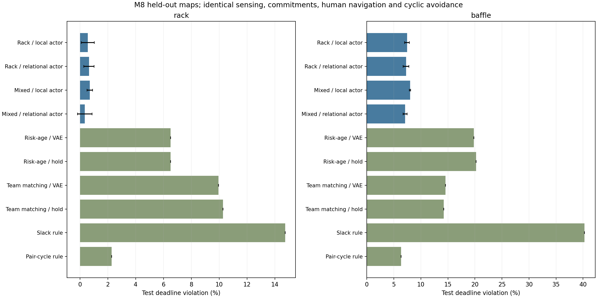
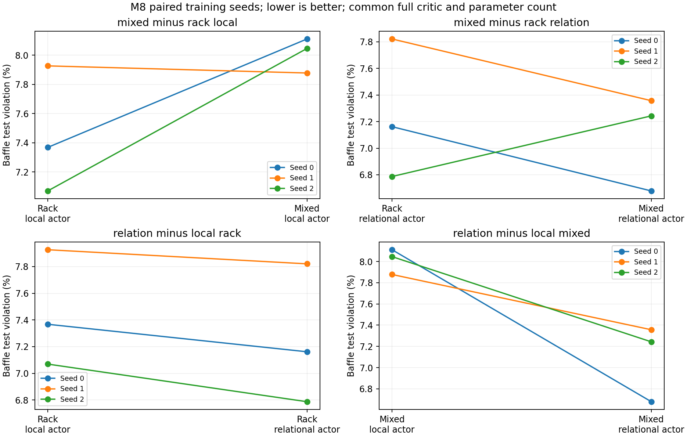
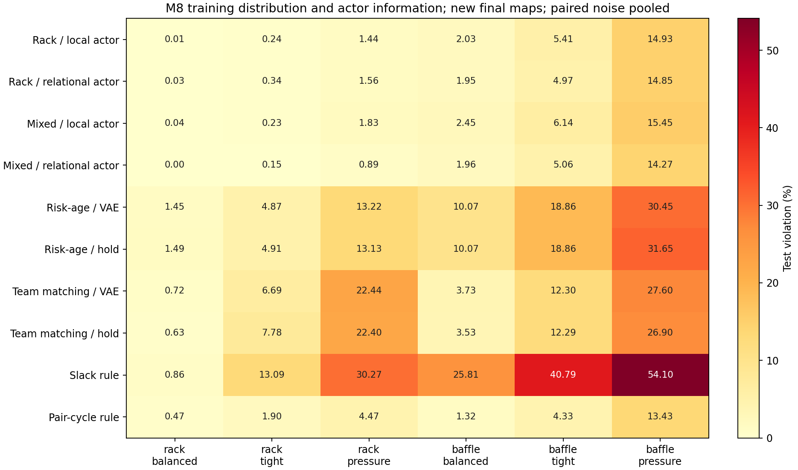
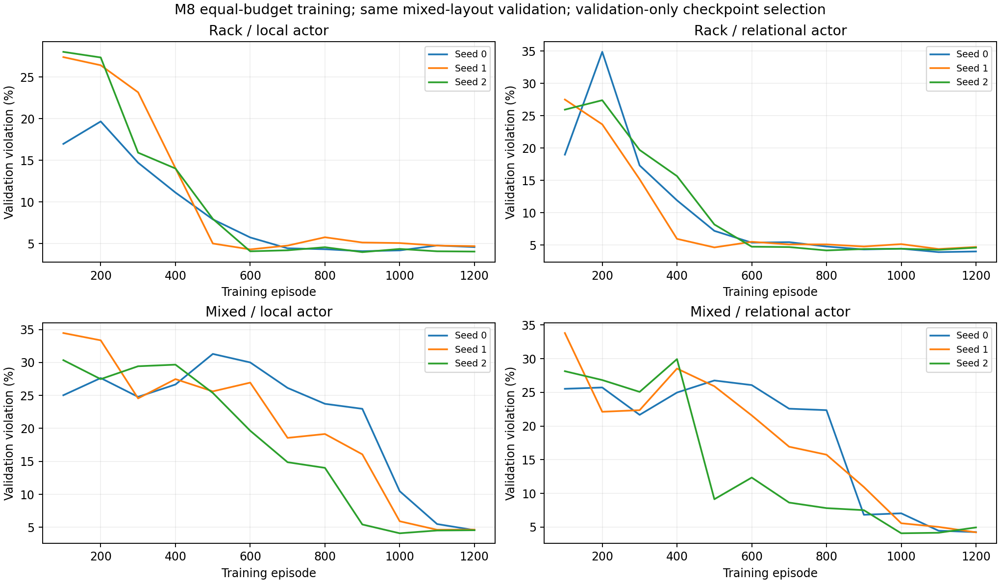

# M8：从头训练与关系输入的因子比较

M7已复核，M8完整实验已完成。**混合布局训练中，加入公开关系信息使三个配对种子的平均逾期都下降；单独扩大训练布局没有稳定收益。复杂通道上仍落后于成对巡回，而且出现92步未重访，下一步应优先处理长期漏检。**

82项完整测试通过，12个正式训练任务和公共规划任务全部成功结束。2,880条测试记录、实际权重、独立轨迹与本地统计均已核对；没有新增语言模型或RSI调用。

## M7 review和本轮问题

M7的文件指纹、统计和完整物理／规划复审与原结果相同。其主要限制是冻结权重迁移同时混合了训练分布和策略表示，不能从baffle退化单独推断某个学习算法无效。

M8从头训练四组：只在机柜布局训练或在机柜与交错通道混合训练；策略读取原14项目标摘要或再读取公开点间距离及全队任务关系。四组均22,594参数、相同初始化、共同价值网络、VAE、PPO、奖励、联合排重和人工低层导航。比较的是演员可用信息，local仍有团队摘要，并非完全无协作。

关系编码采用共享MLP与集合均值；借鉴来源和使用边界见[文献依据](文献依据.md)。本轮没有实现注意力或Transformer，也不把既有集合编码思路当作创新结论。

## 实验完成与证据

先通过82项无跳过测试、两模式CUDA更新和新读权重重放，再按预定种子0运行两个256回合固定baffle预检。local逾期由29.17%降到10.16%，relation由26.82%降到14.32%，两组最终测试均为空，门槛通过才提交主实验。

主实验四组×三训练种子，各1,200回合、115,200团队微步、3,600次梯度minibatch，共1,382,400微步和43,200次更新。各训练表64张地图，共同验证12条件，最终16张新联合实例配三档时限和两档噪声，共96条件。

每个训练任务评价选中模型与相同初始网络，各96条件；公共任务另运行六个规划设置，合计2,880条。检查点仅按共同验证排序选择。独立审计重放1,693种不同公开控制序列，验证全部记录；实读12份选中权重，并在CPU上核对首场景1,152次微步选择。最大行为概率重算误差4.77×10⁻⁶，低于2×10⁻⁵门槛。

## 主结果

先对每个训练种子的96条件平均，再列三个种子的均值±样本标准差。逾期单位为%，标准差单位为百分点。规划规则为单个确定性设置，地图数不算独立训练次数。所有训练后策略和规划器的曾检查覆盖率均为100%。

| 训练分布／策略输入 | 逾期率 | 第33–96步逾期率 | 真值重要度加权未检 |
|---|---:|---:|---:|
| 机柜／原摘要 | 4.010 ± 0.450 | 4.251 | 0.2074 |
| 机柜／关系信息 | 3.951 ± 0.298 | 4.278 | 0.2051 |
| 混合／原摘要 | 4.357 ± 0.128 | 4.700 | 0.2127 |
| **混合／关系信息** | **3.719 ± 0.374** | **4.065** | **0.1989** |
| 原摘要初始网络 | 33.231 ± 6.382 | 38.877 | 0.5154 |
| 关系输入初始网络 | 32.482 ± 5.902 | 37.868 | 0.5101 |
| 重要度年龄／距离＋VAE | 13.155 | 15.190 | 0.2946 |
| 同规则，测量保持 | 13.353 | 15.397 | 0.2952 |
| 全队到达收益匹配＋VAE | 12.245 | 13.556 | 0.3781 |
| 同匹配，测量保持 | 12.255 | 13.544 | 0.3814 |
| 截止裕度规则 | 27.488 | 30.518 | 0.4915 |
| 成对巡回规则 | 4.320 | 4.716 | 0.2115 |

同输入模式的两个训练分布组具有相同初始权重和初始轨迹，因此初始网络不重复列。它们的覆盖率约92.1%和92.5%，明显低于训练后策略。学习确实改善了本轮内的行为；但M8网络和数据都与M6／M7不同，不能把跨阶段数值差异当作某一模块的增量。

## 两个因素分别带来了什么

下表是同种子、同最终条件的配对变化，负数表示逾期下降。

| 因子切换 | 总体逾期变化 | baffle逾期变化 | 总体三个种子方向 |
|---|---:|---:|---|
| 机柜训练：原摘要→关系信息 | −0.0597个百分点 | −0.1980个百分点 | 两次改善、一次退化 |
| 混合训练：原摘要→关系信息 | **−0.6375个百分点** | **−0.9187个百分点** | **三次均改善** |
| 原摘要：机柜→混合训练 | +0.3463个百分点 | +0.5570个百分点 | 一次改善、两次退化 |
| 关系信息：机柜→混合训练 | −0.2315个百分点 | −0.1637个百分点 | 两次改善、一次退化 |

这支持在当前混合训练条件下继续研究关系输入；不支持单纯增加布局就会改善。关系信息与训练分布的总体交互差值为−0.5778个百分点，三个种子方向相同，仍只是三次训练的描述性证据，没有统计显著性或普遍优势的结论。

| 种子 | 机柜／原摘要：选中回合、逾期 | 机柜／关系：选中回合、逾期 | 混合／原摘要：选中回合、逾期 | 混合／关系：选中回合、逾期 |
|---|---|---|---|---|
| 0 | 900，3.894% | 1100，3.697% | 1200，4.351% | 1200，3.350% |
| 1 | 600，4.507% | 1100，4.279% | 1100，4.232% | 1200，3.708% |
| 2 | 900，3.630% | 800，3.875% | 1000，4.487% | 1000，4.099% |

## 复杂通道仍有差距

| 测试布局／时限 | 机柜／原摘要 | 机柜／关系 | 混合／原摘要 | 混合／关系 | 成对巡回 |
|---|---:|---:|---:|---:|---:|
| rack／balanced | 0.014% | 0.033% | 0.043% | 0% | 0.472% |
| rack／tight | 0.244% | 0.342% | 0.228% | 0.146% | 1.904% |
| rack／pressure | 1.440% | 1.560% | 1.834% | 0.890% | 4.468% |
| baffle／balanced | 2.029% | 1.948% | 2.452% | 1.956% | 1.318% |
| baffle／tight | 5.409% | 4.970% | 6.136% | 5.056% | 4.329% |
| baffle／pressure | 14.925% | 14.852% | 15.446% | 14.266% | 13.428% |

混合／关系在rack平均逾期0.345%，优于成对巡回2.281%；在baffle为7.093%，仍高于成对巡回6.359%。总体平均3.719%优于4.320%，不能据此说复杂布局问题已经解决。

最终96条件中有46个条件被至少一个已测方法实现全覆盖零逾期；8个条件存在正的启动逾期下界，最大0.3906%。下界仅限制首次可能到达之前的逾期，未找到见证的其他条件仍标为完整持续巡检可行性未知。

## 最长92步未重访：当前最重要的缺口

四个训练组在所有最终条件中出现的最长检查年龄分别45、39、73、92步，成对巡回为27步。混合／关系虽然平均最好，仍在种子1、baffle布局44100、balanced无噪条件，让时限16步的一个检查点等待了92步；该场景仍满足“至少检查一次”的100%覆盖。

进一步构造了公开状态反例：目标年龄分别为各时限5倍与8倍时，当前网络输入可以完全相同，对同一动作的公开奖励也相同。原因是年龄比在4处截断、未检程度在1处饱和、逾期只取二值指示。该反例说明极端拖延可能无法继续区分，不证明它是92步案例的唯一原因。证据见[尾部风险诊断](尾部风险诊断.json)。

因此本轮只能支持平均任务指标改善，不能声称满足硬重访时限或消除长期盲点。后期逾期指标也仍非零。

## 完整曲线、成本和估计窗口

混合组很多运行到后期才明显改善；首批与末批曲线全部保留，既不只画最好种子，也不把最后回合自动当最优。预算未根据中途曲线延长。

单张V100S上各组训练加验证平均约31.4–31.8分钟，选中权重后的两方法最终评价及复验约251–255秒；这是已记录的运行时间，包含环境与验证开销，受并发负载影响，不含旧VAE预训练。每组预算相同；实际动作选择和估计时间分别保存在逐场数据中，不能以等巡检步数称所有方法计算量相同。

所有训练组都使用相同固定VAE，本轮没有新的VAE消融。约84.9%–86.5%的决策仍发生在全部目标已测之后，届时目标估计由静态测量覆盖预测。关系输入的收益不能归给VAE；动态状态估计价值仍须单独检验。[补充诊断JSON](evidence/report/diagnostics.json)保留首次覆盖窗口和可行见证。

## 适用范围和下一步

训练／测试通过导航＋检查点联合指纹去重。单独看墙体：rack最终8例均不复用训练墙体；baffle训练32例只有9种墙体，最终8例墙体均在mixed训练中出现，只是检查点联合实例不同。因此本轮不证明未见通道拓扑泛化。rack-only组也用含baffle的共同验证选择检查点，并非完全未接触baffle评价。

当前仍是静态合成重要度、已知地图、半径1自动观测、集中共享信息、固定点数和人工导航；没有服务时长、通信约束、动态温度或真实故障概率。集合编码、PPO或VAE本身都不能直接作为论文创新。

下一轮建议先处理长期漏检，再扩大模型：

1. 固定长时间评价和原始年龄指标，先选有可行见证的条件，区分不可避免逾期与策略拖延；长时间滚动时另明确任务时间特征约定。
2. 分别消融年龄截断和饱和代价，检查是否能减少极端拖延；保持平均任务收益和尾部指标同时报告。
3. 比较受约束训练、显式重访保护及纯规划，记录保护介入比例，把规则收益与学习收益分开。约束方法参考见[后续约束研究参考](后续约束研究参考.md)。
4. 保持VAE动态价值与RSI为独立问题：先定义观测新鲜度和时序预测对照，再评估开源智能体的技能／流程改进。

这些是后续安排，未提交新一批训练。本轮已完成用户要求的上一阶段复核与下一阶段流程，并完成预定M8主实验。

## 证据入口

- [冻结设计](实验设计.md)、[实现复核](代码与方法复核.md)、[运行账本](运行记录.md)、[阶段验收](阶段验收.md)。
- [全链审计](evidence/full-chain-audit.json)、[实际权重CPU复验](evidence/actual-weight-audit.json)、[最终Slurm账本](evidence/slurm-outcomes-final.psv)。
- [汇总和全部曲线JSON](evidence/report/aggregate.json)、[本地交付核对](evidence/delivery-verification.json)。
- 12训练任务各自的`summary.json.gz`以及`common-planners/summary.json.gz`包含完整事件、估计、位置、年龄与指标，压缩和原JSON字节指纹同时提供。模型权重保留在集群和本地私有目录。
