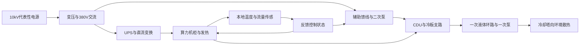
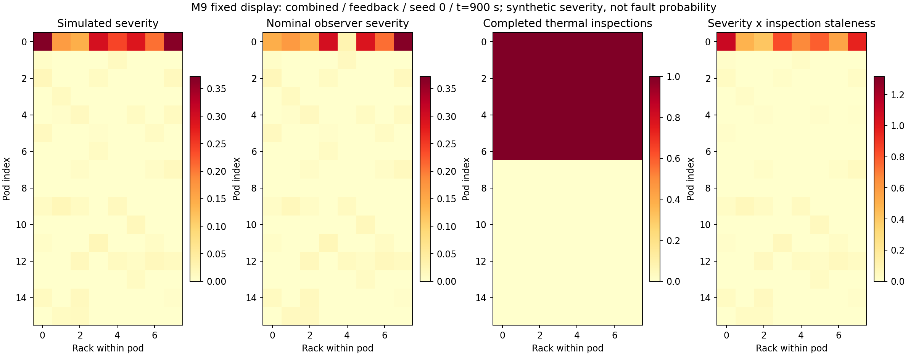
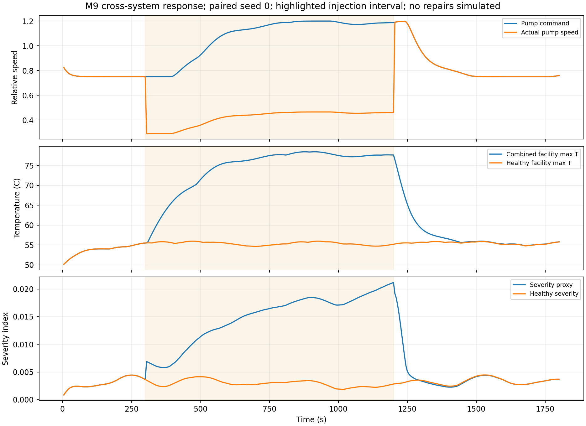
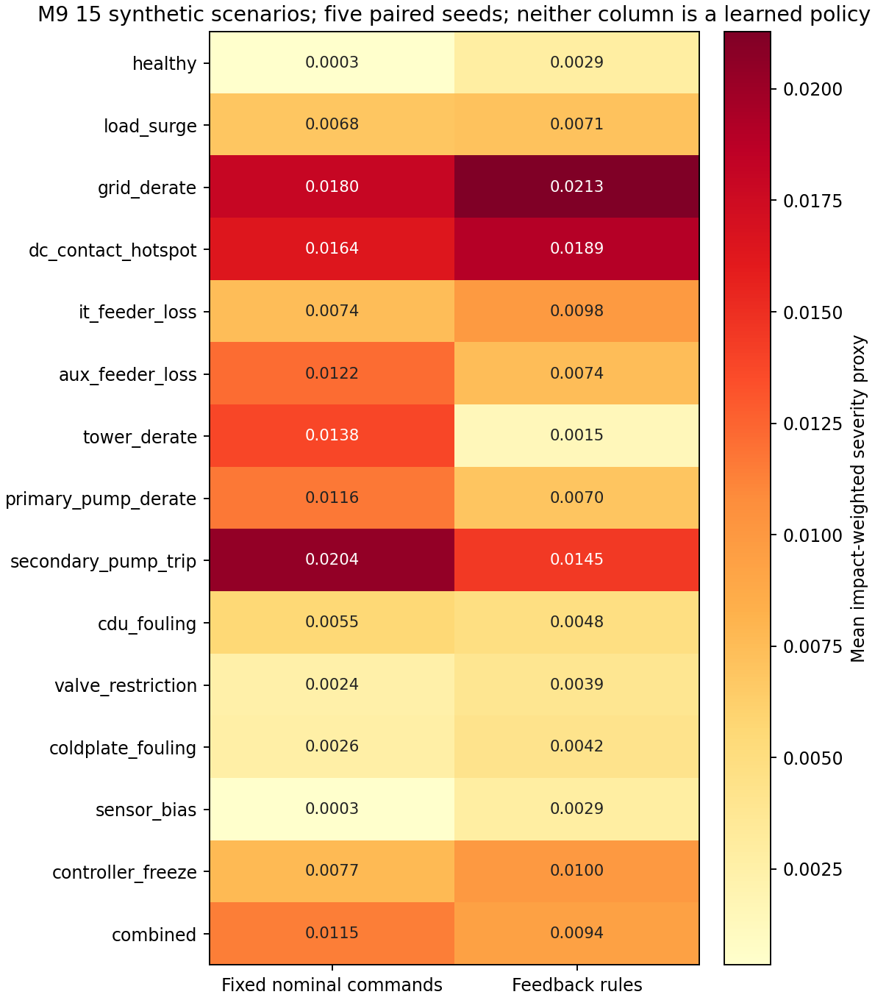
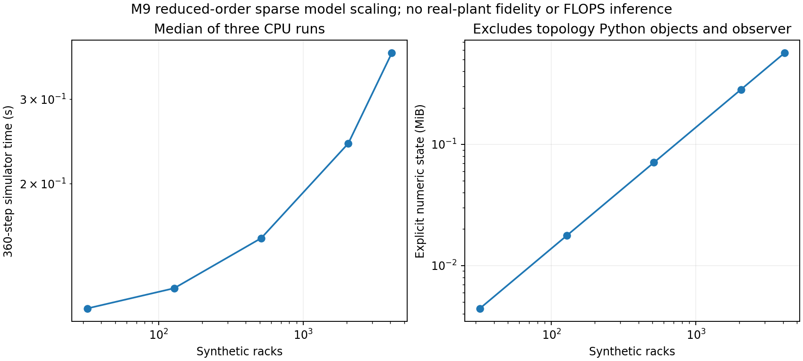

# M9：供电—液冷—自控的领域模型与风险热点

已完成M8复核，并按导师截图及用户JSON参考，完成M9可执行底座：**供电、两回路液冷、自控与检查任务共同进入模型；150条轨迹及全部54,000步数值状态通过重放，94项完整测试通过。** 本轮完成的是领域建模和内部一致性验证，尚未标定真实机房或证明新AI算法优势。

## 对参考建议的处理

采用“先补系统模型，再评价新估计器和调度器”的次序，保留M8原结果。JSON中关于三类系统、动态图、异质任务及分层比较的建议被采纳；立即扩大训练、把合成重要度称故障概率、将G级直接换算成某个性能单位均未采用。详细取舍见[M8复核与建议取舍](M8复核与建议取舍.md)。

用户提供的18页PID报告确认，这里PID是Physics-Informed Diffusion红外重建。报告第10、15、16页区分像素码、采样波动、校准温度与故障诊断。M9将其作为未来辅助观测候选，原报告和JSON全文不进入公共仓库，也没有伪称运行未提供的B-PID模型。

## 当前模型有哪些实际联系

默认128机柜、16pod、额定IT 32MW，拓扑包含516节点、1,188条有类型依赖边。10kV／380V取自截图的代表性范围；直流、效率、热容、阻力、换热和控制参数均为合成假设，不是El Capitan现场参数或国标阈值。

供电模块计算容量分配、变换及电连接损耗；泵曲线与并联支路决定流量；冷板、CDU、两回路液体和环境交换热量。控制器根据本地测温调整泵、塔风机和负载限制，并模拟机柜硬件过温保护。外部估计器只得到稀疏传感、公开遥测和已完成检查的测量，不能读取故障名称或未测真值。

本轮不是全AC潮流、完整水力网络或保护整定模型；电连接的完整热保护、热失控及电弧过程未实现。守恒检查不能替代这些缺失机制或现场校准。

## 核查和固定实验

M8本地源、数据和统计核查通过；Slurm129906重新重放2,880条记录并检查12份实际权重，与原审计相同。

M9先在开发条件通过12项新增物理／观测测试，再在Slurm129909运行94项完整测试，无跳过，以及4条短场景。之后才按冻结方案运行15情景×2控制模式×5个配对合成种子，每条1800s、5s步长。没有按结果更换参数、种子或图示案例。

独立Slurm129911重新运行全部150条轨迹，读取并逐数组比对全部原始NPZ；故障前，同控制／同种子的各反事实场景完全相同。另由原始温度重新计算热储能、由各功率分量检查输入输出，得到最大电功率残差1.46×10⁻¹¹kW、最大单步热量残差1.22×10⁻⁸kJ。两种检查证明实现自洽，不证明参数真实。

## 风险热点图

本轮严重度代理分别记录温度超参考量、电连接过热、服务功率缺口及流量缺口，再按明确的合成权重汇总。它是**无量纲严重度指标，不是故障概率、经济损失或安全许可**。

图预选种子0、combined反馈场景，固定展示900s；每行一个pod、每列其机柜索引，并非现场平面图。第一个故障pod在模型中形成热点，估计图来自透明名义物理状态估计器，不是VAE输出。

第四图为真值严重度乘检查陈旧程度，只供评价。检查是信息更新，没有模拟维修，所以不能把它称为修复后的剩余故障概率。自动遥测的新鲜度和专业检查的完成记录也分别维护。

[离线热点查看页](evidence/report/risk_hotspots.html)可按时间和机柜查看同一组数据及供电、冷却、自控依赖链。其512个单元格、时间切换和机柜选择通过离线脚本测试；浏览器策略阻止了本地预览，实际浏览器布局与响应式外观尚未验证。四张静态PNG均已逐一视觉检查。

## 故障如何传播

图中的300–1200s为注入时段。辅助供电受损后，二次泵实际转速低于控制命令；CDU换热与测温偏差进一步影响局部温升。解除注入后，热惯性使恢复需要时间。

下表为5个配对合成种子各自的情景峰值／积分，再取均值；它们不是实测可靠性样本。完整样本标准差和配对差值见[汇总JSON](evidence/report/aggregate.json)。

| 情景 | 固定命令：峰值柜温均值 | 反馈规则：峰值柜温均值 | 反馈规则未满足IT需求电量 |
|---|---:|---:|---:|
| 无故障 | 54.60°C | 55.87°C | 0kWh |
| 辅助馈线受损 | 92.00°C | 71.78°C | 35.11kWh |
| 冷却塔降额 | 73.43°C | 66.67°C | 4.09kWh |
| 二次泵受损 | 95.56°C | 79.31°C | 112.48kWh |
| CDU换热下降 | 82.68°C | 70.65°C | 24.86kWh |
| 组合情景 | 92.92°C | 78.72°C | 11.35kWh |

反馈控制可以降低部分温升，同时带来负载限制和服务缺口。温度降低不是无成本风险消除；固定命令也不等于优化规划器。

IT馈线受损时，柜温可能下降，但5种子平均未满足IT需求约298.86kWh；因此只看热图会漏掉供电后果。传感偏差情景则几乎不改变物理温度，却使反馈模式下名义估计温度RMSE由无故障约0.19°C升至1.60°C，说明观测异常与过程异常要分开。

综合代理并非每个场景都偏好反馈：无故障、阀受限、冷板下降等案例中，它可高于固定命令。代理权重及流量参考尚未经过专家标定，不能反过来用分数宣称某故障“更安全”。电连接热点模型还产生约151.8°C的峰值均值，这是缺少完整电连接保护及失效机理时的未验证外推，不是设备允许值或现场预测。

## 观测和检查接口

四类执行者分别为热、电气、制冷、自控专业，任务含资格、路程、服务时长和完成条件。固定合格轮巡只是接口演示；没有训练新调度器。带电内部访问被拒绝，图像参考不能完成要求校准测量的任务。实际完成事件和原始时间均保留。

基线分别为测量保持和名义物理传播，两者使用相同外部可用观测；后者还具有本轮名义方程和参数这一先验优势。组合反馈情景中，温度RMSE均值约3.65°C与1.18°C。这不是VAE、B-PID或新方法领先的证据，学习型横向对照将在M10重新冻结。

默认案例最终移动热检查覆盖约85.2%，存在到1800s仍未完成热检查的设备。固定传感和移动测量的联合覆盖约88.3%，不能把“已被某种遥测看过”当作专业检查全部完成。该固定轮巡保留了长期盲区，为后续风险任务分配提供真实接口。

## 规模试验

| 合成机柜数 | pod数 | 节点／边 | 标称IT功率 | 360步仿真中位时间 |
|---:|---:|---:|---:|---:|
| 32 | 4 | 132／300 | 8MW | 0.110s |
| 128 | 16 | 516／1,188 | 32MW | 0.121s |
| 512 | 64 | 2,052／4,740 | 128MW | 0.154s |
| 2,048 | 256 | 8,196／18,948 | 512MW | 0.243s |
| 4,096 | 512 | 16,388／37,892 | 1,024MW | 0.374s |

每档3次CPU运行。时间只覆盖降阶过程模型360步，不含完整观测、检查任务、作图或算法训练；显式数值状态字节数也不含Python拓扑对象和历史数组。进程RSS是累计高水位，不能解释成每档独立内存。

这说明当前稀疏实现可扩展到这些合成规模，不证明真实GW设施精度，更不能从MW推导FLOPS。截图“G级”尚无单位，本轮仅按大型设施复杂度要求处理。

## 原论文、标准和PID如何衔接

[资料与标准核对](资料与标准核对.md)记录原VAE论文的RMSE、加权误差、推理耗时、R²、加权未检及组合消融入口；原文Fig.10是监测密度，不能拿来充当故障风险图。

两项2026液冷国标的官方发布与实施日期已核对，截至2026-10-27仍为即将实施。本文未取得其条款全文，不把合成阈值称国标要求。LLNL的2026介绍用于核对组件与两回路范围，不用于声称复原El Capitan现场。

B-PID后续可提供未校准的红外外观参考和需实测核验的候选区域；它与传感温度、物理状态估计及可靠性概率分开。其模型权重和代码未在本轮执行，接口存在不等于算法已集成。

## 下一阶段安排

M10先明确估计目标：当前设备温度／流量／供电状态或明确的严重度代理，而非未经校准的故障概率。用新种子、未见组合和独立验证冻结数据，分离状态估计与未来预测，再做相同观测序列、预算和硬件下的VAE、GP、rKNN、测量保持、名义模型／简单时序对照。原静态VAE只作迁移对照，需要训练的方法使用新数据训练。

M11再将设备任务和专业资格接到协同调度，比较原摘要、关系信息、人工规则与滚动规划，同时处理长期漏检和服务耗时。M12最后接入受限RSI，固定过程真值和评价，对比固定工作流、等预算搜索、模型提案及改进器更新。

这些是分阶段研究安排；本轮已经完成M9，没有提交M10–M12的新训练，也没有宣称解决多系统风险优化或RSI创新。

## 证据位置

- [冻结设计](实验设计.md)、[实现复核](代码与方法复核.md)、[阶段验收](阶段验收.md)。
- [完整重放审计](evidence/full-chain-audit.json)、[本地传输与统计核对](evidence/delivery-verification.json)、[最终Slurm账本](evidence/slurm-outcomes-final.psv)。
- [拓扑JSON](evidence/topology.json)、[150条情景索引](evidence/case-index.json)、[规模试验](evidence/summary.json)。
- 所有标量轨迹、有效检查事件和演示完整数组均已取回。150份完整数值NPZ约290.8MB保存在集群原运行目录，并已由独立作业逐数组读取及重放；其路径和指纹见[原始数值保存清单](evidence/raw-numeric-storage.json)，未重复提交Git。
