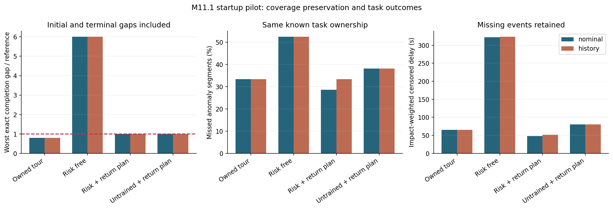
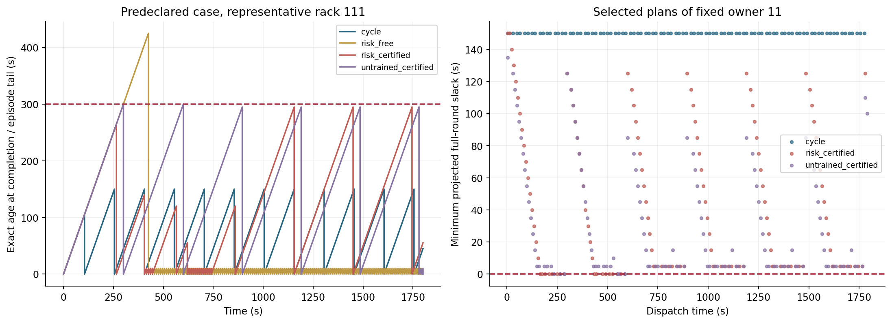
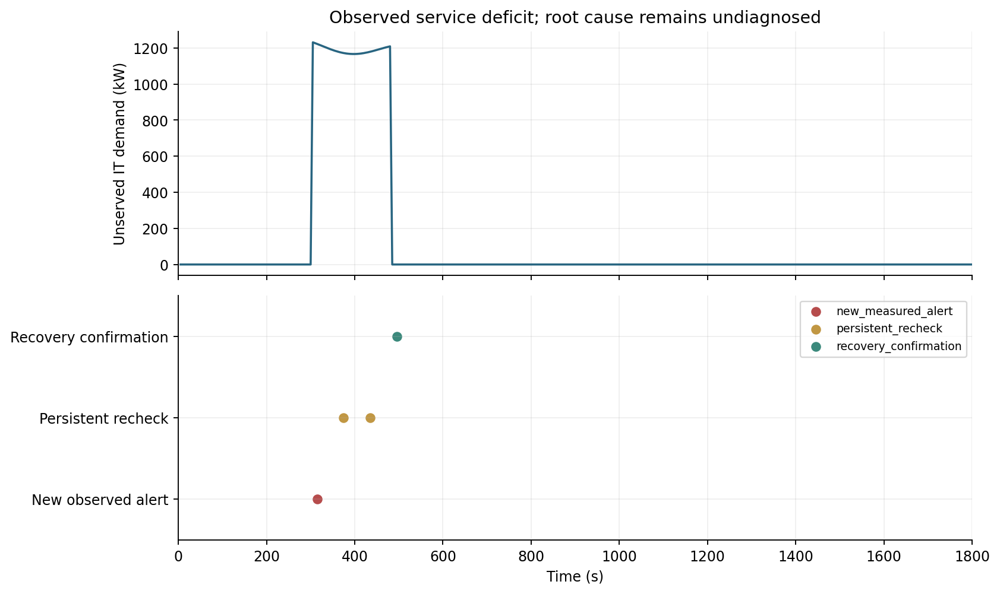

# M11.1启动结果：先检查整轮能否按时返回

已完成M11复核，并实际启动M11.1的首个切片：任务能力矩阵、完整返回计划检查器、132项完整测试、128条新种子闭环，以及独立重放和三张图。本轮没有训练新PPO，也未完成整个M11.1或RSI研究。

**96条启用保护的试跑均保持精确重访要求；异常发现收益还不稳定，不能把覆盖检查器的作用归给AI。**

## 上一步复核

M11四份源归档、92份原始交付、20个作业／子任务终态和全部分组／守卫统计再次核对。另由Slurm130099用实际权重重放四个原定演示，路径、资格、工时和事件记录一致。M11原有全量1,136案例审计保留，本轮没有声称又重跑了一遍全部GW长实验。

复核后重点延续四项纠正：用实际完成时间而非235s采样峰值表示重访间隔；保留固定巡回强基线；供电缺口与连接热分开；无守卫推理不等于无守卫独立训练。本轮没有修改M11结果、参数或事件阈值。

## 本轮究竟改了什么

M11的年龄提醒只优先紧迫任务。本轮每次补查前，把“补查完成后继续走完整一轮巡回”排出来：每一项都须来得及，重复巡回本身也须在周期内。没有完整可行返回计划的候选不能派单。

初始未检积压、图最短路、服务时长、5s量化和任务历史都纳入检查。每执行者只保护自己原巡回的任务，所有对照使用相同所属权限，避免同区接管产生额外竞争；因此不直接与M11不同权限的百分比比较。

这是一种固定巡回下的构造性证据，假设清单／静态通道已知、时长确定、无碰撞排队，计算和通信不占动作时钟。它不是一般安全定理或现场部署保证。详见[检查说明](可行性检查说明.md)。

## 先明确什么证据可以完成什么任务

| 任务 | 当前可用证据 | 本轮边界 |
|---|---|---|
| 热、连接热、流量、传感偏差参考检查 | 原有合格移动测量；经验证的遥测可按能力契约扩展 | 普通温度遥测、预测图或外观红外参考不自动算校准参考测量 |
| IT供电服务缺口 | 合成数据中明确声明已校准的需求／实际功率，连续三次5s读数 | 确认服务缺口，不诊断馈线故障原因 |
| 实际电压、支路电流 | 当前没有测量通道 | 标为不可确认，不从名义380V和功率伪造读数 |

[能力矩阵](任务能力矩阵.json)是仿真契约，仍需专家／现场核对。移动参考任务在这轮试跑中没有被自动遥测替代；供电证据单列，未混入旧四类异常确认率制造更好分数。

## 试跑规模与对照

八个预定“情景／注入持续时间”条件，两个新模拟种子5100/5101、两种估计器、四个选择器，共128条。含16个过程条件，仅两个资产／负载随机种子，不是128个独立机房或训练重复。注入持续60／180／900s不等于温度超阈异常恰好持续同样时间。

四个选择器为所属巡回、所属集合风险贪心、风险贪心＋返回计划，以及未训练评分网络＋同一计划检查。未训练网络固定种子77，参数从未更新；历史CVAE仍为原M10验证选择的权重。没有以本轮试跑再选估计器或训练模型。

| 选择器 | 最大精确间隔／周期 | 名义：漏检段／总段 | 历史：漏检段／总段 | 名义／历史加权截尾等待 |
|---|---:|---:|---:|---:|
| 所属巡回 | 0.8 | 7／21 | 7／21 | 65.34／65.34s |
| 风险贪心，无覆盖检查 | 6.0 | 11／21 | 11／21 | 321.95／323.17s |
| 风险贪心＋返回计划 | 1.0 | 6／21 | 7／21 | 48.26／51.54s |
| 未训练评分＋返回计划 | 1.0 | 8／21 | 8／21 | 79.95／79.95s |

精确间隔包括时刻0到首次检查、相邻完成及末次到1800s。三个受保护选择器共96条均零超期，覆盖均100%；无保护风险组32条均有超期。未训练评分也能保住周期，说明覆盖收益首先来自计划检查，不能称为新学习成果。

名义条件比巡回只少漏1段；历史条件漏检数没有减少。等待时间的下降是这组小规模条件的观察，没有训练重复或显著性结论。约995次平均“额外检查”只是偏离下一巡回项的次数，许多是重复近点，不能等同有用新信息。还需控制巡回相位、匹配补查次数及打乱风险信息，判断收益是否真正来自观测线索。

## 计划证据长什么样

图示为预先固定的coldplate_fouling180s、seed5101、history条件，四个选择器全部展示。左图按真正完成时刻重建年龄，不把采样峰值当完整间隔；右图每个点是一份被选返回计划的最小余量。零余量表示在这个确定时长模型中恰好可行，不表示现实计算／通信延迟已有裕量。

检查可能比较保守，也没有证明分区或巡回最优。动态封路、随机服务、跨执行者任务接管、真实排队和迟到计算都需新的可行性处理。

## 供电证据单列

预定IT馈线损失180s、seed5101例中，读数315s形成新服务缺口告警，持续复核和495s恢复确认分开记录。315s对应连续三次5s端点读数，不是物理连续信号持久性的额外证明。

这说明当前公开功率通道能回答“服务是否满足”的任务，不能据正常连接热否定服务损失，也不能由服务损失推断实际电压或根因。独立审计逐帧重建了所有供电证据；不同选择器得到完全相同的这类遥测证据。

## 已完成的核验

开发作业130100通过132项测试、无跳过，以及12条开发闭环；之后才运行预定128条试跑。130102重新执行全部试跑，用独立Dijkstra和事件历史核对整轮计划、精确间隔、资格／路径／服务及供电生命周期；核对251,813次实际派单／完成，并读取全部16份物理数组。96条保护组最大精确间隔比为1.0。

三张PNG逐张视觉检查。三份源归档、39份原始交付和所有分组统计在本地复核；五个相关作业130099–130103均COMPLETED／0:0。完整逐案返回证据和过程数组保留在集群指纹路径，公共主交付有全部紧凑指标、四个完整演示及一份过程NPZ。

## 接下来怎么做

本轮完成的是启动切片，A的现场任务能力／电压电流通道、C的可行动异常校准、D的新学习比较仍未完成。下一轮先冻结这些条件，再分别训练带／不带保护的策略，并保留规则、未训练评分、相位／补查预算匹配和风险信息置乱对照。使用新验证和测试集，本轮128条转作开发材料，不继续当新holdout。

可靠任务层通过后，M12才让开源语言模型提出技能、工具选择和协作流程修改；可改优先级与工具策略，任务证据检查及评价器应独立保留。详见[下一阶段安排](下一阶段任务.json)。

[启动方案](启动方案.md) · [检查说明](可行性检查说明.md) · [完整试跑审计](evidence/full-audit.json) · [本地交付核验](evidence/delivery-verification.json) · [原始数据索引](evidence/raw-storage.json) · [阶段验收](阶段验收.md)
