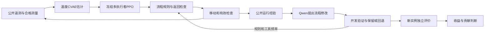

# 本轮方向汇报要点

暂定方向：**面向机房持续巡检的经验驱动工作流改进**。

核心问题是：保留原论文的VAE估计与多执行者学习思想，让开源模型分析巡检经验、修改补查技能和工具使用，能否在相同资源下更早发现异常，同时避免长期漏检和无意义重复？随后再检验，改进器自身更新是否提高产生有效修改的能力。

供电—液冷—自控模型、温度预测和覆盖检查是基础，论文要证明的是改进机制的价值。当前代码采用领域温度CVAE和高层PPO，未完整复现原论文数值结果；设备风险也没有解释为已校准的故障概率。

本轮已把真实开源模型接回新机房模型，比较固定巡回、固定学习流程、人工风险规则、随机搜索及有/无候选记忆的模型。候选实际执行后才能保留；指标、测量资格和重访要求不由模型修改。完整结果见[本轮结果](运行与结果.md)。

在同一批22段异常上，模型流程漏7段，冻结PPO漏10段，固定巡回漏5段；全部重访要求满足。有/无记忆组保留同一程序。因此已有真实可运行的改进闭环，但还没有优于强基线或递归改进有效的证据。

下一轮聚焦两个问题：一是模型能否根据公开证据决定“值得补查”还是“返回巡回”；二是面对重复提案，自动更新诊断和提案方式，能否在新任务上优于固定改进器及同总预算搜索。任务程序和改进器分别评价，不以加了LLM就宣称RSI有效。

需要导师进一步提供的研究依据是：实际有价值的短时异常、各检查项目的合格证据和时限，以及可获取的机房数据。这些信息用于校准已有问题，不改变“原巡检方法＋智能体自改进”的主线。
