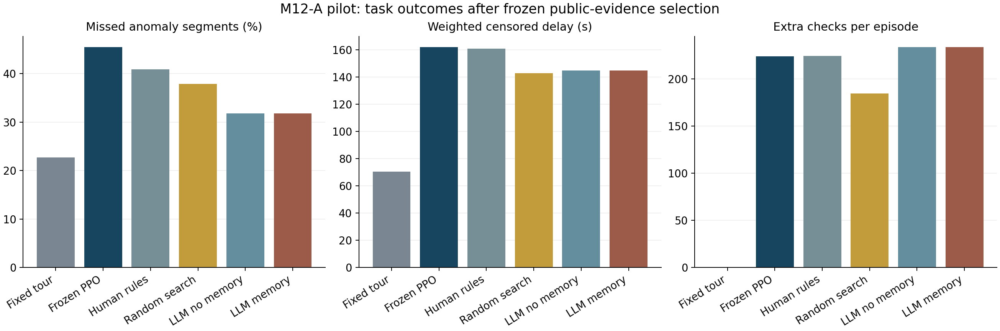
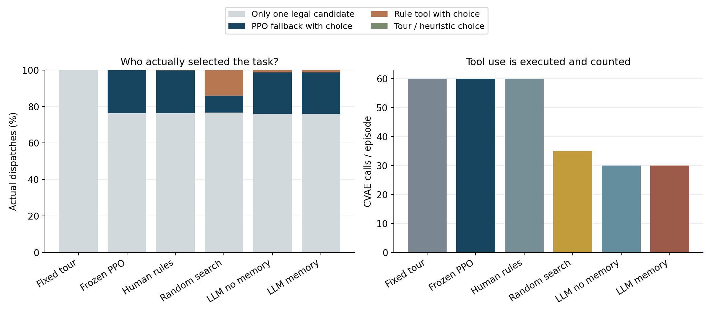
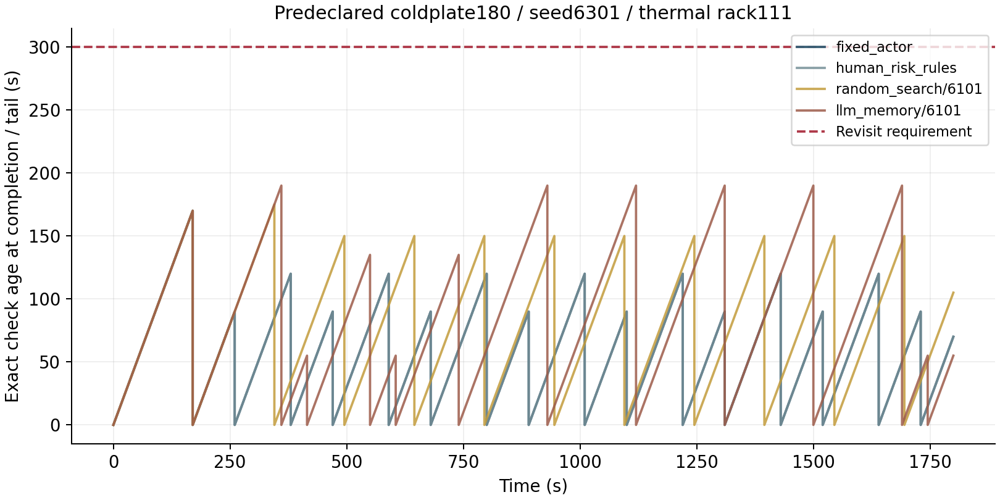

# M12-A结果：外层已接回，固定巡回仍是强基线

本轮重新对齐导师“在指定论文基础上优化，嵌入RSI思想”的要求，并完成真实开源模型的流程提案—执行—评价—保留/回退。**模型生成的流程改善了当前冻结PPO，但没有超过固定巡回；加入候选记忆没有额外收益。** 下一步应研究如何提出有价值且不重复的修改，而不是继续堆叠环境模块。

## 这一步与最初目标的关系

内层保留温度CVAE和多执行者学习，外层使用集群上的Qwen3-8B读取公开巡检经验，修改补查规则与工具频率。返回计划、专业资格、测量有效性、工时与评价器保持固定。论文要回答“经验驱动改进是否有用”，供电—液冷—自控仿真为它提供测试任务。[目标对应表](目标与导师要求.md)逐项说明已做和未做的内容。

当前用的是新域温度CVAE和高层PPO，并非原论文完整数值复现。改进器本身尚未更新，本轮不能称为递归改进有效。

## 模型究竟改了什么

有/无候选记忆、三个生成种子，最终均保留同一个程序，版本ba10532f0b6bf24d。它包含：

- 温度估计从每30s推理一次改为每60s；因果输入历史仍每30s采集。
- 额外补查的重复间隔从60s改为30s；每执行者每轮最多2次额外补查的上限不变。
- 热任务风险代理较高时按风险排序；电气任务温度模型分歧较高时按紧迫度排序；冷却检查年龄较大时按风险排序。其余交回冻结PPO。

原子排序工具由人工编写，模型组合的是流程规则。上述风险与分歧是仿真代理；温度模型分歧不是各专业的校准不确定性。原始回复和实际保留程序均可核对，不能把模型的文字解释当成结果。

## 新实例上的比较

每次比较使用相同16个物理过程条件，其中有22个按旧定义产生的异常段。漏检仍计入等待指标，不只平均已发现事件。

| 方法 | 漏检段／22 | 后果加权截尾等待 | 每回合额外补查 |
|---|---:|---:|---:|
| 固定巡回 | **5** | **70.27s** | 0 |
| 固定PPO流程 | 10 | 161.83s | 224.06 |
| 人工风险规则＋PPO | 9 | 160.69s | 224.38 |
| 随机搜索，3次生成重复 | 9、8、8 | 142.84s，汇总 | 184.48，平均 |
| 模型，无候选记忆 | 7，三次相同 | 144.79s | 233.69 |
| 模型，有候选记忆 | 7，三次相同 | 144.79s | 233.69 |

图中随机/模型组汇总三个生成重复，重复使用相同物理条件；它们不是66段独立异常。模型比固定PPO少漏3段，但仍比巡回多漏2段；随机搜索的汇总等待稍短、漏检更多，不能笼统说模型优于搜索。样本只有两个过程种子、一个已知布局及固定故障注入相位，没有显著性或任意新机房泛化结论。

全部312条实际闭环均满足精确重访要求，最大间隔／时限比1.0；固定巡回为0.8。这里包括初始与末尾间隔，范围仍是静态通道、确定工时和固定所属任务。重访合格不等于每个短时异常都能发现。

## 收益不能全部归给AI

模型流程中，75.97%的派单只有一个合法候选；有选择时使用PPO的派单占全部22.73%，规则工具占1.30%。与演员建议不同的动作约1.04%。资格、返回计划、补查配额和重复间隔共同限制了选择空间，不能把全部单候选派单只归因于覆盖检查，模型也没有重新规划全部路线。

CVAE实际调用由每回合60次降至30次，但固定巡回也为公共对照计算了本来不影响路线的估计；不能据此宣称比精简巡回实现更省算力。模型流程的额外补查反而稍多，尚未达到“减少无意义重复”的完整目标。

同一保留流程的部署干预为：

| 干预 | 漏检段／22 | 加权截尾等待 |
|---|---:|---:|
| 原冻结流程 | 7 | 144.79s |
| 将PPO后备换成紧迫度规则 | 6 | 94.07s |
| 将CVAE换成名义估计 | 8 | 151.22s |
| 只置乱工作流的风险/分歧线索 | 8 | 148.05s |

当前冻结演员没有表现出优势；CVAE和规则风险线索各有小幅变化，尚不能作稳定贡献结论。这些是部署干预，非分别重训消融。换成已有演员seed1/2，模型流程分别漏9/8段，对应固定流程各漏11段；主适配使用seed0，不把这称为本轮三次训练或跨布局迁移。完整29组见[汇总数据](evidence/report/aggregate.json)。

示例提前指定为coldplate180、seed6301、机柜111。部分曲线重叠是因为实际检查时刻相同；末尾表示运行结束前的年龄，不伪造1800s测量。

## 预算、重复与验证

三个方法各9个候选槽，共27槽。随机搜索接纳5次；有/无记忆模型各接纳3次、重复6次，正式提案无语法非法。各模型组的三次接纳都得到同一程序，不是六种新技能。重复提案按原定规则消耗槽，没有追加生成。

正式模型调用18次，输入19,908/output4,350 tokens，生成累计205.22s。无记忆组输入8,679，有记忆组11,229；加入记忆增加输入却没有改变最终程序。有/无记忆生成耗时分别109.91/95.31s，顺序和缓存未统一，不能由此推断速度优势。随机搜索不调用模型；这里只匹配候选评价机会，不声称总GPU成本相同。接口阶段另有2条实际模型回复，其中1条非法，均保留。

实际记录为88条开发＋224条测试＝312条独立闭环，覆盖8个开发＋16个测试过程。29组测试共464次案例引用，重复程序共享实际记录；不能将引用数当独立样本。143项完整测试无跳过。修订后独立审计逐案重放全部312条，核对415,577次实际派单/测量、全部返回计划、规则选择、补查配额、供电证据和24份物理数组，接受/回退及先冻结再测试的顺序一致。

主试验130207、修订审计130216、打包130218均COMPLETED/0:0。接口失败130204、非法回复130205和浮点文本核验失败130209保留；详见[方法复核](代码与方法复核.md)。归因图原版顶部图例裁切，130219仅修正排版，原图及统计指纹保留。三张最终图已逐张检查。[本地交付核验](evidence/delivery-verification-corrected.json) · [完整审计](evidence/full-audit.json) · [原始数据位置](evidence/raw-storage.json)

## 下一步的明确取舍

先做M12-B1：补齐分专业的公开诊断信息，分析重复候选及选择代理与真实目标的关系；在后续新版本加入显式“返回巡回/不补查”技能，让搜索空间能够表达强基线。再做M12-B2：让模型提出并验证改进器协议更新，从共同任务起点比较其在新任务中的提案效率和任务结果，同时计入元准备成本。本轮测试随后只作诊断材料，不再当新holdout。

完整安排见[下一步任务](下一步任务.json)和[预算与迁移方案](M12-B方案.md)。本轮已经恢复并运行“原巡检方法＋外层改进”的主线；论文所需的稳定改进、有效递归性、工程标定和创新性证据仍待建立。[目标文件](目标与导师要求.md)保留的是执行前决策快照，其中的当时缺口由本报告及下一步清单更新。
