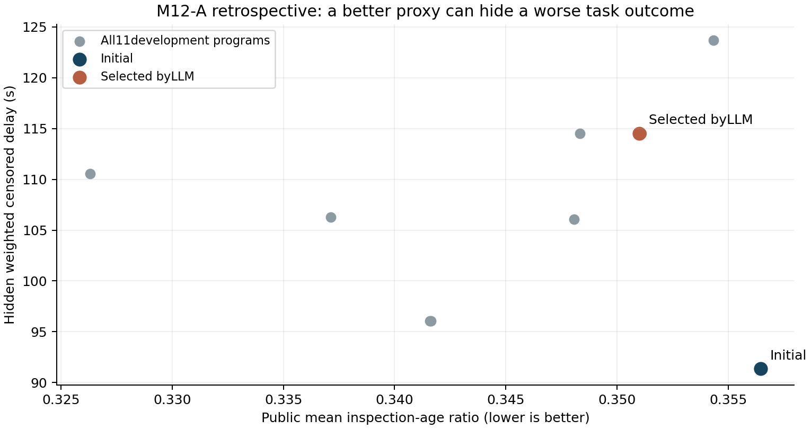
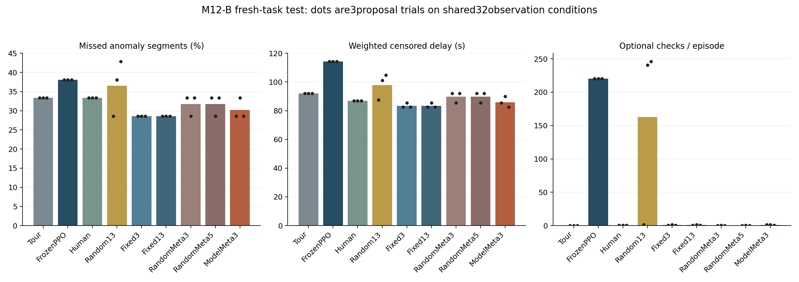
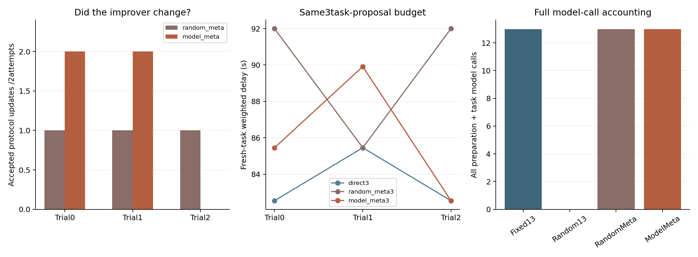

# M12-B结果：流程有小幅收益，改进器更新未带来额外收益

本轮完成M12-A复核，并实际执行了“修订任务接口—验证改进协议—重置任务起点—新实例测试”。**固定改进器提出的流程略优于巡回；更新改进器没有优于固定改进器。当前证据支持继续研究有用的巡检技能，尚不支持以递归增强作为已验证贡献。**

## 上一步发现的问题与处理

M12-A的11种开发程序，覆盖、精确超期与首次告警任务权重都相同，选优实际上主要依赖检查年龄。保留的模型程序年龄指标变好，但开发异常等待从91.37s变成114.53s，漏检同为10/19。旧测试漏7/22的结果保留，没有重写。

本轮在新划分中改变三件事：让工作流能明确返回巡回或不做补查；按温度、接点热、流量、已核验偏差定义专业信号；用固定、有标注的开发验证器按漏检/等待选优。模型只看到公开诊断和有限接受/回退反馈，不接收原始异常起止或测试记录。这是离线有标注适配，不能写成无标签自学习。上述改动是人工修订，对所有新对照相同，不属于模型自主发现的成果。

因此新旧阶段之间不能作单因素性能比较。[复核与设计](复核与实验设计.md) · [旧阶段指标诊断](evidence/m12a-objective-review.json)

横轴是旧公开检查年龄代理，纵轴是独立评价等待；点可能因程序行为相同而重叠。图中“选中模型”表示语言模型提出、由开发验证器保留的程序，模型没有直接充当裁判。

## 改进器实际改了什么

协议可改诊断工具顺序、经验检索和提案指令，任务工作流与模型权重分别管理。每轮比较旧/候选协议时，两者从同一巡回程序与空历史起步，使用相同生成种子，各提出2个流程候选；开发结果严格更好才保存。

三个生成重复中，模型协议更新分别接受2、2、0次；随机协议分别接受1、1、1次。前两组模型最后都把工具选择改成coverage、professional_evidence、novelty，指令和recent记忆模式未变。第三组保留原协议。**被元开发接受不等于在新任务上更会改进。**

后续任务只继承协议，程序和历史重新归零。固定改进器的3候选取自13候选序列的前缀；随机元协议的3候选取自5候选前缀，避免重复执行相同调用。

## 新实例测试

每组使用相同16个物理过程，各配0.2/1.0°C两档公开温度噪声，共32个观测条件。下面42段是按两档噪声重复评价的异常记录，对应21段底层物理异常；不是42次独立故障。三个生成种子又复用这些过程，不把三次重复当成新增机房。

| 方法 | 各生成重复漏检／42 | 加权截尾等待，三次均值 | 每回合额外补查，均值 |
|---|---|---:|---:|
| 固定巡回 | 14、14、14 | 92.00s | 0 |
| 冻结PPO | 16、16、16 | 114.31s | 220.50 |
| 人工专业规则 | 14、14、14 | 87.00s | 0.44 |
| 随机流程搜索，13候选 | 12、16、18 | 97.82s | 162.77 |
| 固定改进器，3候选 | **12、12、12** | **83.51s** | 0.83 |
| 固定改进器，13候选 | 12、12、12 | 83.51s | 0.83 |
| 随机元协议，3/5任务候选 | 14、12、14 | 89.82s | 0.15 |
| 模型元协议，3任务候选 | 12、14、12 | 85.97s | 1.06 |

固定3候选流程在这批条件中比巡回少漏2条噪声配对记录、等待降低约8.49s，但不作显著性或真实机房结论。把直接候选从3增至13，三个重复的保留程序都没有再变好。

模型元更新相对固定3候选：第0组等待85.45s对82.54s，漏检相同；第1组漏14对12且等待更长；第2组完全相同。即两组较差、一组持平，没有改进器迁移增益。模型元更新整体花13次调用，固定3候选只有3次；与同13次调用的直接搜索比较，也未占优。

全部1,352条实际闭环精确超期为0，最大完整间隔/时限比1.0。它只适用于已知静态通道、确定工时和固定所属任务，不能外推为任意短异常必检或现场实时保证。

## 内层贡献仍未建立

三个模型元组保留的流程均回退到巡回，规则没有调用PPO；PPO仍做影子评分用于归因。把PPO工具替换为紧迫度后，三个组的异常结果完全相同。把历史CVAE换成名义估计后，漏检和等待也相同，个别额外补查次数不同。

这表明本轮最终收益来自少量人工原子规则的模型组合与返回巡回，尚不能证明学习器或VAE的任务增益。系统保留了原论文相关模块，不等于已经验证它们在本轮结果中有贡献；本轮没有针对新语法重新训练演员，也不据此否定充分训练后的学习价值。

模型流程平均每回合只多约1次补查，正好体现“有依据时补查、平时返回巡回”的作用；但因选择规则、验证器和起点一起修订，不能把M12-A到M12-B的提升归给任何一个单独因素。

## 成本与验证范围

每生成种子中：直接搜索13次模型调用；随机元协议8次准备＋5次任务调用；模型元协议2次元提案＋8次配对内层＋3次任务调用。三个方法共117次正式调用，输入182,706、输出21,070 tokens，模型生成累计951.74s。随机工作流另有39个候选、不调用模型。

正式任务候选共150槽，元协议尝试12次；52个任务提案重复、1个非法，均消耗名额，未追加生成。输入token、环境评价与实际耗时并不相同，公平性只能表述为同模型调用上限和明确候选机会，不能写成总算力完全匹配。接口开发另有15次真实调用，三版原始回复保留，不混入117次正式预算。

三组分别实际运行456、482、414条，共1,352条；跨组去重有1,078种案例签名，物理过程共28种（4元开发、8任务开发、16测试）。三个目录各保存28份数组，全部84份已审计；它们不代表84种独立物理过程。11测试组×32条件×3重复＝1,056次分组引用，也不是1,056个独立环境。

152项完整测试无跳过。独立审计重放所有1,352条，核对1,890,075次派单/完成测量、完整返回计划、专业规则、配额、初始/末尾间隔，重新核对元协议接受、任务重置、提示词和选择冻结顺序。物理能量平衡最大独立残差约1.03×10⁻⁸kJ。全部12个相关作业/数组项COMPLETED/0:0；初版接口虽然计算成功，因提案格式不合格未算门槛通过。

308份原始交付与5份源归档已取回并核对，本地重新计算了全部统计和预算。三张PNG逐张检查。完整案例/数组保存在[集群索引](evidence/raw-storage.json)，公共交付含全部紧凑指标、原始提案、选择链和预定完整示例，并未声称全量下载。[本地核验](evidence/delivery-verification.json) · [第0组审计](evidence/audit-0.json) · [第1组审计](evidence/audit-1.json) · [第2组审计](evidence/audit-2.json)

## 下一步安排

先分析元开发接受为何未迁移，并把摘要诊断细化为可观测的失败事件；再设计跨专业检查需求与工具交接的受控实验。对保留下来的学习/估计工具单独检验真实任务价值。只有在这些条件下得到稳定优于强基线与搜索的证据，才考虑以RSI作为论文主贡献。

具体见[下一步方案](下一步方案.md)。本轮完成了用户要求的复核、方案和实际执行；最终论文、递归增益和现场标定仍是后续研究目标。
