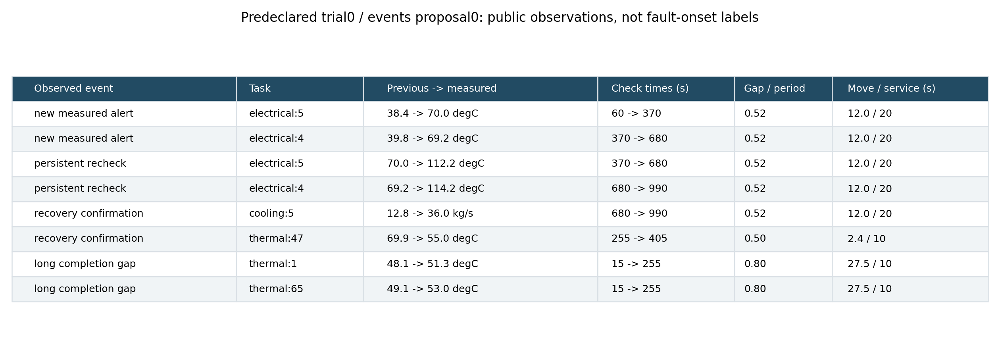
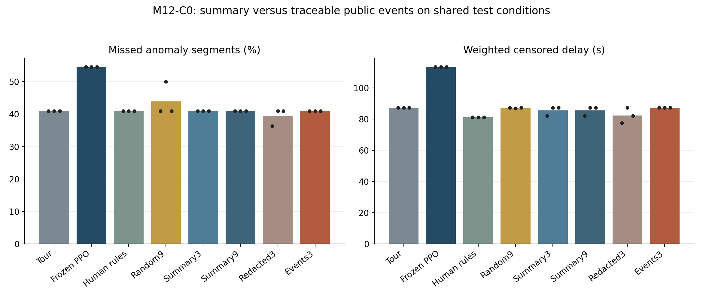
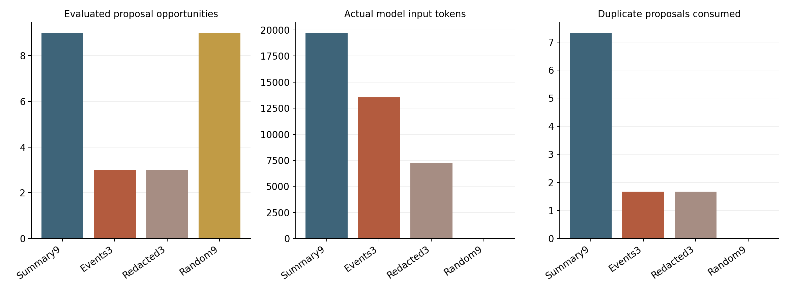

# M12-C0结果：详细事件没有带来额外巡检收益

本轮复核M12-B，并完成公开事件诊断的受控比较。**事件信息确实进入了模型，也产生了实际运行的候选，但最终新测试没有优于固定巡回或摘要组。** 继续增加提示词细节或搜索次数，目前缺少收益证据。

## 上一步复核与本轮改变

M12-B的源、交付和统计通过复核，旧结果保留。四次被接受的元更新只改变工具选择，没有改变记忆或指令。还发现模型把novelty解释成异常模式检测，而工具实际只统计提案重复；这说明模型解释不能当作工具能力的证据，但不能据此断言它导致了迁移失败。

新实验统一明确工具含义，在同一程序语法、强巡回起点、神经权重和带标注开发验证器下比较摘要、详细事件与隐藏细节的信息策略。本轮没有再更新元协议或训练神经网络。[复核与设计](复核与实验设计.md) · [旧流程诊断](evidence/m12b-transfer-review.json)

## 事件信息是什么

每次最多8条来自已完成开发运行的有效测量，关联检查项目、单位、上次/本次测量、间隔和实际工时。首次测量没有伪造时刻0读数；新告警、持续复核和恢复是公开测量状态，不能当作隐藏故障起止。

表中各行来自预定规则选出的开发实例，不能把相同任务ID的所有行当作一条连续轨迹；完整输入保留了回合别名和源事件行号。提取器和工具说明由人工实现，模型没有自主发明这些观测能力。隐藏细节组保留事件类别/数量，但删去任务、时间、数值和工时，不制造错误测量。

所有组从同一程序起步；若保留了不同候选，后续公开历史也会不同。这是适配过程的信息策略比较，不是每次都对同一事件表作文本替换。模型不接收原始真值或测试记录，但接受/回退会传递有限的有标注开发反馈，不能称完全无标签学习。

## 新实例上的对照

每组在同一16个物理过程、两档温度噪声下测试，共32个观测条件。44是22段底层异常在两档噪声下的评价记录数；三个生成重复再次复用这些条件，不是44次独立故障或三个新机房。

| 方法 | 三个生成重复的漏检／44 | 加权截尾等待，均值 |
|---|---|---:|
| 固定巡回 | 18、18、18 | 87.29s |
| 冻结PPO | 24、24、24 | 113.53s |
| 人工专业规则 | 18、18、18 | 81.10s |
| 随机9候选 | 18、22、18 | 87.16s |
| 摘要3候选 | 18、18、18 | 85.58s |
| 摘要9候选 | 18、18、18 | 85.58s |
| 详细事件3候选 | 18、18、18 | 87.29s |
| 隐藏细节3候选 | 16、18、18 | 82.36s |

详细事件没有获得额外测试收益；摘要由3增至9候选也未改善异常指标。隐藏细节组均值更好，但只有3个提案重复、2个物理种子、一个已知布局和有限程序空间，不能据此认定隐藏信息普遍更好，或细节是性能下降的原因。图中黑点是提案重复，不是独立机房或置信区间。

## 开发改善与工具归因

事件组第0次生成重复，在开发中从漏5/16、等待79.75s改为漏4/16、等待74.10s，保留了流量、接点热和温度分歧规则；但新测试仍与巡回相同。第1、2次没有有效改善，保留空规则巡回。保留或回退都有原始记录，不能把无变化版本称为新技能。

三个事件流程均没有实际调用PPO。第0组测试平均每回合多0.75次补查，另两组为0。替换PPO工具、CVAE换名义估计、移除非年龄规则后，三个组的漏检和等待均保持相同。因此本轮没有建立学习器、CVAE或详细事件对异常目标的增益；模块仍在代码中不等于有效贡献。这些是部署干预，不是分别重训实验。

全部1,064条实际运行精确重访超期为0，最大完整间隔/时限比1.0。范围仍是已知静态图、确定工时和固定所属任务；重访合格不等于每个短时异常必被发现。

## 成本与验证

正式45次模型调用，72个候选槽，其中32个重复、0个非法；输入121,644、输出8,508 tokens，模型生成累计413.79s。接口另有3次调用，单列保留。事件组输入40,649 tokens，隐藏细节组21,788，摘要9候选组59,207；调用上限相同不等于输入成本相同。

左图是消耗的候选机会，包含重复，并非全部重新运行环境的次数；右图重复数按三个生成重复取均值。摘要3是摘要9的前缀，未重复执行相同调用。随机搜索不调用模型，只匹配候选空间和评价机会。

三组实际运行408、296、360条，共1,064条（328开发、736测试）；跨组去重有776种案例签名。物理过程共24种，三个目录各存24份数组，全部72份已读取。11测试组×32条件×3重复共1,056次案例引用，不能当作1,056个独立环境。

160项完整测试无跳过。独立审计重放全部运行，核对1,492,991次派单/测量、专业规则、完整返回计划、事件来源和筛选、隐藏细节对照、提示词及先冻结选择再测试的顺序。独立能量平衡最大残差约9.76×10⁻⁹kJ。10个相关作业/数组项均COMPLETED/0:0。

176份原始交付、3份源归档和全部统计通过本地核验，三张PNG逐张检查。完整逐案记录及数组保留在[集群索引](evidence/raw-storage.json)，公共交付包含全部紧凑指标、提案、选择和预定完整示例，没有声称全量下载。[本地核验](evidence/delivery-verification.json) · [第0组审计](evidence/audit-0.json)、[第1组](evidence/audit-1.json)、[第2组](evidence/audit-2.json)

## 下一步的决定

本轮完成C0信息比较，没有证明更细诊断或递归增强有效。下一步先做决策机会核对：漏检时是否有公开线索、合法补查和足够工时，再决定改进测量/估计、学习策略还是专业任务交接。保留原论文相关模块与强巡回对照，但不强迫调用无收益工具制造AI比例。

详见[下一步方案](下一步方案.md)和[任务清单](下一步任务.json)。完整C1工具研究、C2跨专业交接、C3新元协议、现场验证和论文创新性仍待各自证据。
