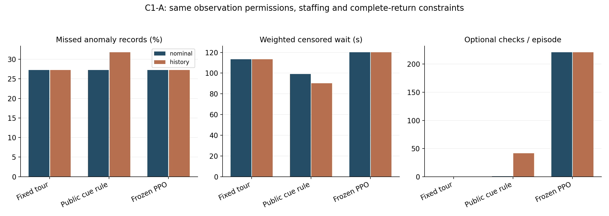
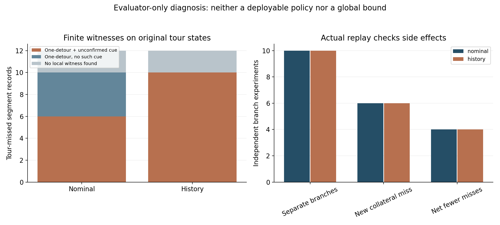
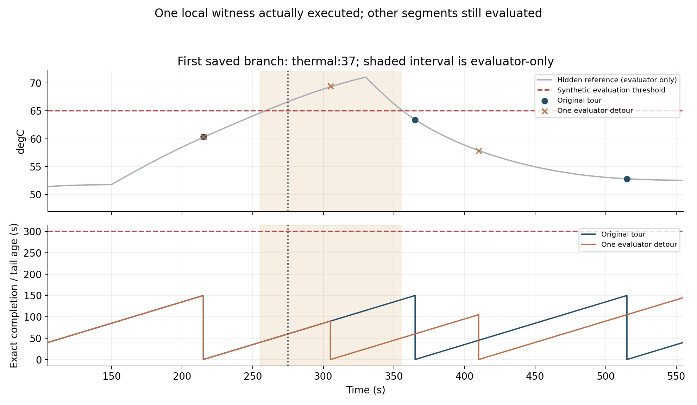

# C1-A结果：补查需要同时计入后续检查的代价

本轮完成C0复核，并实际执行决策机会核验：192条公开控制器对照、20条独立的一次补查干预，全部重放通过。**当前任务存在局部补查空间，但发现目标后可能转移其他漏检；增加公开线索触发并未自动带来更少漏检。** 这个结果将下一步聚焦到补查的全程收益与代价，而不是继续增加提示词细节。

本轮没有语言模型调用、权重训练或改进器更新，不能当作新的RSI增益。[复核与设计](复核与实验设计.md) · [实现与边界](代码与方法复核.md)

## 公开方法的结果

同一16个物理过程，各配0.2/1.0°C噪声，共32个观测条件；每种估计下各运行巡回、预定公开线索规则和冻结PPO。44条异常记录是22段物理异常在两档噪声下的重复评价，不是44次独立故障；两种估计再次引用同样过程。

| 估计工具 | 控制器 | 漏检／44 | 后果加权截尾等待 | 每回合额外补查 |
|---|---|---:|---:|---:|
| 名义物理估计 | 固定巡回 | 12 | 113.33s | 0 |
| 名义物理估计 | 公开线索规则 | 12 | 99.03s | 0.75 |
| 名义物理估计 | 冻结PPO | 12 | 120.20s | 221.19 |
| 历史CVAE | 固定巡回 | 12 | 113.33s | 0 |
| 历史CVAE | 公开线索规则 | 14 | 90.31s | 41.59 |
| 历史CVAE | 冻结PPO | 12 | 120.20s | 221.19 |

线索规则只读取显式公开候选快照：本专业估计/测量信号、热模型分歧、稀疏原始测温、年龄、成本和返回余量。原始遥测可提示补查，不能自动完成合格参考测量。规则由人工预先固定，并非模型自主发现或最优公开方法。

历史估计使该规则补查更多、等待指标更低，却比巡回多漏2条噪声配对记录，并产生2次错误测量告警。因此不能笼统说历史工具更好；漏检与等待的权衡需要一起看。巡检不修复物理过程，服务供电损失在同一过程下不随路线改变。

PPO使用原M11 history-seed0权重，在两种估计输入下均未减少漏检，额外补查很多。它没有针对本轮接口重新训练，名义模式还有输入分布变化；这不是充分训练强化学习的能力上限。

## 原巡回状态中有什么局部机会

评价器沿实际巡回的空闲派单时刻，枚举完整返回计划仍可行的候选，再用隐藏异常区间核对一次检查能否实际告警。它只做离线诊断，不进入公开控制、训练奖励或LLM输入。

每种估计条件中，巡回漏12条记录，对应6段底层漏检在两档噪声下的重复。结果如下：

| 对原巡回漏检的有限分类 | 名义估计 | 历史估计 |
|---|---:|---:|
| 有一次补查见证，且有预定的未确认公开线索 | 6 | 10 |
| 有一次补查见证，未触发该未确认线索 | 4 | 0 |
| 原巡回状态中未找到一次补查见证 | 2 | 2 |

10条有见证的记录对应5段底层物理漏检在两档噪声下的重复。历史模式使更多候选触发预设线索，但本统计只针对真实可确认的见证，未估计所有触发的精度、误报率或概率校准，不能据此认定其判断更准确。

未找到见证的2条只表示在原巡回状态、固定所属权限和声明动作约束中，没找到这类一次补查；它不是全程无解、容量绝对不足或信息论上不可观测的证明。同样，多个段分别有见证，也不能把它们拼成一条共同可行的调度。

## 把见证实际执行后，发生了什么

每个漏检段只取最早派单时刻的第一条可行见证，重新从初始状态运行：此前保持巡回，只在指定时刻替换一名执行者的一次任务，之后全部回到巡回。每种估计10条、两种估计共20条分支，彼此独立，不能合计为一条策略的收益。

每种估计的10条实际分支均确认了目标，但：

- 4条没有新漏检，净漏检少1条。
- 4条新增1条其他漏检，净漏检不变。
- 2条新增2条其他漏检，净漏检多1条。

即6/10条分支带来其他异常失去确认；目标发现成功不足以证明整个回合更好。两种估计下的分支选择和这些结果相同，它们重复了同一批物理事件，不是20次独立机会发现。

例图按分支索引顺序选取，没有按分数挑成功案例。275s增加一次检查，305s确认了thermal:37；随后整轮仍符合重访要求，但另有两段失去确认，净漏检反而多1条。新增移动22.3m，服务总量少10s；后者是有限终止时间内检查安排改变的结果，不表示检查效率提高。阴影和灰色参考曲线使用评价器标签，不是部署时可得输入。

公开规则改变路线后，后续测量和估计也会变化，未必经过同样的原巡回状态。所以局部线索见证是研究入口，不足以断言规则在自己实际状态中漏做了某个确定动作。

## 已完成的验证和交付

167项完整测试无跳过。正式运行212条全部重放，独立Dijkstra重建1,565,985个合法候选实例（包括未选择的动作及重复轨迹中的状态）、292,174次公开选择/派单/测量及完整返回计划；逐段重算线索、最早见证和所有实际干预，验证干预前一致、指定时刻只改一项、目标确认和附带损失。

16份物理数组全部读取，独立能量平衡最大残差约9.87×10⁻⁹kJ。全部主对照与分支精确超期为0，最大完整间隔/周期比1.0；范围仍是已知静态图、确定工时和固定所属任务，计算/通信不计动作时钟，不外推为现场实时保证。

正式运行130300、完整审计130301、图表130302、打包130303均COMPLETED/0:0。旧检查器130296因整数键比较失败保留；修订后130298独立重放12条接口并核对84,797个候选，通过后才提交正式运行，实验源未变。完整原始数据保存在[集群索引](evidence/raw-storage.json)，公共交付有全部紧凑指标、局部探针、分支记录、首个示例及日志；没有声称全量下载。

51份原始交付、5份源归档和全部统计通过本地核验，三张PNG逐张检查。[本地核验](evidence/delivery-verification.json) · [完整审计](evidence/formal-audit.json) · [逐段机会表](evidence/report/missed-opportunity-catalogue.json) · [分支记录](evidence/branch-index.json)

## 下一步的具体取舍

先在独立开发实例中检验线索辨识度与提前量，并构造同时记录目标收益、后续任务损失和工时的技能评价；估计误差与决策收益分别验证。若要重训演员，冻结3个配对初始化、资源与更新预算后再做，不强迫调用模型制造AI占比。

有效技能之后仍接回原有外层版本改进链，比较固定改进器、直接搜索与可更新协议，继续围绕导师的“去哪里、检查什么”研究专业证据和交接。[下一步方案](下一步方案.md) · [任务清单](下一步任务.json)

本轮完成了C1-A的局部机会核验。全程最优规划、C1-B新工具/训练实验、跨专业共享责任、现场标定、原文完整复现和RSI稳定增益仍需要各自证据。
