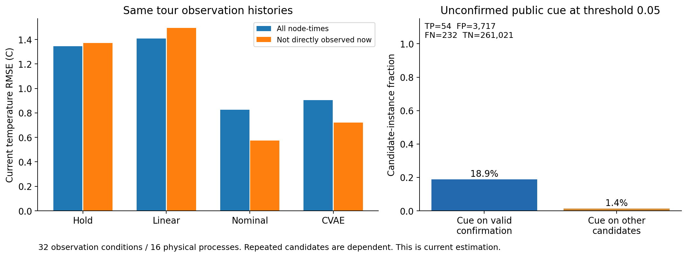
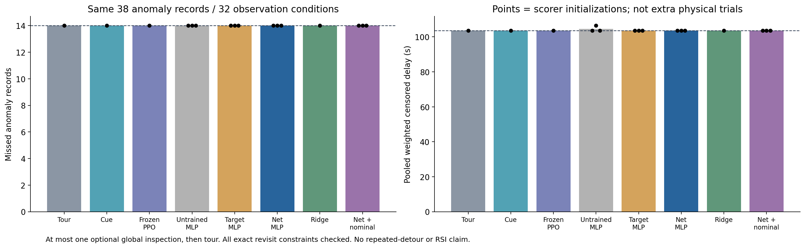
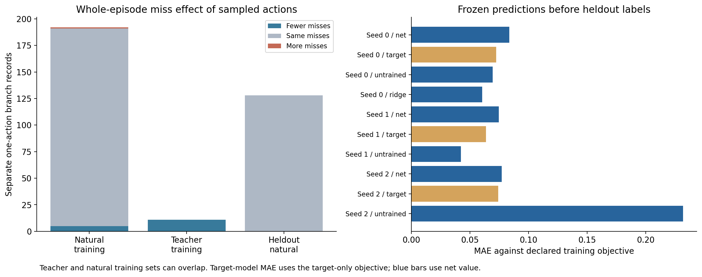

# C1-B0：学会评分，尚未学会在合适时机补查

上一流程C1-A复核通过。本轮已实现并运行“最多补查一次、随后继续巡回”的技能原型，分别学习目标收益和全回合净收益。**新测试未显示异常发现收益**：两类模型、公开规则和冻结PPO均漏检14/38条异常记录，净收益模型的发现等待也与巡回相同。

已启用的补查全部发生在5–30秒，早早耗尽唯一额度。下一步优先检验“现在检查还是继续等待”的工具调用流程，再接回开源改进器；这只是当前证据支持的研究切口，尚未证明它能改善结果。

## 做了什么

固定128机柜、18名专业执行者、所属任务、合格测量、完整返回检查以及旧CVAE/PPO权重。新评分器读取34项公开状态和候选成本，不接收情景名、种子或未来异常。净收益标签同时计算目标确认、其他任务失去确认、删失等待和移动代价，目标收益对照只计所选任务的正收益。

新划分包含16条训练过程、8条验证过程、16条测试过程。测试配0.2/1.0°C两档噪声，共32组观测条件；其中19段物理异常各重复评价两次，形成38条记录。三个评分器初始化共用这些测试，不增加独立机房数量。

| 环节 | 实际运行数 | 用途 |
|---|---:|---|
| 开发巡回与分支 | 227 | 24条巡回，203条独立一次补查标签 |
| 三次初始化的阈值验证 | 320 | 每评分器比较0/0.1/0.3/off，按漏检、等待、移动选择 |
| 冻结策略测试 | 512 | 共用32组条件，包含名义估计替换 |
| 测试自然样本分支 | 128 | 先冻结预测，再生成独立标签；不反馈训练/选择 |
| 正式运行合计 | **1,187** | 全部独立重放通过 |

另有40次接口试运行，不混入正式结果。203条训练标签包含192条公开哈希采样和11条有标注教师采样，本次没有重叠；教师用于补充罕见机会，不代表自然发生率。每个目标各用3个配对初始化、每次400步全批Adam更新，共6次2,209参数MLP训练；未训练初始评分和固定正则线性模型获得相同阈值验证机会。没有新PPO/CVAE训练或语言模型调用。

## 线索和温度估计是否有用

同一巡回历史每30秒比较四种**当前温度估计**，不是预测未来。下表热点召回的分母是没有当前直接测量的110个异常“节点×时刻”，含配对噪声重复。

| 估计方法 | 全节点RMSE，°C | 非当前直接观测RMSE，°C | 非当前直接观测热点召回 |
|---|---:|---:|---:|
| 保持最近测量 | 1.344 | 1.370 | 72/110 |
| 线性历史外推 | 1.407 | 1.495 | 92/110 |
| 名义物理估计 | 0.825 | 0.574 | 46/110 |
| 冻结历史CVAE | 0.905 | 0.720 | 0/110 |

名义估计在本轮平均误差更低，线性外推的热点召回更高但误报更多。CVAE没有表现出未直接观测热点的发现能力，不能把较小的平均误差写成风险识别有效。

全部265,024个合法额外候选实例中，公开未确认线索触发3,771次，其中54次对应完成时可合格告警，精确率约1.43%。若把已确认异常的再次测量也算作正样本，召回为54/286＝18.88%；扣除派发前已确认的段，只看新确认机会，则为54/96＝56.25%。两者问题不同，不能混用分母。原始未过滤线索的240次有效完成中，186次是已确认段的重复机会。

这些是重复候选实例，既不是独立机房，也不是校准故障概率。一次未来有效测量仍可能挤占其他检查，不能直接视为正的净巡检收益。[逐专业及提前量记录](evidence/quality-details-audit.json)

## 新测试的实际结果

“加权等待”将未发现异常保留到该段结束并加权统计。初始化不同的组用均值及范围呈现，完整逐次结果保留在原始汇总中。

| 方法 | 漏检记录 | 加权删失等待，秒 | 每32条件的补查次数 |
|---|---:|---:|---|
| 固定巡回 | 14/38 | 103.664 | 0 |
| 公开线索规则 | 14/38 | 103.664 | 32 |
| 冻结PPO评分 | 14/38 | 103.664 | 32 |
| 未训练MLP | 均为14/38 | 均值104.583，范围103.664–106.420 | 0、32、0 |
| 目标收益MLP | 均为14/38 | 均为103.664 | 0、0、0 |
| 净收益MLP | 均为14/38 | 均为103.664 | 32、0、32 |
| 线性净收益 | 14/38 | 103.664 | 0 |
| 净收益MLP换名义估计 | 均为14/38 | 均为103.664 | 32、0、32 |

每档噪声分别是漏7/19段，不能将14/38视作38段独立物理事件。所有测试均满足精确重访，没有不合格测量或额外资源特权。

公开规则的补查发生在15–30秒，冻结PPO和启用的净评分发生在5秒；启用的未训练评分在20秒。净评分种子0/2选中动作的平均评分分别比实际净收益高约0.379/0.331，显示选中动作的收益估计偏乐观。评分拟合改善不等于正确的调用时机。

公开规则与冻结PPO分别比巡回平均多走13.90/34.45米；PPO平均少完成2次检查、少20秒服务。这是有限时域中任务安排改变，不能写成效率提高。净评分两次启用组平均少走0.35米，异常发现完全持平，也不足以作为论文收益。[全部512条实际调用及后果](evidence/deployment-diagnosis-audit.json)

## 离线样本能解释什么

203条开发分支中，16条减少漏检、186条持平、1条增加漏检；教师11条均有收益，自然采样只有5/192条减少漏检。单条负分支失去2段确认，损失已进入净标签。

测试自然采样的128条分支全部没有改变漏检数，部分改变等待和路线。它不能检验评分器对罕见“救回一段但丢失另一段”的全面辨识能力。净模型在该抽样中的MAE约0.074–0.083；未训练评分随初始化变化，不能仅凭稀疏样本误差判断部署优劣。目标模型用不同监督目标，其误差不与净模型直接排名。

## 复核、成本与交付

174项测试在集群完整通过，无跳过。正式1,187次运行全部重新执行并核对测量、路径、返回计划、物理数组与标签；共独立重建11,508,486个合法候选实例，核对1,692,280次实际派发/完成。电热收支最大残差分别约1.18×10⁻¹¹kW、1.12×10⁻⁸kJ。

所有计算经Slurm，任务请求2CPU/8GB内存，无GPU GRES分配。旧语言模型没有加载或调用。训练作业完成时间包含完整阈值验证，约180–241秒，不能称为纯梯度训练时间。完整作业资源与重放成本见[Slurm账本](evidence/slurm-final.psv)；审计额外计算单列，不混充新增实验样本。

原始交付194份文件及首次三张图保留；超过1MB的部分JSON仅加可逆gzip包装，原始字节指纹可核对。完整1,227份案例文件（含40次试运行）及132份分阶段物理数组留在集群索引；后者重复保存共同过程，正式独立过程只有40条。仓库含全部压缩索引、标签、冻结JSON模型、训练/选择日志与五个固定条件完整示例。[原始存储索引](evidence/raw-storage.json) · [本轮汇总](evidence/report/aggregate.json)

逐图检查后修复两处标签拥挤，最终图在`report-v2`，原图保留且统计内容相同。[便携校验](evidence/delivery-verification.json) · [视觉检查](evidence/visual-review.json) · [代码与方法复核](代码与方法复核.md)

## 下一步决定

不追加本轮训练或以旧测试挑阈值。保留评分器为待验证工具，回到“检查、等待、保留额度”的技能调用接口；让开源改进器依据公开失败日志修改调用条件，并保留人工证据门槛、随机搜索和固定改进器对照。随后用新的适配与测试划分独立判断任务收益与改进器迁移。

当前结论是一次补查原型已运行并找到了调用时机问题，尚无新技能任务收益或RSI有效证据。具体交付与门槛见[下一步方案](下一步方案.md)和[任务清单](下一步任务.json)。
