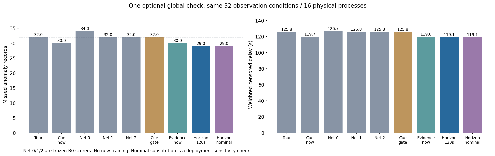
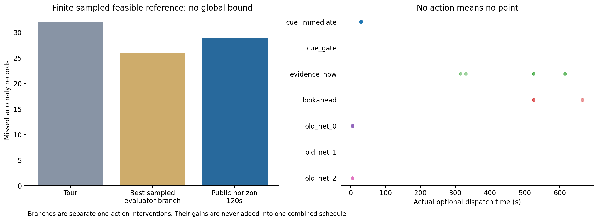
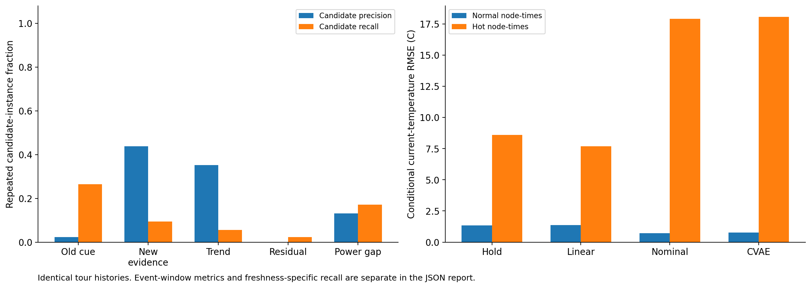

# C1-B1：等待机制出现有限收益，也出现反复推迟

状态：正式运行、全部独立重放及本地统计复算已完成，三张最终图已逐张检查。

复核上一轮C1-B0后，采纳用户建议，先补充“现在检查还是继续巡回、保留额度”的决策。本轮120秒公开模型前瞻漏29/46条异常记录，巡回漏32/46，使用相同证据的零视野方法漏30/46。改善集中于一个耦合故障族的两个物理实例；其中一个只在低噪声下有效，尚不支持稳定泛化或RSI有效。

## 本轮做了什么

固定128机柜、18名专业执行者、资格/所属任务、工时、重访要求和旧CVAE/PPO。全队1800秒内最多一次额外检查，之后继续巡回。等待期间执行正常巡回，不站着空等。新控制器用当前公开状态和已知路线推演120秒内的巡回状态，比较同一代理效用下的当前检查与折扣后的未来检查；不读取未来测量、故障起点或情景名。

前瞻是人工设计的有限模型，尚未训练新的停止策略。旧三个净评分器及阈值原样保留，无新神经训练、Qwen调用或元协议更新。PPO在共同快照中计算影子评分，但本轮没有把PPO动作作为新方法，也未证明它带来收益。

| 环节 | 实际回合数 | 说明 |
|---|---:|---|
| 接口试运行 | 17 | 2种情景与有限分支，181项完整测试另计 |
| 固定等待门槛验证 | 40 | 0/60/180/300/off，各8条验证实例 |
| 正式部署对照 | 288 | 8组主对照与1组名义估计替换，各32条件 |
| 开发巡回诊断 | 8 | 单独的新开发过程 |
| 独立一次补查分支 | 140 | 开发36条、测试104条；各自从巡回出发 |
| 验证与正式合计 | **476** | 加17次接口试运行，共493次实际回合 |

测试包含16个物理配置过程、两档观测噪声，共32条件。23段物理异常在两档噪声下形成46条记录。底层测试种子只有8200/8201，跨情景共享种子，不能把46条记录或16个配置都当作完全独立的随机机房做显著性判断。

## 任务结果与等待门槛

| 方法 | 漏检记录/46 | 加权删失发现等待，秒 | 补查次数/32条件 |
|---|---:|---:|---:|
| 强巡回 | 32 | 125.788 | 0 |
| 旧线索立即触发 | 30 | 119.719 | 32 |
| 旧净评分0 | 34 | 126.650 | 32 |
| 旧净评分1 | 32 | 125.788 | 0 |
| 旧净评分2 | 32 | 125.788 | 32 |
| 验证选择的固定等待门槛 | 32 | 125.788 | 0 |
| 新证据零视野 | 30 | 119.751 | 6 |
| 120秒前瞻 | **29** | **119.050** | **3** |
| 同一前瞻替换名义估计 | 29 | 119.050 | 3 |

验证集选择off。0/60秒门槛均漏10/18，180/300秒分别漏13/18、12/18；off同为10/18且移动更少，按冻结规则选中。说明简单晚一点触发并不自动有效，正式测试没有另挑有利门槛。

巡回在每档噪声下都漏16/23段；前瞻在0.2°C噪声下漏14/23，在1.0°C噪声下漏15/23。它相对零视野只多改善一条低噪声记录。旧立即规则与新证据方法虽然都漏30条，但改善的是不同物理实例，不能仅凭相同总数认为行为相同。

前瞻替换名义估计后结果相同，因此本轮不能把改善归给CVAE。所有部署对照在现有静态、确定工时条件下保持精确重访，无假测量或额外巡检额度。

## 一个有用的等待例与一个失败例

以下是事后按结果挑出的解释例，完整样本仍以全部配对统计为准。

在8201号耦合故障、0.2°C噪声条件下，615秒零视野方法查机柜76，645秒测得64.87°C，没有告警。前瞻当时认为等待代理值0.150高于当前0.011，继续巡回；665秒当前值0.101高于等待值0.057，于是查机柜72，695秒测得71.99°C，确认了巡回漏掉的热异常。这些值是代理效用，不是故障概率或实际净收益。

同一物理过程换1.0°C噪声后，前瞻出现340帧“等待未来价值更高”，5次放弃正的当前代理值，最后没有补查，也没有救回异常。显式等待解决了立即消耗额度的问题，却引入过度乐观和反复推迟的风险。

另一个8200号耦合故障中，零视野和前瞻都在525秒派发冷却任务，575秒完成确认；该例的收益来自公开专业证据和候选排序，不能归给等待比较。旧立即规则在8201号两档噪声下都通过改变后续巡回时刻，在595秒确认了机柜72；早期补查并非必然有害。下一步需要盲目路线相位和信号屏蔽对照。

## 可测、合法与净改善之间还有多大差距

对测试巡回的每段异常预先选首个、最后一个和完成成本最小的合法见证，去重后独立重放104个分支。选动作时没有读取分支结果。

| 原巡回漏检类型 | 漏检记录 | 有合法有效补查 | 有旧线索的合法见证 | 有新证据的合法见证 | 某分支确认该任务且净少漏检 |
|---|---:|---:|---:|---:|---:|
| 热异常 | 28 | 24 | 24 | 6 | 22 |
| 冷却异常 | 4 | 4 | 2 | 2 | 4 |
| 合计 | 32 | 28 | 26 | 8 | 26 |

最后一列是逐段的独立分支机会，不能相加为一条全队策略的恢复数。同一条件只选一条已重放分支或巡回，有限离线参考仍漏26/46，公开前瞻漏29/46。这比逐段机会更接近一次额度的全回合比较，但仍不是全动作、全时域最优上界。

没有局部见证的4条记录不等于整个任务资源无解；可能需要不同历史路线、另一种信息或不同预算。原始表还列出参考测量的可确认端点、事件窗口线索和每个分支的附带损失，供进一步区分限制。

32条漏检记录都存在参考测量超阈值的端点，其中28条在原巡回状态上有合法一次补查。可测、当前可行动及全程净改善因此分别统计。[逐事件表与端点](evidence/report-v2/aggregate.json)

## 信息质量诊断

全部候选的同轨迹审计中，旧线索触发3,854次，其中90次对应完成时能有效告警；新证据触发73次，其中32次有效。精确率由约2.34%升至43.84%，但召回由90/340降至32/340。重复设备/时刻候选并不独立，也可能再次测量已确认段，不能把这组数直接当作现场独立告警性能。

趋势、简单残差和功率缺口分别提供19/54、8/16,754、58/442次有效候选触发。残差采用最近测量减当前名义估计，尚有时间错位；其低辨识度不能证明所有残差建模都无效。事件窗口和提前量采用同任务起点前120秒至事件结束，另有独立分母，未混入候选Precision/Recall。

按上述事件关联窗口，旧线索、新证据、趋势、残差和功率缺口分别在32、14、12、6、24条事件记录上出现合法可选触发，分母均为46。触发到真实起点的提前量逐条保留；窗口包含起点后的触发，不能把所有关联都称为提前预警。

| 当前估计方法 | 全节点RMSE，°C | 热点条件RMSE，°C | 非当前观测热点召回 |
|---|---:|---:|---:|
| 测量保持 | 1.364 | 8.588 | 44/116 |
| 有界线性外推 | 1.392 | 7.695 | 46/116 |
| 名义物理模型 | 0.872 | 17.910 | 40/116 |
| 冻结历史CVAE | 0.936 | 18.060 | 0/116 |

241,664个节点—时刻中只有200个超过65°C。平均误差较小，仍可能伴随严重的局部热点漏估；CVAE对116个非当前观测热点的估计均未超过65°C。这里再次看到失效，但无法单独证明原因是训练损失稀释还是可用信息不足。

本轮线性外推截断到120秒；C1-B0使用完整测量年龄外推后裁剪温度，且测试种子不同，不能跨阶段作单因素性能归因。

## 成本、证据与下一步

每个1800秒仿真回合的累计决策墙钟耗时，巡回约1.35秒、零视野约1.47秒、前瞻约3.68秒。代码字段沿用`decision_CPU_seconds`，实际使用`perf_counter`，因此这是决策墙钟而非操作系统CPU时间；物理过程步进和估计耗时另计。这些耗时不推进仿真物理时钟，不能直接据此作现场实时保证。

前瞻平均比巡回少走约0.25米、少2.5秒服务，属于有限回合的任务安排变化，未作效率收益解释。正式原始案例、分支、公开模型比较、温度数组、物理过程和Slurm终态将随完整交付保留。方法范围见[代码与方法复核](代码与方法复核.md)，审计与便携验证见[阶段验收](阶段验收.md)。

181项测试在Slurm完整执行且无跳过，493次实际回合全部重新运行核对；正式审计独立检查156,524个公开状态与停止/等待帧、222,334条正效用投影，以及621,586次派发/测量和完整返回计划。验证及接口审计另计，共核对702,832次实际派发。所有任务运行于CPU分配，未请求GPU，完整Slurm账本保留。

79份原始交付、8份源归档、全部紧凑索引/分支与温度图谱已取回并核对。493份完整案例与34份物理数组按[远端索引](evidence/raw-storage.json)保留，公共交付包含固定条件的5个完整示例及5个注明事后选择的解释例。部分大JSON仅增加可逆gzip包装。补充报告作业130346因源码/输出路径冲突在执行前取消，修正作业130350成功；原脚本、取消记录、包内截取日志和最终日志分别保存。主试验和完整审计保持原记录。

本轮阅读版建议原文仅统一换行，完整原始字节另存压缩备份。最终三图使用补充报告`report-v2`，首次报告与其统计保留；补充只加入逐专业事件表和参考测量端点，所有方法结果相同。[便携核验](evidence/delivery-verification.json) · [视觉核查](evidence/visual-review.json) · [最终文件清单](evidence/run_manifest.json)

下一步先冻结该工具，确认故障族/相位/噪声中的可重复性，加入信息屏蔽和盲目路线调整对照，并检查高噪声下反复推迟。有效技能经过确认后，再将调用条件接回Qwen3-8B的工作流提案及改进器迁移。本轮没有新增神经学习或递归改进结论。[后续方案](下一步方案.md) · [任务清单](下一步任务.json)
