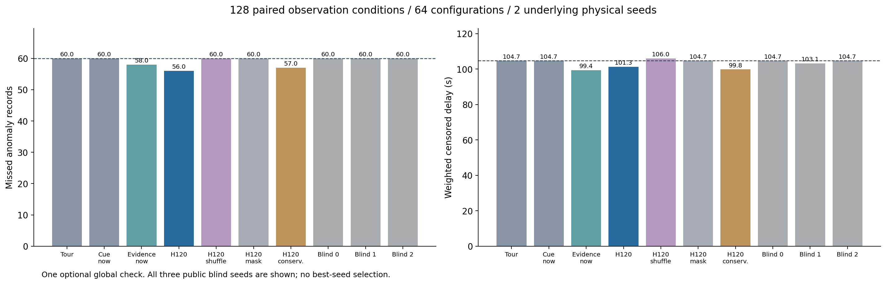
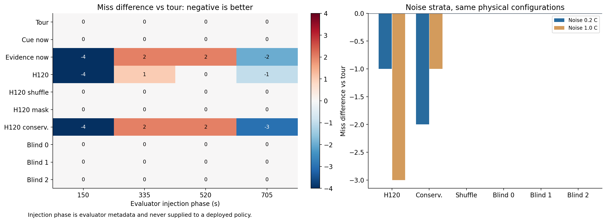
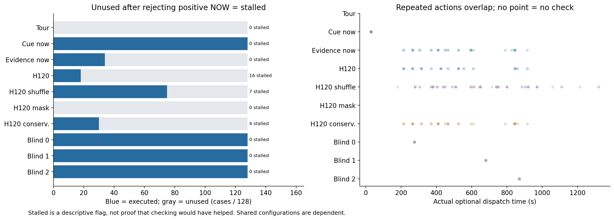

# C1-B2：前瞻平均少漏4条，但收益未跨过程稳定重复

上一轮B1的源文件、统计、原始交付和完整重放记录已重新核对，旧结果成立。本轮已实际完成此前安排的相位/噪声确认及信息对照：188项完整测试通过，20条接口试运行和1,280条正式回合全部独立重放，精确重访零超期，全队一次额外补查额度均满足。三个图已逐一打开检查。

核心结论是：公开风险线索和检查时机值得继续研究，但当前工具仍会以其他短异常漏检为代价换取目标的提前发现。不能据此进入“RSI已有效”的表述。

## 1. 比较了什么

沿用128机柜、18名异质执行者和1800秒回合。正式使用8300/8301两个底层生成种子，交叉8种情景/持续时间与150/335/520/705秒四个注入起点，形成64个配置、58个不同数值过程指纹；每配置配0.2/1.0°C噪声，得到128个观测条件。十组方法使用相同过程、噪声、移动/检查模型和重访保护，每回合最多一次额外补查。

每组有180条异常评价记录，来自90段物理异常的两档噪声重复评价。这些相位、情景和噪声条件相互有关，尤其只有两个底层种子，不能把1,280回合当作1,280个独立机房。

“前瞻”是在当前公开观测上，用固定代理模型比较现在检查与未来120秒内机会；它没有读取真实未来。“保守前瞻”仅降低等待造成的乐观温升外推。置乱仅移动同专业的观测及其时间信息，实际地图、资格、工时和已测告警不变。盲参照按三个预定公共种子，在275/675/870秒尝试一次合法动作。

## 2. 总体结果

表内等待为后果加权的发现等待：已发现的计至首次合格确认，未发现的计至该异常段结束；先汇总权重再求均值。短异常漏检也可能得到较小删失值，必须与漏检数共同阅读。无异常案例的等待为`null`，不记为零。

| 方法 | 漏检/180条 | 加权删失等待/秒 | 实际补查/128回合 | 曾放弃正当前值、最后仍未补查的回合 |
|---|---:|---:|---:|---:|
| 固定巡回 | 60 | 104.66 | 0 | 0 |
| 旧线索立即触发 | 60 | 104.66 | 128 | 0 |
| 新证据零视野 | 58 | 99.37 | 34 | 0 |
| 原120秒前瞻 | **56** | 101.25 | 18 | 16 |
| 前瞻＋同专业观测置乱 | 60 | 106.02 | 75 | 7 |
| 前瞻＋风险观测屏蔽 | 60 | 104.66 | 0 | 0 |
| 保守前瞻 | 57 | 99.78 | 30 | 4 |
| 盲参照0 | 60 | 104.66 | 128 | 0 |
| 盲参照1 | 60 | 103.11 | 128 | 0 |
| 盲参照2 | 60 | 104.66 | 128 | 0 |

原前瞻对巡回：7个观测条件少漏、119个相同、2个多漏，净少4条；零视野为9/114/5，保守前瞻为9/115/4。因此，平均漏检、平均等待与逐条件稳健性并没有同时给出同一最优方法。



## 3. 分层后，稳定性问题仍然明显

| 底层种子 | 巡回漏检/90条 | 零视野 | 原前瞻 | 保守前瞻 |
|---|---:|---:|---:|---:|
| 8300 | 32 | 26（−6） | 27（−5） | 25（−7） |
| 8301 | 28 | 32（＋4） | 29（＋1） | 32（＋4） |

括号为相对同种子巡回的记录数差。原前瞻在一个种子改善、另一个退化；保守外推减少反复等待，却也没有解决跨过程退化。

| 注入起点/秒 | 巡回漏检 | 原前瞻漏检 | 差值 |
|---|---:|---:|---:|
| 150 | 22 | 18 | −4 |
| 335 | 10 | 11 | ＋1 |
| 520 | 16 | 16 | 0 |
| 705 | 12 | 11 | −1 |

按噪声分层，巡回各漏30条；原前瞻在0.2/1.0°C下分别漏29/27条。高噪声并非单向更差：它同时改变触发、等待和放弃动作。当前结果不能概括为“降噪即可提高巡检收益”。

任务变化只出现在180秒冷板故障和辅助馈电—CDU耦合故障：原前瞻分别从2降至1条、58降至55条。其他情景没有漏检数变化；其中冷板60秒和IT馈电180秒在冻结的温度/专业事件定义下没有合格异常段，不能用其零漏检宣称成功检出所有注入故障。



## 4. 两个退化案例解释了什么

以下是正式测试完成后选择的解释案例，完整原始轨迹与散列保留在`evidence/failure-examples/`，可核对[事后时间线](evidence/strata-review.json)。它们用于分析，不是新增独立实验，也不用于重算本轮策略。

| 8301低噪声耦合故障 | 补查动作与目标收益 | 对其他异常的影响 | 整回合漏检变化 |
|---|---|---|---:|
| 起点335秒 | 465秒出发查108；490秒确认，巡回本会在520秒确认 | 110的445–535秒异常，巡回535秒确认，补查后565秒才到，未确认 | ＋1 |
| 起点520秒 | 610秒出发查108；635秒确认，巡回本会在665秒确认 | 104和106的短异常失去确认；110还晚确认30秒 | ＋2 |

两次目标测量都真实告警，且都提前30秒。问题不是这两次补查毫无信息，而是当前效用只充分计入目标提前量，没有显式计入后续短异常的机会损失。完整返回计划保证重访上限，不能保证捕获短于该上限的所有异常。公开信息能否预估这些机会损失，才是下一轮要验证的部分。

## 5. 信息与等待对照支持到哪里

观测置乱后漏检回到巡回的60条，说明本轮收益对观测与任务位置的关联敏感；屏蔽组等同巡回，核对了无风险信号时的接口。三组盲补查也均为60条，但其实际动作次数与时刻分布不同，不能单凭这种对比完成严格因果归因。

保守组将“曾有正当前值却等待至终局未查”的回合从16降至4，补查从18增至30；漏检仍比原前瞻多1条。这个等待标记仅作诊断，不意味着当时检查必然有净收益。



## 6. 验证、成本与复查入口

完整测试含Torch与既有模型，188项无跳过。独立审计逐一重构公开候选、地图成本、观测变换和检查/等待选择，重跑全部1,300个原始案例，核对资格、测量、完整返回计划、初始/末端间隔和物理数组。仅将原始结果与重放一致称为执行核验，不将它当作模型贴近现场的验证。

Slurm作业：接口130397、接口审计130401、正式数组130402、审计数组130403、报告130417、打包130418；全部终态`COMPLETED / 0:0`。使用4gpu分区的2CPU/8GB分配，未申请GPU。均值决策墙钟为巡回0.95秒/回合、原前瞻3.56秒/回合，估计器推断约0.025–0.028秒/回合；这是当前节点与实现下的日志，计算耗时没有推进仿真物理时钟。

旧CVAE/PPO保持冻结，本轮没有新神经训练、LLM调用或改进器更新。PPO影子评分不控制本轮实际补查，不能将收益归给PPO。现场标定、原论文完整数值复现与RSI收益仍须各自建立证据。

本地保留全部紧凑结果、作业日志、三张PNG/SVG、六个预定示例回合、四个事后失败轨迹及一个完整物理数组；远端保留1,300个完整案例和66个物理数组文件。[原始存储索引](evidence/raw-storage.json)列出路径、字节数和散列。[完整统计](evidence/report/aggregate.json.gz)为无损gzip封装，解压即原始JSON；未重排或删去不利案例。

快速核对全部本地交付（在仓库根目录）：

```powershell
python scripts/verify_m12c1b2.py --workspace . --research research/2026-10-29-m12c1b2-confirm --output b2-review.json
```

输出使用新路径，防止覆盖已有核验记录。本地入口验证源归档、原件、完整配对和分层统计；完整权重/物理/路径重跑由集群审计记录支持，需要原模型与远端完整数组才能重新执行。[阶段验收](阶段验收.md)和[下一步方案](下一步方案.md)给出结论范围与后续安排。
