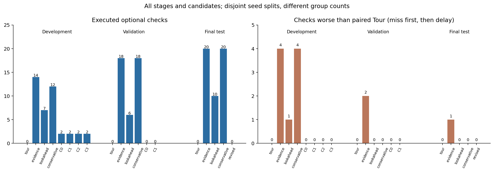

# 六个科学问题：补查减少了，可靠收益仍未建立

分析只读取本轮已冻结的768条正式运行、保存的观测／决策和物理数组。没有新策略运行、参数重选或估计器干预。以下“有害”按漏检优先、漏检相同时再看加权等待判定；“失去其他确认”另计，允许同时获得更多目标确认。

## 1. 显式顺延代价能否减少有害补查？

在开发集，四候选各补查2次，均有利，未出现有害补查；原120秒前瞻补查7次，其中1次有害；零视野14次、保守前瞻12次，各有4次有害。新候选把补查收缩到了一个物理事件的两档噪声重复。

验证集两候选补查均为0，原前瞻6次、保守18次且均无整回合有害补查。因此，可以确认新规则减少了实际补查及本批有害动作，尚不能把作用单独归因于“顺延代价”：候选还一起改变了等待范围、风险修正和守卫，且没有完成逐项干预。少做甚至不做动作，也会降低出现有害动作的次数。

## 2. 是否过于保守，失去原前瞻的有效机会？

验证C0、C1各32回合均未补查，漏36条、等待65.351秒；原前瞻漏33条、等待62.591秒，保守前瞻漏31条、等待58.974秒。两候选各有11/32回合曾出现正的当前补查值，最后仍未用掉额度。旧方法的配对结果表明这批条件中确有可用收益，新规则没有取得这些收益。

“保守”在行为上表现为不补查；内部可能同时过度乐观地估计未来机会。不能只靠降低一个代价系数就断定能解决。

事后解释例：8601、耦合故障180秒、起点335秒、噪声0.2、C0。495秒当前检查值0.02188，等待值0.35621，选择WAIT；预测680秒完成任务72时信号为1.17255，来源为有界历史趋势。该时刻保存的温度约54.998°C，65°C阈值下参考信号为0。这个回合13次正当前值仍等待，最终补查0次。案例与数组各自核对原始SHA，便携复算见[离线解释](evidence/offline-explanations.json)。这是从已有结果中选取的解释案例，不是新增实验或独立验证样本。

## 3. 预测未来收益与真实整回合收益偏差多大？

必须分开两种量。决策分数是无量纲代理；实际任务结果包括漏检数量和等待秒，两者不能直接相减成一个“收益预测误差”。本轮没有为每个未执行的未来候选生成全回合干预标签，因此尚不能量化全部动作的真实反事实净效用误差。

可核对的是：保存的最佳未来目标信号，与同一目标／预测完成时刻的物理参考信号比较。C0开发8,201点中8,158点为“预测正、参考零”，信号MAE为0.46668；C0验证8,671点中8,661点如此，MAE为0.47729；C1验证8,671点中8,669点如此，MAE为0.47743。数值支持已记录的未来候选存在明显高估；这些是重复时间点，不是8,671个独立故障，也不是分类准确率。诊断只检查被保存的最佳未来候选，其选择本身会放大乐观偏差。

实际执行的新候选开发动作仅两次噪声配对：750秒派执行者14检查冷却任务148，795秒完成，相比原巡回990秒提前195秒；净代理0.38366，目标收益0.39449，计入的附带风险项为0，执行项0.01083。公开排班显示首轮顺延65秒、全程暴露1465秒。实际每次少漏1条、加权等待少18.471秒、增加移动21米，没有失去其他确认。此局部一致性不能校准整批未来候选。

## 4. 能否降低8301类型的跨任务损失，并在新种子重复？

原8301的“目标提前、其他短异常失去确认”已在B3/B3.1回归保留。新候选开发两次动作均没有其他确认丢失；验证没有动作，不能据此声称跨任务风险已经被可靠识别并消除。

独立最终测试中，零视野、原前瞻、保守前瞻分别有2、2、4次补查失去至少一个原巡回能确认的其他任务；与此同时，净漏检增加的回合均为0。目标新增确认可以抵消其他确认损失，所以净指标改善与跨任务损失能够同时发生。零视野另有1次因同漏检但等待更长而判为有害。修订组已回退巡回，没有实际补查可用于验证新的风险识别能力。

## 5. 哪些故障、相位和噪声有收益？

新候选的开发收益集中于8500、辅助馈电—CDU耦合故障180秒、起点705秒的同一物理事件，两档噪声各少漏1条；其他开发条件未少漏，验证没有收益。

最终测试原前瞻的两条少漏记录都来自8703、同一耦合故障族、起点335或705秒、低噪声0.2°C；高噪声没有少漏。零视野与保守前瞻在该故障族共少漏3条，低噪声2条、高噪声1条。其他三个测试种子漏检数均未改善。冷板故障有部分等待改善但没有少漏，传感偏差及健康情景不能提供少漏证据。

这些是旧对照方法的局部收益。最终没有一个新候选独立通过选择，故本轮不判LIMITED GO，也不凭最终分层再挑新适用域。全部故障／相位／噪声数字保留在[分层统计](evidence/report/aggregate.json.gz)。

## 6. 冻结CVAE是否真正影响动作？

本轮真实加载并调用冻结历史CVAE，PPO保持既有影子参照。新候选开发实际CHECK的目标线索两次均为remote_flow。开发与验证记录的最佳未来目标主要来自measured_bounded_trend，其次nominal、remote_flow；被保存的目标和正附带风险项中未出现history_assimilated来源。

这意味着当前记录尚无“CVAE改变动作并改善结果”的正证据。仍不能据此断言CVAE对所有候选和决策完全无影响：未胜出的竞争候选、缓存融合和拓扑分量可能间接影响选择，现有来源计数没有隔离这些路径；实际干预没有执行。最终修订组为巡回，其零差值也不能证明估计器无用。

独立估计器消融需要另立协议：固定其他条件，替换或移除CVAE，比较动作变化及结果，同时记录影子评分与实际控制权。本轮NO-GO后不自动追加该实验，优先收敛观测与效用问题。

