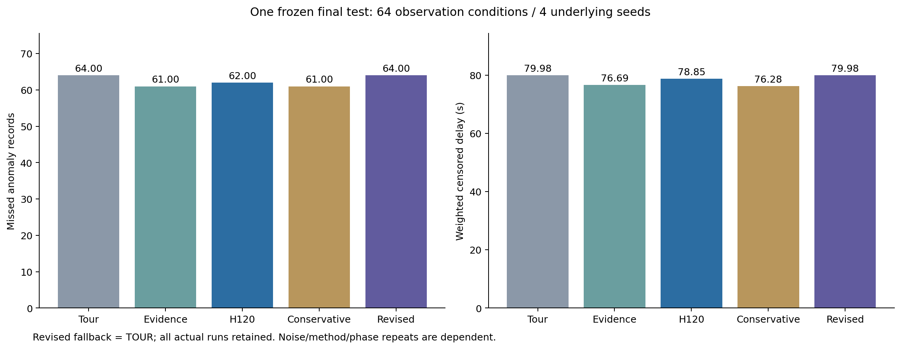
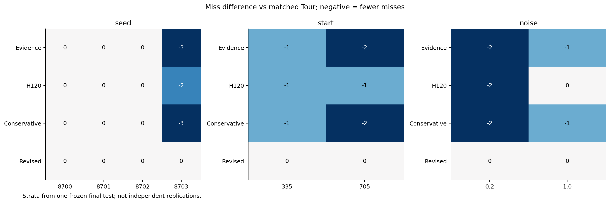

# C1-B3.2正式结果：NO-GO，开发收益未在验证中重复

本轮已经实际完成**256开发＋192验证＋320一次最终测试＝768条正式闭环**，以及每条一次真实权重独立重放。旧模型、原返回计划和全队一次补查预算保持不变，没有CVAE/PPO研究训练、Qwen调用、追加候选或改选测试种子。

核心结果：四个修订候选在开发中相同，较巡回少漏2条噪声配对记录；保留的C0、C1在验证中均与巡回相同，未达到严格改善门槛，按预注册规则回退Tour。最终“注册修订组”实际运行的因此是Tour，不是未经选择的C0。**不能把未选候选想象中的最终表现当作已测结果。**

## 1. 选择流程与分层结果

原协议SHA保持`5018ee1cd7165cf9e501ebb4218fa9be825d1d76398313305cab08834cb56085`，执行基线`32ca592`。每底层种子交叉四情景、两起点、两噪声，16观测条件；开发与验证各两个种子，最终四个种子。所有方法共享同一物理配置／噪声。

### 开发：8500、8501

| 方法 | 每组条件数 | 异常记录 | 漏检 | 加权等待／秒 | 补查 |
| --- | ---: | ---: | ---: | ---: | ---: |
| 固定巡回 | 32 | 76 | 34 | 89.165 | 0 |
| 新证据零视野 | 32 | 76 | 32 | 84.143 | 14 |
| 原120秒前瞻 | 32 | 76 | 30 | 85.920 | 7 |
| 保守前瞻 | 32 | 76 | 32 | 84.143 | 12 |
| C0 | 32 | 76 | 32 | 86.081 | 2 |
| C1 | 32 | 76 | 32 | 86.081 | 2 |
| C2 | 32 | 76 | 32 | 86.081 | 2 |
| C3 | 32 | 76 | 32 | 86.081 | 2 |
### 验证：8600、8601

| 方法 | 每组条件数 | 异常记录 | 漏检 | 加权等待／秒 | 补查 |
| --- | ---: | ---: | ---: | ---: | ---: |
| 固定巡回 | 32 | 74 | 36 | 65.351 | 0 |
| 新证据零视野 | 32 | 74 | 34 | 62.151 | 18 |
| 原120秒前瞻 | 32 | 74 | 33 | 62.591 | 6 |
| 保守前瞻 | 32 | 74 | 31 | 58.974 | 18 |
| C0 | 32 | 74 | 36 | 65.351 | 0 |
| C1 | 32 | 74 | 36 | 65.351 | 0 |

四候选的移动成本也相同，开发排序因此由候选编号确定为C0、C1、C2、C3，保留前两项；没有人工改排名。开发集每组76条评价记录来自38段物理异常的两档噪声重复；验证每组74条来自37段。

验证C0、C1每个种子的漏检差值均为0，汇总等待差值为0，严格改善条件为假，因此两者都不合格。原前瞻与保守前瞻的较好验证结果没有被用来替换本轮修订候选或修改预算。

## 2. 一次独立最终测试

最终选择先冻结，之后才运行8700–8703的64个观测条件、五组各64回合。最终每组148条评价记录对应74段物理异常的两档噪声，**不是148次独立故障或320个独立机房**。一次注入也可能在多个任务形成多个异常段。

| 方法 | 漏检／148条 | 加权删失等待／秒 | 补查次数 | 精确违约 |
| --- | ---: | ---: | ---: | ---: |
| 固定巡回 | 64 | 79.977 | 0 | 0 |
| 新证据零视野 | 61 | 76.692 | 20 | 0 |
| 原120秒前瞻 | 62 | 78.851 | 10 | 0 |
| 保守前瞻 | 61 | 76.283 | 20 | 0 |
| 注册修订组（验证回退Tour） | 64 | 79.977 | 0 | 0 |

均值加权删失等待包含未发现异常，按该段结束截尾，先汇总事件权重再平均。没有异常的单回合保持空值，不以0参加发现等待平均。原前瞻和保守方法的改善幅度仍是有限模拟证据，不据此作一般行业或现场性能结论。

### 分底层种子的漏检

| 底层种子 | 异常记录数 | 巡回漏检 | 零视野 | 原前瞻 | 保守前瞻 | 注册修订组 |
| --- | ---: | ---: | ---: | ---: | ---: | ---: |
| 8700 | 32 | 10 | 10 | 10 | 10 | 10 |
| 8701 | 40 | 12 | 12 | 12 | 12 | 12 |
| 8702 | 36 | 18 | 18 | 18 | 18 | 18 |
| 8703 | 40 | 24 | 21 | 22 | 21 | 24 |

完整逐种子的加权等待、补查、移动、服务、执行时间、首轮顺延与全程暴露见[evidence/supplemental-seed-costs.json](evidence/supplemental-seed-costs.json)；原始故障族／起点／噪声分层位于[完整分层统计](evidence/report/aggregate.json.gz)，为无损gzip封装的原JSON。

## 3. 资源与顺延

| 最终方法 | 均值移动／米 | 均值回合执行／秒 | 累计首轮顺延／秒 | 累计顺延暴露／秒 |
| --- | ---: | ---: | ---: | ---: |
| 固定巡回 | 11793.40 | 1.68 | 0 | 0 |
| 新证据零视野 | 11797.73 | 2.00 | 985 | 39985 |
| 原120秒前瞻 | 11794.93 | 4.04 | 385 | 16280 |
| 保守前瞻 | 11797.61 | 3.76 | 950 | 38320 |
| 注册修订组（验证回退Tour） | 11793.40 | 1.56 | 0 | 0 |

顺延暴露是原巡回完成到修订完成之间失去及时观测的时间，在1800秒截断，目标提前收益与其他任务延误分别记录。它不是物理损失秒或多个独立异常。

回合执行计时含环境构建、派单与只读记录，不含排队、模型初始化和最终压缩；方法固定顺序下缓存复用不同，不能据表证明端到端算力优势。合成物理时钟没有被决策计算延迟推进。

## 4. 运行与证据完整性

正式执行为开发130532、验证130548、最终130552；阶段审计为开发130534失败后有界恢复130546、验证130549、最终130553。恢复的两项各21条已实际重放只作静态补核，另各107条新重放，开发总重放仍256；总正式重放为768，不隐藏重复计数。详见[审计恢复说明](审计格式修复与恢复.md)。

最终真实Torch完整套件222项无跳过／失败／错误，包含原215项及7项新执行／选择测试。完整审计核对每条动作、测量、资格、路径、完整返回证书、初始／终末重访及物理数组；全部精确重访和一次额度满足。父目录未创建的门槛作业130526、首次JSON比较审计130534均保留。

64个命名物理配置实际有56种不同数值指纹；健康情景在不同名义注入时刻可能相同。底层种子、相位、噪声及方法重复不当作独立随机样本。

原始轨迹及全部数组保存在集群，完整路径、字节数与SHA见[evidence/raw-storage.json](evidence/raw-storage.json)。本地保留每条紧凑指标与事件、全部选择和审计、原始日志、预定完整示例与一份物理数组。结果来源、可复查范围与下一步见[阶段验收](阶段验收与下一步.md)。
