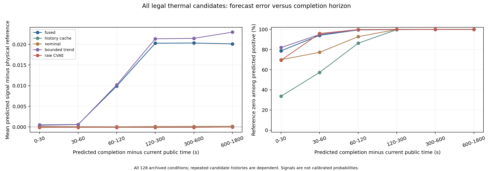
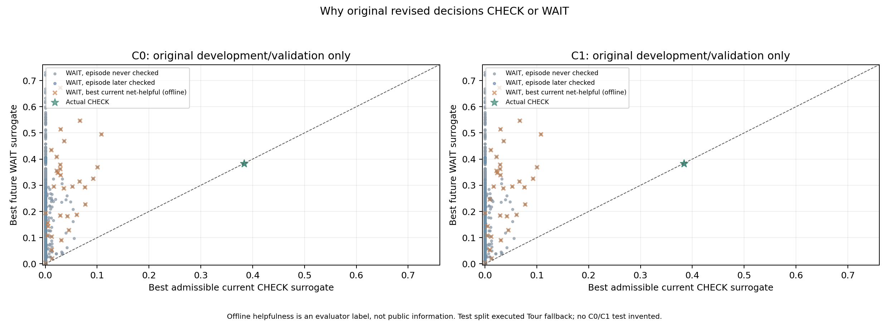

# B4-A：可用动作存在，主要缺口首先出现在风险线索，其次在评分和等待

本轮完成原768条正式记录、64份物理数组的绑定，并从旧动作与冻结模型恢复128个条件、45,952帧巡回公开历史。核对67,256个原有公开状态散列；每条件8,282个硬约束合法补查，共1,060,096个动作，与更早的公开历史组合成182,692,352个候选—时刻对。完整因子保存在集群，所有紧凑统计和两份完整历史在本地交付。

原动作重放只恢复观测，不选择新策略或新实例。包括预审计，共132次旧巡回历史恢复，其中128次为修订版全量；没有新的神经训练、Qwen调用、策略搜索或独立测试。B3.2的NO-GO与最终Tour回退保持原结果。

## 1. 准确信息是否可能产生更好的合法动作？

在90/128个旧条件中，至少存在一个“检查一次然后按原队列巡回”的净有益动作；共5,162个有益、14,880个有害动作。它们相互重叠且共享异常，不能全部执行，也不代表在线系统知道该选哪一个。

因此，旧任务里的收益空间并非处处为空。当前证据不支持把失败完全归因于唯一一次预算；是否扩大预算或重排任务，仍需独立设计。这里的“有益”按漏检优先、同漏检再比较加权删失等待，不是已标定业务损失。

## 2. 主要错误在哪一层？

下表只取原C0的64个开发／验证条件，避免将四候选重复算成四份独立证据。共22,558个尚未耗尽额度的原决策帧：

| 诊断层次 | 帧数 |
| --- | ---: |
| 当前没有净有益合法补查 | 21,822 |
| 有益动作缺少可用正线索或被已告警排除 | 678 |
| 有正线索，但被代价／门槛／守卫拒绝 | 22 |
| 当前代理把非有益动作排在前面 | 1 |
| 实际CHECK执行有益动作 | 2 |
| 当前最优动作有益，仍选择WAIT | 33 |

当前有益动作存在的736帧中，678帧（92.12%）没有可接受的正风险线索；另有22帧被代价／门槛／守卫拒绝，1帧当前排序不理想，33帧因未来最大代理选择等待。实际执行2帧有益CHECK。

这表明，“等待价值高估”是实在的问题，**当前估计未给有益动作提供正线索，是本批原决策帧更常见的阻断层**。这些是分层诊断频次，不能直接解释成每种机制造成了多少漏检。缺少正线索也不等于信息论上不可预测：可能是缺测、模型漏估、阈值或观测利用方式造成。

有益候选发生次数另计：缺少信号212次、信号为零2,012次、已有告警排除0次；同一帧可有多个候选，这些次数不作为上述帧数百分比的分母。

## 3. 未来最大值和融合有什么表现？

全部合法热候选—时刻对中，融合正信号6,765,758次，其中6,758,344次对应完成时刻参考信号为零。正线索主要由历史有界趋势独立胜出：6,683,430次；名义模型独立胜出71,328次。

原C0保存的最优未来点共16,872个，正预测而参考零16,819个，信号MAE为0.47213。本轮同时补上了未胜出候选，避免只对最优分数做结论；完整误差按专业与预测完成视野分层。

读图：横轴是从当前到预测检查完成的时间；左图越高表示风险信号越高估，右图表示正预测中真实参考为零的比例。fused是最大值融合，history cache是覆盖缓存，nominal是物理名义估计，bounded trend是有界趋势，raw CVAE是未覆盖的CVAE先验输出。远期误差应与异常召回一起看；很少报异常也可能得到较低平均误差。

信号是连续代理，尚不是异常概率；此处不计算伪装成概率的Brier分数。不同来源可用量不同，逐来源误差的分母在完整统计中保留。重复根时刻、候选、噪声和种子存在依赖，图上的海量点不构成海量独立样本。

## 4. CVAE这次提供了什么独立信息？

热任务历史帧5,881,856个，原始先验可用5,799,936个，融合缓存可用5,799,936个。缓存与原始值相同3,948,032次、不同1,851,904次。时间戳匹配测量和先验的计数可重叠，不能当互斥来源比例。

history_assimilated在正信号中独立胜出0次，参与平局11,000次（平局容差1e−10）。所有45,952帧都具备可用名义温度；端点界检查发现可由历史缓存独立提高正信号的帧为0，信号比较容差1e−12。在这批保存的巡回历史上，该融合分量没有产生可检测的额外风险信号，固定评分因此缺少相应的新增信息。

这比仅看显示的胜出来源更具体，范围仍是**冻结模型、旧任务与固定历史上的输入／评分支配分析**。它不替代新训练模型或其他观测条件下的闭环估计器消融，也不说明VAE这一模型类别无价值。cvae_raw本来未直接进入旧task_signal，独立保留它是为了检验原始输出及后续预测目标。

读图：横轴是当前最优可接受CHECK分数，纵轴是未来WAIT分数；虚线两侧表示二者大小关系。灰点表示最终未补查的WAIT，蓝点表示后来有补查的WAIT，橙叉标记当前最优动作事后有益却仍等待，绿星为实际CHECK。两个面板是原C0／C1，点会重叠。

图中“事后有益”由离线评价器计算，不作为公开输入。C0/C1实际决策只来自开发与验证；最终测试执行的是Tour回退，没有虚构C0/C1测试成绩。

## 5. 核验强度与限制

全部133条原实际补查的方法记录，解析计算与原逐异常确认、漏检和加权等待一致。独立程序又直接移时原检查事件、调用原专业测量与告警函数，对全部1,060,096个合法动作、2,468,036个动作—异常标签核对通过；它不复用主分析器的分组移时／搜索计算。

230项真实Torch完整测试无跳过、错误或失败。初版评价遗漏热测量噪声、单候选JSON未定义指标导出问题均已修复，并保留版本与测试记录。最终结果仍来自合成机房，无现场标定。

单次检查之后的动作被固定为原巡回，所以后续观测虽然改变，却不会改变处方动作；这使移时评价成立。若后续换成多次自适应动作或检查影响设备状态，必须真实模拟观测和策略反馈，不能沿用这套代数标签冒充闭环。
